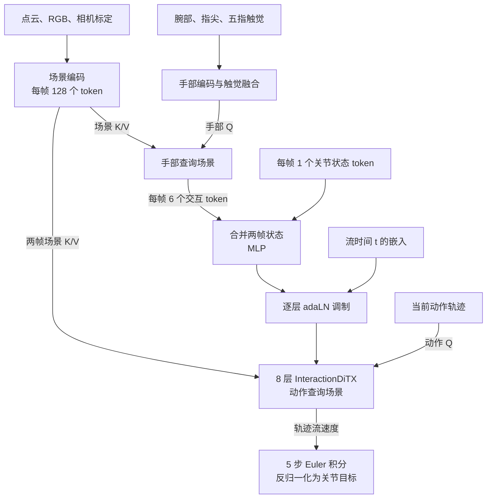

# InteractionFlow 模型架构

InteractionFlow 用最近两帧观测生成一段绝对关节目标。它先让带触觉的手部 token 查询场景，得到腕部和五指各自的交互表征。生成动作时，关节状态与这些交互表征调制解码器，动作 token 再查询两帧的场景细节。下文的维度和步数均取自默认配方。 [interaction_flow.yaml](../dexmani_policy/configs/interaction_flow.yaml)

## 整体架构

### 输入与输出

`B` 为批大小，`T=2` 为观测帧数。下表使用策略输入的维度顺序，示教 Zarr 中的 RGB 按 `[H,W,3]` 存储。五指顺序均为拇指、食指、中指、无名指、小指。 [示教数据格式](仿真数据集格式.md)

| 字段 | 默认形状 | 含义 |
| --- | --- | --- |
| `point_cloud` | `[B,T,N,C]` | 基座系场景点云，XYZ 单位为米。默认从 XYZ 或 XYZRGB 中取前三维。 |
| `rgb` | `[B,T,3,H,W]` | 与点云对应的相机图像，送入 RGB 主干前调整到 224 × 224。 |
| `camera_intrinsic` | `[B,T,9]` | 展平的 3 × 3 相机内参，将相机坐标投影到图像像素。 |
| `camera_extrinsic` | `[B,T,12]` | 展平的 3 × 4 外参，将基座坐标变换到 OpenCV 相机坐标。 |
| `joint_state` | `[B,T,19]` | 实测关节角（弧度），依次为 7 维手臂和 12 维手部。 |
| `eef_pose` | `[B,T,9]` | 基座系腕部位置（米），以及腕部旋转矩阵前两列组成的 6D 表示。 |
| `fingertip_xyz` | `[B,T,5,3]` | 五个指尖在基座系中的位置，单位为米。 |
| `finger_tactile_force` | `[B,T,5,3]` | 每指一个三维汇总力，沿用数据源的触觉坐标系和尺度。 |
| `action`（训练目标） | `[B,16,19]` | 16 个控制时刻的绝对关节目标，排列与关节状态一致。 |

训练集分别提供 `joint_state` 和 `action` 的逐维归一化范围。几何与相机参数保留物理尺度供投影和空间注意力使用。RGB 由视觉主干的图像处理器归一化。

## 单帧观测编码

### 场景几何与 RGB

从最多 1024 个点中用最远点采样选出 128 个中心，为每个中心取 32 个最近邻。点级 MLP 和最大池化编码邻域相对中心的几何，中心位置的嵌入保留 patch 在基座系中的绝对位置。

冻结的 DINOv2-small 将 224 × 224 图像编码为 16 × 16 的特征网格。模型用相机外参、内参和图像缩放变换定位每个 patch，再双线性采样 RGB 特征。`agent.rgb_semantic_sampling` 默认为 `center`，只投影中心。设为 `group_mean` 时对能投进图像的邻域点取平均。没有有效投影的 patch 保留几何分量，RGB 分量置零。

几何与 RGB 特征各为 192 维，拼接后投影回 192 维。两层 8 头空间 Transformer 用 patch 中心的三维旋转位置编码（3D RoPE）关联各个邻域，输出每帧 `[B,128,192]` 的场景 token。

### 手部运动学

腕部 MLP 编码基座系位置和 6D 旋转。模型对旋转的两列做 Gram–Schmidt 正交化，将每个指尖相对腕部的位移转入腕部坐标系，再用五指共享的 MLP 编码。腕部位置和指尖局部位移分别除以 0.25 m 和 0.10 m。腕部与五指各加上自己的可学习身份嵌入，得到 6 个 192 维 token。模型另保留六个位置在基座系中的米制坐标，用于查询场景。

### 逐指触觉融合

共享的无偏置 MLP 把每指的三维力映射为 64 维特征，五指取均值得到全局触觉特征。模型根据单指状态和触觉计算逐指权重，根据六个手部 token 的均值和全局触觉计算共享接触权重。局部残差乘以两种权重后加到对应手指，全局残差乘以共享权重后加到腕部和五指。五指输入力均为零时，触觉残差为零。

### 手物几何关系

六个手部 token 先做 4 头自注意力，再以手部为查询（Q）、场景 patch 为键和值（K/V）做交叉注意力。腕部、指尖和 patch 中心都以当帧 patch 中心的均值为原点。3D RoPE 按各手部位置旋转 Q，按各 patch 位置旋转 K，让注意力利用手部与场景的相对位置。残差前馈网络和归一化输出 `[B,6,192]` 的交互 token。 [手物交互编码器](../dexmani_policy/agents/obs_encoder/interaction/hand_object_interaction.py)

## 两帧条件与动作解码

关节状态由独立 MLP 编为 1 个 192 维 token。每帧按「128 个场景、1 个关节状态、腕部和五指的 6 个交互 token」排列，两帧从旧到新组成 `[B,270,192]`。解码器按用途取出两组条件。

| 条件 | 两帧合并后的形状 | 在 DiTX 中的作用 |
| --- | --- | --- |
| 场景 | `[B,256,192] → [B,256,768]` | 投影后加上对应的帧嵌入，各层从中计算交叉注意力的 K/V。 |
| 关节状态与手物交互 | `[B,2,7,192] → [B,2688] → [B,768]` | 按帧和手部顺序展开，MLP 将两帧压缩为一个状态向量，供各层调制使用。 |

当前轨迹的每个 19 维动作投影为一个 768 维 token，加上动作窗口内的位置嵌入。8 个 DiTX 块依次用 **自注意力** 关联 16 个动作时刻，用 **交叉注意力** 让动作向两帧场景查询信息，再用 **前馈网络** 更新每个动作 token。注意力使用 8 个头，前馈隐藏宽度为模型宽度的 4 倍。

流时间先编码为 128 维正弦特征，再映射到 768 维。与状态条件相加后，一次投影为每层的三个子层分别生成平移、缩放和残差门控向量。输出头将动作 token 映射回 `[B,16,19]`，预测归一化动作轨迹沿流时间变化的速度。 [策略组装](../dexmani_policy/agents/policies/interaction_flow.py) · [InteractionDiTX](../dexmani_policy/agents/action_decoders/backbones/ditx.py)

## Rectified Flow 训练与闭环推理

### 训练目标

令 $a$ 为归一化后的完整示教动作窗口，$c$ 为两帧观测条件。对每个窗口采样同形状的高斯噪声 $\epsilon\sim\mathcal N(0,I)$，窗口内各控制时刻共用一个流时间 $t$。默认 `time_shift_alpha=1`，$t$ 在 $[0,1)$ 上均匀采样。模型学习从噪声指向示教轨迹的速度，损失覆盖全部 16 个时刻和 19 个关节。

$$
x_t=(1-t)\epsilon+t a,\qquad
\mathcal L=\operatorname{MSE}\bigl(v_\theta(x_t,t,c),\;a-\epsilon\bigr).
$$

### 五步 Euler 采样

从 $x_0\sim\mathcal N(0,I)$ 出发，同一对观测编码一次，五次速度预测共用场景 K/V。在 $t_i=i/5$（$i=0,\ldots,4$）处依次更新 $x_{t_{i+1}}=x_{t_i}+v_\theta(x_{t_i},t_i,c)/5$。将 $x_1$ 反归一化，即得到按控制时刻排列的绝对关节目标。 [Rectified Flow](../dexmani_policy/agents/action_decoders/flow.py)

### 动作对齐

设最近一次观测在控制时刻 $k$，另一帧在 $k-1$。16 个输出位置中，第 0 个对应过去，从索引 1 起的 15 个构成 `future_actions`。默认执行其中前 8 个目标，随后用新观测重新规划。 [动作窗口切片](../dexmani_policy/agents/policies/base.py)

| 窗口索引 | 0 | 1 至 8 | 9 至 15 |
| --- | --- | --- | --- |
| 控制时刻 | $k-1$ | $k$ 至 $k+7$ | $k+8$ 至 $k+14$ |
| 本轮用途 | 对齐较早的观测 | 依次执行 8 个目标 | 下一轮观测到达后重新预测 |

## 复现入口

准备含表中字段的示教数据并下载默认的 DINOv2-small 权重后，在仓库根目录运行 `bash scripts/training/train.sh interaction_flow task_name=pick_apple_messy`。 [默认配方](../dexmani_policy/configs/interaction_flow.yaml) · [权重下载](../data/README.md#外部模型) · [仿真评测](仿真评测机制.md)
