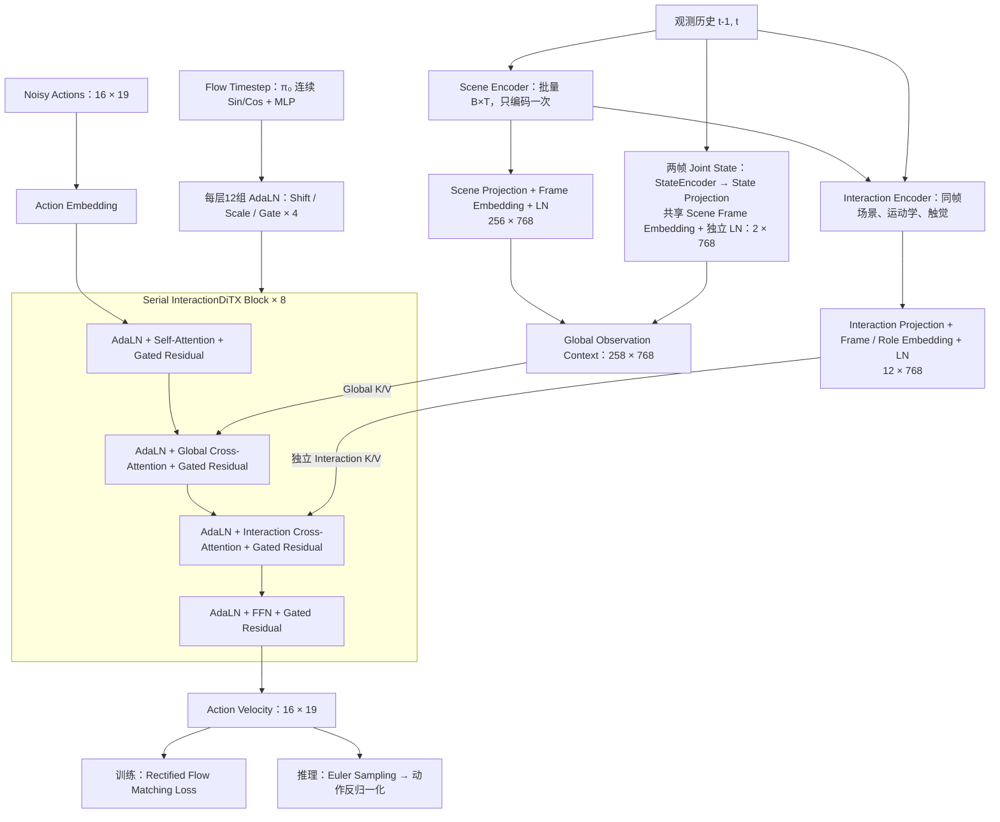

# InteractionFlow 模型架构

InteractionFlow 是 Interaction-conditioned Rectified Flow Policy，将结构化手–物交互 Token 与场景、关节状态共同作为动作专家的条件，以标准 Rectified Flow Matching Loss 训练。

配置入口为 `interaction_flow`，实现类为 `InteractionFlow`。下文维度取自[默认配方](../dexmani_policy/configs/interaction_flow.yaml)：动作窗口 16、观测窗口 2、执行窗口 8。

## 输入与输出

`B` 为批大小，`T=2` 为观测帧数，`N` 为每帧点数。下表为 Policy 接收的 Tensor 形状；Dataset 将 Zarr 中的 RGB 从 HWC 转为 CHW，模型内再 resize 到 224 × 224。

| 字段 | 默认形状 | 含义 |
| --- | --- | --- |
| `point_cloud` | `[B,2,N,3]` | 基座系 XYZ，单位为米；默认只读取 XYZ 通道 |
| `rgb` | `[B,2,3,H,W]` | 与点云相机对应的 `uint8` 图像 |
| `camera_intrinsic` | `[B,2,9]` | 展平的 3 × 3 内参 |
| `camera_extrinsic` | `[B,2,12]` | 展平的 3 × 4 外参，基座系转相机系 |
| `joint_state` | `[B,2,19]` | 实测关节角，7 维手臂与 12 维手部 |
| `eef_pose` | `[B,2,9]` | 腕部位置和旋转矩阵前两列组成的 6D 旋转表示 |
| `fingertip_xyz` | `[B,2,5,3]` | 基座系五指指尖位置 |
| `finger_tactile_force` | `[B,2,5,3]` | 五指汇总力，沿用数据源坐标系和尺度 |
| `action`（训练） | `[B,16,19]` | 完整专家动作窗口，默认绝对关节目标 |

五指顺序固定为 Thumb、Index、Middle、Ring、Little。交互 Token 在五指之前增加 Wrist。`joint_state` 和 `action` 使用训练数据拟合的 limits 归一化；几何、相机、触觉字段使用 identity，RGB 由 ImageProcessor 处理。

训练 batch 包含观测历史 `obs` 和完整动作窗口 `action`。`predict_action()` 只接收观测字典，返回 `future_actions: [B,15,19]`，执行器每轮使用前 8 步。

## 信息流



训练和推理共用 Action Backbone 的动作嵌入、Block 和输出计算。推理以噪声初始化动作，反复计算 Action Velocity 并做 Euler 积分。

## 单帧观测编码

### 场景几何与 RGB

从最多 1024 个点中用最远点采样选出 128 个中心，为每个中心取 32 个最近邻。点级 MLP 和最大池化编码邻域相对中心的几何，中心位置的嵌入保留 patch 在基座系中的绝对位置。

冻结的 DINOv2-small 将 224 × 224 图像编码为 16 × 16 的特征网格。模型用相机外参、内参和图像缩放变换定位每个 patch，再双线性采样 RGB 特征。`agent.rgb_semantic_sampling` 默认为 `center`，只投影中心。设为 `group_mean` 时对能投进图像的邻域点取平均。没有有效投影的 patch 保留几何分量，RGB 分量置零。

几何与 RGB 特征各为 192 维，拼接后投影回 192 维。两层 8 头空间 Transformer 用 patch 中心的三维旋转位置编码（3D RoPE）关联各个邻域，输出每帧 `[B,128,192]` 的场景 token。

### 手部运动学

腕部 MLP 编码基座系位置和 6D 旋转。模型对旋转的两列做 Gram–Schmidt 正交化，将每个指尖相对腕部的位移转入腕部坐标系，再用五指共享的 MLP 编码。腕部位置和指尖局部位移分别除以 0.25 m 和 0.10 m。腕部与五指各加上自己的可学习身份嵌入，得到 6 个 192 维 token。模型另保留六个位置在基座系中的米制坐标，用于查询场景。

### 逐指触觉融合

共享的无偏置 MLP 把每指的三维力映射为 64 维特征，五指取均值得到全局触觉特征。模型根据单指状态和触觉计算逐指权重，根据六个手部 token 的均值和全局触觉计算共享接触权重。局部残差乘以两种权重后加到对应手指，全局残差乘以共享权重后加到腕部和五指。五指输入力均为零时，触觉残差为零。

### 手物几何关系

六个手部 token 先做 4 头自注意力，再以手部为查询（Q）、场景 patch 为键和值（K/V）做交叉注意力。腕部、指尖和 patch 中心都以当帧 patch 中心的均值为原点。3D RoPE 按各手部位置旋转 Q，按各 patch 位置旋转 K，让注意力利用手部与场景的相对位置。残差前馈网络和归一化输出 `[B,6,192]` 的交互 token。 [手物交互编码器](../dexmani_policy/agents/obs_encoder/interaction/hand_object_interaction.py)

## 条件与动作专家

六个交互 Token 按 Wrist、Thumb、Index、Middle、Ring、Little 排列。输入点云、RGB、相机标定、腕部姿态、指尖位置和触觉的字段与坐标约定见[示教数据格式](仿真数据集格式.md)。

| Packed Condition 内容 | 默认形状 | 用途 |
| --- | --- | --- |
| 两帧 Scene，旧帧在前 | `[B,256,192]` | 独立 Linear 投影，加 Frame Embedding，再 LayerNorm |
| 两帧 Joint State，旧帧在前 | `[B,2,192]` | 独立 Linear 投影，共享 Scene Frame Embedding，再独立 LayerNorm |
| 两帧 Interaction，旧帧在前 | `[B,12,192]` | 独立 Linear 投影，加 Interaction Frame Embedding 和六个 Role Embeddings，再 LayerNorm |

Scene、State 和 Interaction 使用相同的观测窗口。展平的 `[B*T,...]` 观测一次性执行 `encode_scene()`，再将同帧 Scene Tokens、Scene Points 与完整观测传入 `encode_interaction()`，不重复编码场景。每帧六个 Interaction Tokens 保持 Wrist、Thumb、Index、Middle、Ring、Little 顺序；StateEncoder 一次性编码完整 `[B*T,19]` 关节历史，并恢复为 `[B,T,192]`，沿用原有 limits 归一化。

Packed Condition 顺序为 Scene、State、Interaction，计数为 `(T*num_scene_tokens, T, T*6)`，默认 `[B,270,192]`，仅用于 Policy 与 Decoder 传递数据。Scene `[B,256,768]` 与 State `[B,2,768]` 分别投影、加入同一个 `context_frame_pos_embed` 并独立归一化，再按 Scene、State 顺序组成 `[B,258,768]` Global Observation Context。Interaction Context 为 `[B,12,768]`，作为第二路独立 Attention Memory。

Interaction 先恢复 `[B,T,6,192]`，投影到768维，再广播加入独立的 `[1,T,1,768]` Frame Embedding 和 `[1,1,6,768]` Role Embedding，归一化后展平。两路 Frame Embedding 均零初始化，Role Embedding 沿用标准差0.02的正态初始化。

动作专家保持8层、768维、8 heads、MLP ratio 4。每层顺序为 Self-Attention、Global Cross-Attention、Interaction Cross-Attention、FFN，每个子层均为 Pre-Norm、AdaLN 和 Gated Residual。Interaction Query 来自 Global Residual 更新后的 Hidden States；两路 Cross-Attention 拥有独立 Q/K/V/O 和 Softmax。每层12组 Shift/Scale/Gate 仅由 Flow Timestep Embedding 生成；State 只通过 Global Context 注入。AdaLN 与 Velocity 输出层保持零初始化，Attention 输出投影沿用 Xavier 初始化。

两路 Cross-Attention 默认开启 `qk_norm`，Q/K 在每个 head 内做 LayerNorm，Value 和 SDPA 缩放不变；缓存 Key 只在准备 K/V 时归一化一次。Flow 时间特征使用共享的 π₀ 连续 Sin/Cos 编码，周期为0.004至4.0，相位和三角函数均用 FP32 计算，接入原有 Mish Time MLP。训练、普通推理和预计算 AdaLN 共用此路径；Flow Time 采样保持不变。[公共设置与公式](手部动作表示.md#flow-matching-的公共设置)

16个时间动作 Tokens 的输入输出仍为 `[B,16,19]`，Hidden States 为 `[B,16,768]`。

## 动作窗口与训练目标

默认观测历史为 t−1、t，动作窗口包含历史对齐位置 t−1 及 t 至 t+14。Policy 返回后 15 步动作，执行器每轮执行前 8 步。Dataset 在回合边界重复首尾帧进行 Padding。

InteractionFlow 直接复用 `Policy.compute_loss()` 和 `RectifiedFlow.compute_loss()`。观测与动作归一化后，`RectifiedFlow.sample_training_pair()` 采样高斯噪声及 Flow 时间。默认 `time_shift_alpha=1`，每个样本的时间在 [0,1) 上均匀采样，16 个动作位置共用该时间。

```python
loss = F.mse_loss(pred_velocity.float(), target_velocity.float())
```

其中 `target_velocity = actions - noise`。损失覆盖完整动作窗口，以 FP32 计算。梯度经过动作专家回到当前观测编码器的可训练参数。日志沿用 RectifiedFlow，仅报告 `loss`；关闭指标时返回空字典。梯度累积使用通用 Trainer 按样本数汇总。

EMA 默认开启，用于权重平均、checkpoint 保存恢复和 EMA Policy 评测；训练损失不依赖 EMA，设置 `training.use_ema=false` 仍可正常训练。

## 推理

`InteractionDiTX` 继承 `DiTX.forward()`，训练和推理均只返回动作速度。

InteractionFlow 自己准备多步推理所需的 Action Velocity，再用公共 Euler 更新函数积分。eval 模式下，观测编码一次，Scene、State 和 Interaction 各投影一次。每层的 `(global_kv, interaction_kv)` 与分块预计算的 12 组 Time-only AdaLN 调制在本次请求内复用，Action Query 每步重新计算。每步调制形状为 `[1,L,12,D]`，广播到整个 Batch。单步采样直接前向，训练使用每个样本自己的 Flow Timestep。输出反归一化后从索引 1 起返回 15 个 `future_actions`，默认执行前 8 个，然后重新观测规划。

## 运行

准备上述字段的示教数据及 [DINOv2-small 权重](../data/README.md#外部模型)。在 `policy` 环境、仓库根目录运行：

```bash
RUN=experiments/train/interaction_flow/pick_apple_messy/run01
bash scripts/training/train.sh interaction_flow task_name=pick_apple_messy hydra.run.dir="$RUN"
```

每个新实验使用新的输出目录。默认权重目录为 `data/pretrained/dinov2-small`，可通过 `initialization.rgb` 指定其他位置。续训和评测沿用统一入口：

```bash
python -m dexmani_policy.training.resume --run "$RUN"
bash scripts/eval/evaluate.sh --checkpoint "$RUN/checkpoints/latest.pt" --episodes 100
```

[默认配方](../dexmani_policy/configs/interaction_flow.yaml) 中的相关设置：

| 配置 | 默认值 | 作用 |
| --- | --- | --- |
| `training.use_ema` | `true` | 可选的 EMA 权重平均与评测 |
| `training.use_compile` | `true` | 编译训练用 Action Backbone |
| `training.use_bfloat16` | `false` | 默认 FP32；显式开启才使用 BF16 autocast 训练 |
| `agent.num_inference_steps` | `10` | Euler 积分次数 |
| `agent.qk_norm` | `true` | 两路 Cross-Attention 的 Q/K LayerNorm |

默认标定数据路径在 Dataset 中保留 RGB 分辨率，由 Encoder 内的 ImageProcessor 做 resize 和归一化。

相关实现：[Policy 与损失](../dexmani_policy/agents/policies/interaction_flow.py)、[InteractionDiTX](../dexmani_policy/agents/action_decoders/backbones/interaction_ditx.py)、[Flow 采样](../dexmani_policy/agents/action_decoders/flow.py)、[Dataset](../dexmani_policy/datasets/demonstration.py)。

### Time-only AdaLN 参数量

默认 Action Backbone 参数量为152,693,011。每层双路 QK LayerNorm 共包含768个参数，8层合计6,144。含 S 个时间步的预计算调制形状为 `[S,1,L,12,D]`，计算不随 Batch Size 重复。此处不将参数量或缓存机制视为延迟、完整训练效果或机器人闭环成功率的实测结论。
