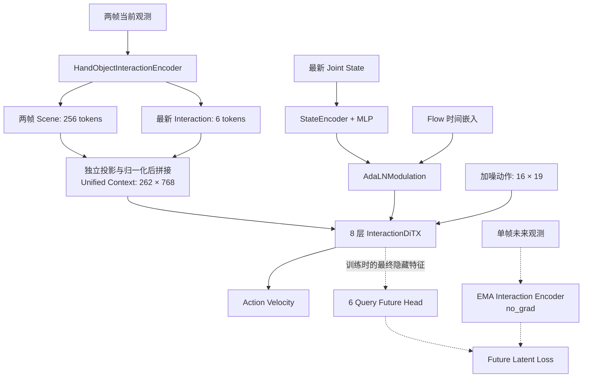

# DAI-Flow 模型架构

DAI-Flow（Dynamic-aware Interaction Flow for Dexterous Imitation Learning）以模仿学习为主体，将结构化手–物交互 Token 直接送入动作专家，并通过动作隐藏特征预测未来交互 Latent。未来预测仅作为训练监督，不重建观测，也不使用历史交互差分。

配置入口为 `interaction_flow`，实现类为 `InteractionFlow`。下文维度取自[默认配方](../dexmani_policy/configs/interaction_flow.yaml)：动作窗口 16、观测窗口 2、执行窗口 8。

## 输入与输出

`B` 为批大小，`T=2` 为观测帧数，`N` 为每帧点数。下表为 Policy 接收的 Tensor 形状；Dataset 将 Zarr 中的 RGB 从 HWC 转为 CHW，模型内再 resize 到 224 × 224。

| 字段 | 默认形状 | 含义 |
| --- | --- | --- |
| `point_cloud` | `[B,2,N,3]` | 基座系 XYZ，单位为米；默认只读取 XYZ 通道 |
| `rgb` | `[B,2,3,H,W]` | 与点云相机对应的 `uint8` 图像 |
| `camera_intrinsic` | `[B,2,9]` | 展平的 3 × 3 内参 |
| `camera_extrinsic` | `[B,2,12]` | 展平的 3 × 4 外参，基座系转相机系 |
| `joint_state` | `[B,2,19]` | 实测关节角，7 维手臂与 12 维手部 |
| `eef_pose` | `[B,2,9]` | 腕部位置和旋转矩阵前两列组成的 6D 旋转表示 |
| `fingertip_xyz` | `[B,2,5,3]` | 基座系五指指尖位置 |
| `finger_tactile_force` | `[B,2,5,3]` | 五指汇总力，沿用数据源坐标系和尺度 |
| `action`（训练） | `[B,16,19]` | 完整专家动作窗口，默认绝对关节目标 |

五指顺序固定为 Thumb、Index、Middle、Ring、Little。交互 Token 在五指之前增加 Wrist。`joint_state` 和 `action` 使用训练数据拟合的 limits 归一化；几何、相机、触觉字段使用 identity，RGB 由 ImageProcessor 处理。

训练 batch 另含单帧 `future_obs`（每个字段为 `[B,...]`，没有时间维）和布尔 `future_obs_valid: [B]`。`predict_action()` 只接收观测字典，返回 `future_actions: [B,15,19]`，执行器每轮使用前 8 步。

## 信息流



虚线为训练期辅助路径。推理以噪声初始化动作，反复计算 Action Velocity 并做 Euler 积分。

## 单帧观测编码

### 场景几何与 RGB

从最多 1024 个点中用最远点采样选出 128 个中心，为每个中心取 32 个最近邻。点级 MLP 和最大池化编码邻域相对中心的几何，中心位置的嵌入保留 patch 在基座系中的绝对位置。

冻结的 DINOv2-small 将 224 × 224 图像编码为 16 × 16 的特征网格。模型用相机外参、内参和图像缩放变换定位每个 patch，再双线性采样 RGB 特征。`agent.rgb_semantic_sampling` 默认为 `center`，只投影中心。设为 `group_mean` 时对能投进图像的邻域点取平均。没有有效投影的 patch 保留几何分量，RGB 分量置零。

几何与 RGB 特征各为 192 维，拼接后投影回 192 维。两层 8 头空间 Transformer 用 patch 中心的三维旋转位置编码（3D RoPE）关联各个邻域，输出每帧 `[B,128,192]` 的场景 token。

### 手部运动学

腕部 MLP 编码基座系位置和 6D 旋转。模型对旋转的两列做 Gram–Schmidt 正交化，将每个指尖相对腕部的位移转入腕部坐标系，再用五指共享的 MLP 编码。腕部位置和指尖局部位移分别除以 0.25 m 和 0.10 m。腕部与五指各加上自己的可学习身份嵌入，得到 6 个 192 维 token。模型另保留六个位置在基座系中的米制坐标，用于查询场景。

### 逐指触觉融合

共享的无偏置 MLP 把每指的三维力映射为 64 维特征，五指取均值得到全局触觉特征。模型根据单指状态和触觉计算逐指权重，根据六个手部 token 的均值和全局触觉计算共享接触权重。局部残差乘以两种权重后加到对应手指，全局残差乘以共享权重后加到腕部和五指。五指输入力均为零时，触觉残差为零。

### 手物几何关系

六个手部 token 先做 4 头自注意力，再以手部为查询（Q）、场景 patch 为键和值（K/V）做交叉注意力。腕部、指尖和 patch 中心都以当帧 patch 中心的均值为原点。3D RoPE 按各手部位置旋转 Q，按各 patch 位置旋转 K，让注意力利用手部与场景的相对位置。残差前馈网络和归一化输出 `[B,6,192]` 的交互 token。 [手物交互编码器](../dexmani_policy/agents/obs_encoder/interaction/hand_object_interaction.py)

## 条件与动作专家

六个交互 Token 按 Wrist、Thumb、Index、Middle、Ring、Little 排列。输入点云、RGB、相机标定、腕部姿态、指尖位置和触觉的字段与坐标约定见[示教数据格式](仿真数据集格式.md)。

| Packed Condition 内容 | 默认形状 | 用途 |
| --- | --- | --- |
| 两帧 Scene，旧帧在前 | `[B,256,192]` | 独立 Linear 投影，加 Frame Embedding，再 LayerNorm |
| 最新 Joint State | `[B,1,192]` | 独立 MLP 映射为 `[B,768]` |
| 最新 Interaction | `[B,6,192]` | 独立 Linear 投影，加六个 Role Embeddings，再 LayerNorm |

编码器按帧批量执行；打包时保留两帧 Scene，只取最新一帧的 Interaction 与 Joint State，不引入时间差分。Packed Condition 按表格顺序排列，为 `[B,263,192]`。Scene 和 Interaction 拼成唯一的 `[B,262,768]` Context Memory；Joint State 与 Flow 时间嵌入相加，进入原有 AdaLNModulation。

动作专家保持 8 层、768 维、8 heads、MLP ratio 4。每层依次执行动作自注意力、唯一的 Context Cross-Attention 和 MLP，均由 AdaLN 调制。16 个时间动作 Token 的输入输出仍为 `[B,16,19]`。

## 训练期 Future Interaction Latent

### 预测头与 Teacher

最后一层动作隐藏特征 `[B,16,768]` 投影到 192 维。六个可学习 Query 通过一次 4-head Cross-Attention 读取动作特征，再经 LayerNorm 和 `192→384→192` MLP 输出 `[B,6,192]`。Query 身份顺序与 Interaction Encoder 相同。

目标来自现有 EMA Policy 的 Interaction Encoder，在 `torch.no_grad()` 下编码单帧未来观测。当前与未来观测使用相同 LinearNormalizer 和确定性 RGB 预处理。Trainer 的 EMA 更新保持原样，仅通过 `training_microbatches()` 传入 Teacher Encoder，不额外编译 EMA Action Backbone。

### 时间对齐与有效性

Dataset 先通过 `SequenceSampler.source_rows()` 找到最新观测的真实 Zarr 行号 `r`，再计算 `r + future_obs_steps`；默认 `future_obs_steps=${n_action_steps}=8`。目标达到或超过 exclusive Episode End 时，读取本 Episode 末行并置 `future_obs_valid=False`。样本仍参与 FM 训练，不将 Padding 后的未来帧当成有效监督。

| 窗口索引 | 0 | 1–8 | 9 | 10–15 |
| --- | --- | --- | --- | --- |
| 时刻 | t−1 | t 至 t+7 | t+8 | t+9 至 t+14 |
| 用途 | 历史观测 | 执行 8 步动作 | Future Target | 剩余预测动作 |

### 训练目标

`RectifiedFlow._sample_training_pair()` 供普通 FM 和辅助训练共用，保持高斯噪声采样与 Flow 时间采样。默认 `time_shift_alpha=1`，每个样本的时间在 `[0,1)` 上均匀采样，16 个动作位置共用该时间。FM Loss 覆盖整个动作窗口：

$$
x_\tau=(1-\tau)\epsilon+\tau a^*,\qquad
\mathcal L_{FM}=\operatorname{MSE}(v_\theta,a^*-\epsilon).
$$

Future Loss 在每个 Token 的特征维做无参数 LayerNorm，再对 Token 和特征维取 L1 均值，得到每个样本的误差 $\ell_b$。Teacher 停止梯度，预测路径保持梯度：

$$
\mathcal L_{future}=\frac{\sum_b m_b\tau_b^2\ell_b}{\max(\sum_b m_b\tau_b^2,1)},\qquad
\mathcal L=\mathcal L_{FM}+0.1\mathcal L_{future}.
$$

求和范围为当前 microbatch；通用 Trainer 继续按样本数平均梯度累积组，默认 `gradient_accumulation_steps=1`。FM 和 Future Loss 均用 FP32 计算。Future Loss 的梯度经过预测头、动作专家回到当前 Interaction Encoder，Teacher 不产生梯度。全无效目标的 Future Loss 为零。日志记录 `loss`、`fm_loss`、`future_loss`，其中后者包含 mask 和时间权重，尚未乘以 0.1。

## 推理

`InteractionDiTX.forward(..., return_aux=False)` 只返回动作速度；显式传入 `return_aux=True` 时返回 `(velocity, future_latent)`。该辅助接口由训练损失调用，开关不依赖模块的 train/eval 状态。推理不读取未来观测、不调用 Teacher，也不预测未来 Latent。

标准推理在 eval 模式下运行：观测编码一次，每层 Context K/V 缓存一次。5 次 Euler 迭代复用缓存及预计算的 AdaLN 调制。输出反归一化后仍从索引 1 起返回 15 个 `future_actions`，默认执行前 8 个，然后重新观测规划。

## 运行与验证

准备上述字段的示教数据及 [DINOv2-small 权重](../data/README.md#外部模型)。在 `policy` 环境、仓库根目录运行：

```bash
RUN=experiments/train/interaction_flow/pick_apple_messy/run01
bash scripts/training/train.sh interaction_flow task_name=pick_apple_messy hydra.run.dir="$RUN"
```

每个新实验使用新的输出目录。默认权重目录为 `data/pretrained/dinov2-small`，可通过 `initialization.rgb` 指定其他位置。续训和评测沿用统一入口：

```bash
python -m dexmani_policy.training.resume --run "$RUN"
bash scripts/eval/evaluate.sh --checkpoint "$RUN/checkpoints/latest.pt" --episodes 100
```

[默认配方](../dexmani_policy/configs/interaction_flow.yaml) 中的相关设置：

| 配置 | 默认值 | 作用 |
| --- | --- | --- |
| `dataset.future_obs_steps` | `${n_action_steps}`，即 8 | 当前观测到未来目标的控制步数 |
| `agent.future_loss_weight` | `0.1` | Future Loss 系数 |
| `training.use_ema` | `true` | 提供未来交互 Teacher，训练必须启用 |
| `training.use_compile` | `true` | 编译 Student Action Backbone |
| `agent.num_inference_steps` | `5` | Euler 积分次数 |

默认标定数据路径在 Dataset 中保留 RGB 分辨率，由 Encoder 内的 ImageProcessor 做 resize 和归一化。启用未来观测采样时，Dataset 不接受随机 RGB 裁剪或颜色增强；当前和未来目标均使用确定性预处理。

相关实现：[Policy 与损失](../dexmani_policy/agents/policies/interaction_flow.py)、[DiTX 与 Future Head](../dexmani_policy/agents/action_decoders/backbones/ditx.py)、[Flow 采样](../dexmani_policy/agents/action_decoders/flow.py)、[Dataset](../dexmani_policy/datasets/demonstration.py)。

```bash
python -m pytest dexmani_policy/test_tools/test_regression.py -q
```

回归测试覆盖形状和 Token 顺序、未来目标对齐与屏蔽、梯度路径、EMA 路由、缓存等价性、推理跳过 Future Head，以及训练保存和恢复。单元测试不衡量机器人任务成功率。
