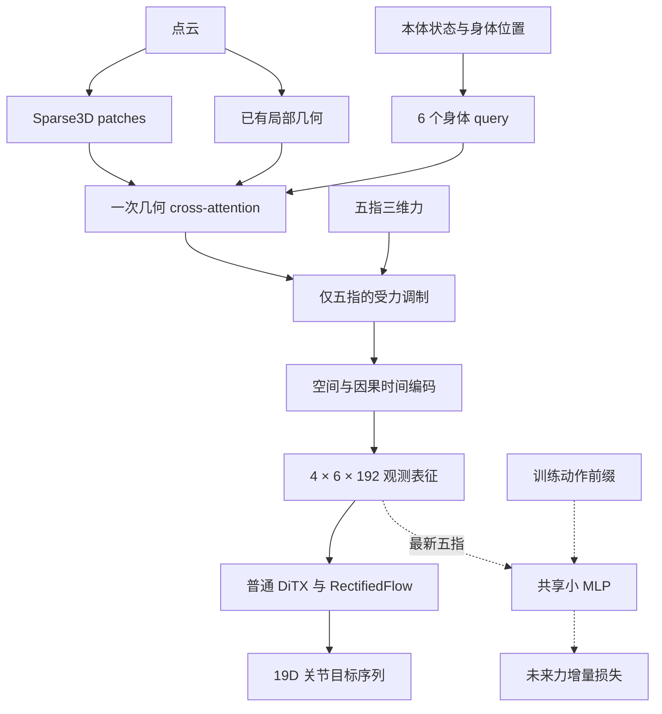

# InterAct-Dex：观测表征重构、调参与验证任务书

> 状态：**T1–T5 已实现，关键检查与真实数据有限 smoke 已通过；长训练、调参与闭环待实验**。第1节保留固定基线事实，实际实施记录见第16节。
> 编写日期：2026-11-04（Asia/Shanghai）。  
> 仓库：`haoyangzhanglab/dexmani_policy`，审查分支：`main`。  
> 审查代码基线：[`79cd54f6bbd095b87fa78c56925d30c65104042b`](https://github.com/haoyangzhanglab/dexmani_policy/tree/79cd54f6bbd095b87fa78c56925d30c65104042b)，提交说明：`Fix CordViP pretraining coverage and clarify tactile compatibility`。  
> 目标：在保持代码直接、正确、易读易改的前提下，将 InterAct-Dex 收敛为“身体锚定的几何读取—五指对应的受力调制—动作后果监督”的紧凑观测表征方法。

## 0. 执行约定与完成范围

先阅读仓库根目录的 [AGENTS.md](../AGENTS.md)，再阅读本文件。实施前核对当前 HEAD 与上述基线的差异：以当前真实接口为准，不回退已更新代码，不重复实现已经完成的事项，不覆盖无关工作区改动。

本任务分为三个层次：

1. **本次必做：**完成第 4～9 节的模型、数据、配置、优化器、相关检查与说明文档修改；验证新结构自身的保存、恢复和推理路径。优先完成最小但完整的修改。
2. **有条件即做：**有可用依赖、真实数据和设备时，执行第 10 节规定的有限 smoke；缺少条件时完成所有可执行检查，明确记录未运行项和原因。
3. **后续实验计划：**第 11～13 节的长训练、调参、闭环评测与论文实验，在实际数据、设备和执行预算明确后进行。任务书中的候选表不是默认自动启动的全量网格。

主要实现直接放在现有类与文件中。不要为了架构图中的每个方框新增包装类、预测框架、registry、兼容迁移器、缺测协议或通用配置系统。不要修改其他策略的训练配方；最新版本已经修复的单一触觉来源约束必须保留。

本次重构作为**新实验配方**训练。旧结构 checkpoint、旧实验结果和原始数据保留；不使用 `strict=False` 绕过旧结构不兼容，也不增加自动迁移逻辑。

## 1. 最新代码事实：务必与历史讨论区分

以下为上述固定提交中的实际实现，不是设计推测：

| 项目 | 当前代码 | 本任务目标 |
| --- | --- | --- |
| 场景压缩 | `SceneTokenizer` 生成 12 个 scene token，再投影到 192D | 删除该路径，场景 patch 由身体 query 直接读取 |
| 每帧观测 | 6 个身体 + 12 个 scene token | 6 个身体 token |
| 4 帧策略条件 | `[B,72,192]` | `[B,24,192]` |
| 场景均值上下文 | `query_context=scene.mean(dim=1)` 加入身体 query | 删除；不换成另一种 patch/global mean 旁路 |
| 触觉融合 | tactile LayerNorm + fusion MLP + scalar gate；腕部使用五指 latent 均值 | 单个共享 affine 层生成残差 FiLM，只作用于五指 |
| 动作主干 | `CoupledDiTX`，16 个 action + 6 个动态 interaction token | 普通 `DiTX`，16 个 action token |
| 未来力特征来源 | CoupledDiTX 中五指的 768D 特征 | 同一次观测编码结果中最新五指的 192D 特征 |
| 预测跨度 | 标量 `interaction_horizon=4` | 单一配置 `future_force_horizons: [1,2,4]` |
| 未来头 | `768→128→3`，98,819 参数 | `272→128→3`，35,331 参数 |
| 标签读取 | `read_future_force(..., *, field)`，显式字段 | 保留接口，传入多个 offsets 和 `field="finger_tactile_force"` |
| 触觉来源 | InterAct 只允许 `finger_tactile_force` 这一种触觉字段 | 原样保留 |

**此前讨论中的“4 个 learned global query”和“208,899 参数的 AdaLN 未来头”均未进入该代码基线。不要创建这些中间版本，也不要将其当作当前代码基线。**

静态结构变化可以报告为：条件 token 从 72 减至 24，减少 66.7%；每次 velocity evaluation 的动态 token 从 22 减至 16，减少 27.3%；真实基线的未来头参数从 98,819 减至 35,331，减少约 64.2%。这些数字均不等于端到端延迟下降比例，也不是成功率结论。

本任务依赖的最新变化：

- `read_future_force` 必须显式传 `field`；不能沿用更早的无字段调用方式。
- `InterActDexDataset` 对已声明触觉字段的集合检查应继续严格等于 `{"finger_tactile_force"}`，不能放宽为“只要存在 aggregate force 即可”。
- `dataset.val_episodes` 只留出 episode；当前 `PolicyTrainer` 没有自动 validation loop，也没有基于验证损失的 early stopping。
- 归一化只统计训练集的真实源帧，不包含 padding、窗口重复、验证集或增强后的样本。

## 2. 研究目标与架构决策

### 2.1 唯一主线

**以身体部位组织场景信息，以对应受力更新该部位的观测表征，再用执行动作之后的受力变化监督表征。**

需要验证的假设：在相同输入、动作解码器和训练预算下，显式身体—几何对应与短时动作条件受力监督，能改善紧凑表征对操作相关交互信息的保留，进而改善闭环控制和未见场景表现。

这是一项待验证假设。FiLM、3D attention、attention sink 与未来预测是已有机制；不能把每个原语分别包装成独立创新，也不能在没有实验时宣称已达到 RA-L 水平。

### 2.2 最终选择

| 类别 | 确定选择 |
| --- | --- |
| 删除简化 | 删除 SceneTokenizer、scene projection/mean 路径，以及 InterAct 对 CoupledDiTX 动态交互 token 的依赖 |
| 机制引入 | 在现有几何 cross-attention 内增加一个零值 null 位置，只供五指的局部 head 使用 |
| 机制优化一 | 五指对应的残差 FiLM；显式保留归一化三维力输入；腕部不直接做触觉调制 |
| 机制优化二 | 一份共享小 MLP，根据最新五指表征与有序动作前缀预测多个跨度的力增量 |

保留 Sparse3D、HandStateEncoder、原始点级 local surface、现有空间/时间历史编码、RectifiedFlow 和普通 DiTX 的既有训练机制。不要同时改动动作表示、Flow 采样分布、主干宽度/深度或执行步数来制造混合收益。

### 2.3 数据流



图中的逻辑块不要求新增类。未来头仅用于辅助监督和离线受力评测，在线 `predict_action` 不调用；它可以随完整训练 checkpoint 正常保存和实例化，不需要另建“推理权重剥离”机制。是否构造由保存的 loss weight 配方决定，不用 `self.training` 关闭监督分支；`model.eval()` 下仍须能够计算离线预测误差。

## 3. 必须保持的数据与坐标契约

### 3.1 观测和动作

- `obs[t]` 位于执行 `action[t]` 之前，执行后得到 `obs[t+1]`。
- `joint_state[T,19]` 是观测关节位置；`action[T,19]` 是执行的绝对关节目标。动作不是位移，也不是未来实际达到的关节状态。
- 19 维顺序：arm 7、thumb 3、index 3、middle 2、ring 2、pinky 2。
- 五指顺序固定为 thumb/index/middle/ring/pinky。
- `eef_pose`、`fingertip_xyz`、pointcloud XYZ 使用实测几何。每帧使用该帧 EEF 旋转；不通过未来动作目标或未来真实位姿构造当前输入。
- 行向量局部坐标使用 `(p_world - eef_xyz) @ rotation_world_from_eef`。身体位置和 patch 中心的 RoPE 必须共享同一个参考原点。
- 默认 `N=4`、`H=16`、`C=4`；`action_start_index=N-1=3`，可用未来动作数 `H-(N-1)=13`。
- 策略输出继续是 `future_actions[B,13,19]`；未来力跨度与实际执行长度 C 独立。

### 3.2 力、归一化与输入边界

- InterAct 只使用 aggregate `finger_tactile_force[B,N,5,3]`。不引入 dense/taxel/patch 分支。
- 仿真 force 是世界系 N；真实 aggregate 来自 SDK，物理尺度与坐标轴不能自动按仿真解释。保持当前生产端通道、顺序及归一化约定，不自动旋转或假定 sim/real 数值兼容。
- 合法零力有效；不由零值、点云支持度或 null 权重推断传感器缺失。当前不扩展缺测协议。
- `Policy._preprocess_obs` 已先归一化再展平 batch/time；HandSceneFusion 收到的 tactile 已是归一化输入，不得重复归一化。
- 默认 force normalization 仍为 `limits`：从 train 真实源帧拟合 XYZ 各轴极值，跨五指共享，广播为 `[5,3]` scale/offset。保留现有 RMS/MaxAbs 作为后续独立实验选项，不新增统计方案。
- `point_cloud`、`eef_pose`、`fingertip_xyz` 保持 identity normalization，不能把几何距离计算改为任意归一化空间。

### 3.3 两种 mask 严格分开

| mask | 含义 | 使用位置 |
| --- | --- | --- |
| 动作前缀 mask | 某个预测跨度允许读取哪些动作 | 构造 predictor 输入，附带前缀有效位 |
| `future_force_valid` | 对应未来帧在同一 episode 中真实存在 | 只用于监督损失和统计 |

不将未来标签、未来标签有效性、未来实测关节/姿态输入观测编码器或在线动作分支。

## 4. T1：压缩观测组织，保留必要几何

主要文件：`dexmani_policy/agents/obs_encoder/interaction/hand_interaction.py` 与 `dexmani_policy/agents/policies/interact_dex.py`。

### 4.1 删除实际存在的 scene 路径

删除 InterActDexEncoder 中的 `scene_tokenizer`、`scene_projection`、scene 计算、scene 拼接以及 `query_context=scene.mean(...)`。从 HandSceneFusion 的参数与计算中删除 `query_context`。

身体 query 由现有 HandStateEncoder 特征与局部 geometry update 构成：

$$
q_i = H_i + G_i,\qquad x_i=H_i+G_i+\operatorname{CrossAttn}(q_i,P).
$$

不要增加 patch mean、额外 global query、第二个场景聚合分支或新的全局池化。

实施时用 `rg` 再次确认 SceneTokenizer 和 `_sample_region_seeds` 没有其他真实消费者，随后删除失去用途的定义及专属于旧结构的检查。保留其他方法需要的 interaction 组件。

### 4.2 保留 `_local_surface`

保留现有最多 32 个近邻、4 cm 有效范围、六维几何描述符、`3→32→32` point MLP 及 `38→192` projection。这部分只有 8,672 个学习参数，补充 Sparse3D patch 压缩后的原始点级细节。

保留 point MLP 后的有效点 mask、`clamp_min(1)` 均值分母、FP32 几何计算与残差相加。无有效近邻时，局部点特征池化为零；最近点距离/方向描述仍可表征接近关系。不要要求整个 G 在空近邻时必须为零。

旧 tactile gate 对几何描述符的额外拼接随 gate 删除；不为此删去局部几何输入本身。

### 4.3 保留现有历史编码

每帧始终保持六个身体 token。沿用一层六体 spatial attention + FFN，再沿用按身体位置独立的一层 causal temporal attention + FFN。保留身体身份和时间 embedding 的现有实现，不增加 recurrent memory 或新的 temporal 分支。

最终返回顺序为 frame-major：`[frame0 的6个身体, frame1 的6个身体, ...]`，形状 `[B,N*6,192]`，默认 `[B,24,192]`。

**T1 验收：**不再有 scene token 或 scene mean 旁路；输出形状和顺序正确；现有局部几何、身体身份与历史因果行为保持。

## 5. T2：在现有 cross-attention 内加入 null

复用 `SpatialCrossAttention`，保留一个 Q/KV 投影、一个输出投影和一次 SDPA。

### 5.1 固定作用范围

| 查询 | 前 3 个 head | 最后 1 个 head |
| --- | --- | --- |
| wrist/EEF | 不施加距离偏置，禁止 null | 不施加距离偏置，禁止 null |
| 五指 | 现有距离偏置，允许 null | 不施加距离偏置，禁止 null |

所有真实 Q/K 仍沿用现有 3D RoPE。不施加距离偏置的头仍有位置编码，不能称为“完全位置无关”。

### 5.2 实现顺序

1. 对真实 query 和 memory 做现有线性投影及共同原点的 RoPE。
2. 在投影与 RoPE **之后**追加一个 zero K 和 zero V；不为 null 构造虚假 XYZ。
3. 增加 `null_logits`，形状 `[3]`，三个局部 head 各一个标量，跨 batch、帧和五指共享，显式零初始化。
4. 使用固定 `[head,body]` 规则构造额外 bias 列；禁止 null 的位置为 `-inf`。
5. 与真实 patch 的 attention bias 拼接后执行同一次 `F.scaled_dot_product_attention`。
6. 保持 `self.out` 的 `bias=False`。

默认 K/V 长度 96→97；输出仍是六个身体 token。固定规则用简单张量广播即可，不为 6 个已知身体位置增加路由器或可配置 mask 框架。

learned null logits 的拼接/赋值必须处于可求导上下文，不得误放进坐标计算的 `torch.no_grad()`。保留现有 FP32 距离计算，进入 SDPA 前按现有风格转 dtype。

### 5.3 正确解释与边界

对于允许 null 的单个 head：

$$
p_{\varnothing}=\frac{e^s}{e^s+\sum_j e^{\ell_j}},\qquad
m_{\mathrm{null}}=(1-p_{\varnothing})m_{\mathrm{ordinary}}.
$$

null 允许减少该 head 的视觉消息幅度，不改变真实 patch 间的相对权重。它不是接触概率、可见性或经过标定的不确定性；不会天然在 4 cm 阈值触发，也可能被高内容相似度的错误 patch 影响。

不把 null 权重乘到力输入、FiLM 更新、身体残差、local geometry 或整个历史表示上。不增加 sink 正则、可靠性网络或独立 contact loss。

**T2 验收：**只有指定局部 head 能分配 null 权重；非局部 head 与无 null 参考在合理浮点误差内一致；局部消息可以衰减；null 参数有正确梯度路径。不要仅为测试新增生产 forward 的 memory-valid 协议。

## 6. T3：五指对应的残差 FiLM

保留现有 XHandForceEncoder：`3→64→64→64`。删除 `tactile_norm`、`fusion_mlp`、`gate_mlp` 及旧 gate 初始化，保留身体特征 LayerNorm。

HandSceneFusion 输入的 `tactile=f_i` 已经归一化。使用：

$$
T_i=E_F(f_i)\in\mathbb R^{64},\quad
c_i=[T_i;f_i]\in\mathbb R^{67},\quad
[\gamma_i,\beta_i]=\operatorname{Linear}_{67\to384}(c_i),
$$

$$
\widetilde x_i=x_i+\gamma_i\odot\operatorname{LN}(x_i)+\beta_i,\qquad i\in\{1,\ldots,5\}.
$$

腕部保留原 x，不构造五指均值条件，也不把全零条件送入带 bias 的 Linear。紧随其后的六体 spatial attention 负责全手信息传播。

参考核心实现（保留实际代码的 dtype 风格）：

```python
features = self.tactile_encoder(tactile).float()
conditioning = torch.cat((features, tactile.float()), dim=-1)
gamma, beta = self.force_affine(
    conditioning.to(self.force_affine.weight.dtype)
).chunk(2, dim=-1)

finger_x = x[:, 1:]
normalized = self.query_norm(finger_x.to(self.query_norm.weight.dtype))
fingers = finger_x.float() + gamma.float() * normalized.float() + beta.float()
tokens = torch.cat((x[:, :1].float(), fingers), dim=1)
```

`force_affine` 权重和 bias 均零初始化，使初始融合为恒等变换。不要再乘一个零初始化 gate；不要对 `x[:,1:]` 原位写入；不要再给 tactile conditioning 加 LayerNorm。

FiLM 显式力通道提供直接使用数值强度的路径，但不保证 latent 可逆，也不能据此宣称旧归一化结构必然丢失全部幅值。该共享融合层（含身体 LayerNorm）参数为 26,496；五指调制与六体调制的参数量相同，取消腕部均值的收益是信息路径更清楚。

**T3 验收：**默认初始化时 tokens 等于输入 x；使用受控非零 affine 权重时，空间 attention 之前改变某一指 force 只直接改变对应指 token，wrist 保持；进入 spatial attention 后允许信息传播到其他身体位置。

## 7. T4：动作主干解耦与共享未来力监督

### 7.1 普通 DiTX

在 `agents/policies/interact_dex.py` 中将导入和构造改为普通 `DiTX`，保留：`hidden_dim=768`、8 层、8 heads、`mlp_ratio=4`、16 步动作、10 步 Euler、`p_drop_attn=0.1`、`qkv_bias=false`、`qk_norm=false`。

Flow 保持 `t_sample_mode="uniform"`、`time_shift_alpha=1.0`，arm/hand 两组动作损失权重继续各 0.5。

删除 InterAct 对 `return_features=True` 的使用：普通 DiTX 不接受该参数，不返回交互特征。保留 RectifiedFlow 的训练配方与 `(loss, metrics)` 返回接口；确认无消费者后删除仅服务旧主干的 `return_features` 分支。普通 DiTX 已支持按帧组织不同数量的 context token，也有推理 context K/V 缓存，不新增缓存层。

再次 `rg` 确认 CoupledDiTX 没有其他真实消费者后，可删除其类定义及只服务旧结构的 decoder 检查；保留通用 DiTX、Flow 和其他策略检查。

### 7.2 只编码一次观测

```python
condition = self._encode_obs(batch["obs"])
fingers = condition.unflatten(1, (self.n_obs_steps, 6))[:, -1, 1:]
```

`fingers` 为 `[B,5,192]`，已经包含空间与历史信息。动作 loss 与未来头复用这一个 condition。不要第二次调用 encoder，不 detach fingers，不让 predictor 旁路读取 pointcloud、原始 force 或其他观测特征。

当前关节值仅用于下述动作相对化，不作为额外预测器观测旁路。

### 7.3 动作前缀

设 `horizons=(1,2,4)`，`K=max(horizons)=4`。从 batch 中尚未做 affine normalize 的值构造：

```python
a = batch["action"][:, self.action_start_index:self.action_start_index + K]
q = batch["obs"]["joint_state"][:, -1]
u = (a.float() - q[:, None].float()) * self.normalizer["action"].scale
```

q 已可能包含 Dataset 的现有 StateNoise；它不是额外读取的未增强源帧。保留该观测增强契约，不新增 clean-q 数据旁路。

对跨度 h，仅允许 `j<h` 的动作：

$$
M_h[j]=\mathbf 1[j<h],\qquad
v_h=[\operatorname{vec}(\operatorname{where}(M_h,U,0));M_h].
$$

默认 `v_h` 为 80D：4×19 个动作分量 + 4 个前缀 bit。使用 `torch.where` 屏蔽后再展平，拼接 bit；动作顺序由展平位置表达。保留 bit 以区分短前缀与后续恰好为零位移的保持目标。

不要增加 step/horizon/finger embedding、action tokenizer、动作 self-attention 或 query attention。K 与前缀维度由 horizons 和 action_dim 推导，不维护独立 prefix 长度配置。

### 7.4 小 MLP

继续使用属性名 `future_force_head`：

```python
self.future_force_head = nn.Sequential(
    nn.Linear(192 + K * (action_dim + 1), 128),
    nn.SiLU(),
    nn.Linear(128, 3),
) if future_force_loss_weight > 0 else None
```

输入 `[z_i;v_h]`，默认 `[B,3,5,272]`，一次批量调用输出 `[B,3,5,3]`。五指和所有跨度共享权重。只将最后一个 Linear 权重和 bias 零初始化，其他层常规初始化；不增加额外 LayerNorm、AdaLN、残差 FFN 或 dropout。

不要改名为 `force_predictor`：当前评测代码会将该名字识别为其他方法的力采样器并读取 `num_inference_steps`。

### 7.5 力增量与损失

默认监督：`future_force[B,3,5,3]`、`future_force_valid[B,3]`。在 FP32 下计算：

```python
current = batch["obs"]["finger_tactile_force"][:, -1:].float()
valid = batch["future_force_valid"]
delta = torch.where(
    valid[..., None, None], batch["future_force"].float() - current, 0.0
)
target = delta * self.normalizer["finger_tactile_force"].scale
```

即 `(F[t+h]-F[t]) * force_scale`。不加 offset、不旋转、不裁剪、不另拟合差分统计。

每个跨度先在其有效样本、五指和三轴上平均，再对有监督的跨度平均：

```python
per_example = F.smooth_l1_loss(
    prediction.float(), target, reduction="none", beta=1.0
).mean(dim=(-1, -2))
mask = valid.float()
counts = mask.sum(dim=0)
per_horizon = (per_example * mask).sum(dim=0) / counts.clamp_min(1)
active = (counts > 0).to(per_horizon)
future_loss = (per_horizon * active).sum() / active.sum().clamp_min(1)
loss = action_loss + self.future_force_loss_weight * future_loss
```

全无效时应返回保留计算图的零辅助损失。正常有限输入下不因 padding/无效标签产生 NaN。保留总损失、动作损失；实际启用辅助分支时，保留未加权和加权未来损失、有效比例，并可在现有 `log_metrics` 路径添加每个跨度的误差与有效比例，不构建新日志框架。

未来头在辅助监督和离线受力评测中调用。在线动作条件不能包含真实未来动作、预测未来力或 future label。`predict_action` 保持通用动作推理路径，不调用未来头。

**T4 验收：**普通 DiTX 调用正确；一次 obs encode；共享小头形状正确；固定同一 z 时严格遵守动作前缀；增量目标与归约正确；辅助梯度能够进入观测编码器；推理不调用未来头。

## 8. T5：数据、配置、优化器与保存闭环

### 8.1 多跨度标签

修改 `datasets/variants/tactile.py` 中 InterActDexDataset，从标量 `interaction_horizon` 改为 `future_force_horizons`。要求非空、正整数、严格递增且不重复；policy 还需检查最大跨度不超过可用未来动作数。校验放在构造/配置边界，复用已有正整数校验，不在每个 batch 重复检查。

保持：

```python
force, valid = read_future_force(
    self.episode_store,
    query,
    tuple(self.future_force_horizons),
    field="finger_tactile_force",
)
```

query 仍由 `sample_source_rows(idx)[action_start_index]` 获取。保留现有窗口 sampler、单一触觉字段检查和 episode 边界规则。未来行不存在时用末行占位且 valid=false；合法零力 valid=true；全无效窗口不因此删除。

无需改写 `read_future_force`，也不要改变 AdapTac 的 field 选择、dense 支持或有效后继采样。InterAct 对自身 horizons 的递增/去重约束不应改变通用 reader 接受无序、重复 offsets 的既有行为和测试。

默认原 sampler 可能不会产生某些尾部无效标签；边界检查应使用可控样本验证语义，不为制造无效标签改变训练采样规则。

### 8.2 单一配置来源

`configs/interact_dex.yaml`：删除顶层 `interaction_horizon`，新增唯一顶层配置：

```yaml
future_force_horizons: [1, 2, 4]
```

`training/common/config.py`：把同一份 horizons 传给 `cfg.agent` 与需要辅助标签时的 `cfg.dataset`。删除旧字段传播；不要同时保留新旧键并静默选一个。

- `agent.future_force_loss_weight=0`：不创建未来头，使用普通 DemonstrationDataset，不读取或要求未来标签。
- 正权重：使用 InterActDexDataset，模型和 dataset 的 horizons 一致。
- effective config 保存新的 horizons 与权重，移除旧 `interaction_horizon`。
- Python 默认辅助权重继续为 0.0；标准 YAML 保持 0.1 起始值。

### 8.3 优化器与 EMA

保留 InterAct 的 `optimizer_groups` override，将非空 future_force_head 显式加入 `parameter_groups(..., lr=lr, weight_decay=weight_decay)`。

- future head 使用主 `lr/weight_decay`。
- FiLM/null 属于 obs encoder，使用 `obs_lr/obs_weight_decay`。
- 沿用现有 decay 分组；bias、LayerNorm 和独立 null 标量不增加 weight decay。
- 现有 optimizer 构建会验证每个可训练参数恰好出现一次；确保新参数被覆盖，不重写分组框架。
- 保留同一套 policy EMA，自动覆盖新结构；不新增 teacher encoder 或辅助 EMA。

### 8.4 checkpoint 与部署

新结构自身的 raw/EMA strict 保存加载、离线预测与同版本恢复训练必须成立。lambda=0 与正权重属于不同构造配方，不能直接修改旧 checkpoint 的保存配置来开关辅助头。

旧 SceneTokenizer/Coupled checkpoint 不兼容本重构，明确作为新实验训练。不迁移、不自动忽略权重、不删除旧实验。

不为未来头另做 export/strip 机制，不修改 Runtime 公开接口。保留 sync/async/rtc 能力声明，并运行现有相关动作路径检查。

**T5 验收：**配置、数据、模型和 optimizer 一致；lambda=0 真正无需未来标签；新 checkpoint strict roundtrip 与有限续训通过；其他触觉策略的单一字段约束不回退。

## 9. 文件清单、文档与最小行为检查

### 9.1 修改范围

| 文件 | 责任 |
| --- | --- |
| `agents/obs_encoder/interaction/hand_interaction.py` | scene 清理、已有 attention 内的 null、五指 FiLM；保留 local surface 与 history |
| `agents/policies/interact_dex.py` | 六体输出、普通 DiTX、共享小头、prefix、loss、effective config、optimizer |
| `datasets/variants/tactile.py` | InterAct 多跨度标签；保留最新 field API 与单一来源检查 |
| `training/common/config.py` | horizons 传播、lambda=0 dataset 切换 |
| `configs/interact_dex.yaml` | 单一 horizons 配置与明确起始超参 |
| `agents/action_decoders/backbones/ditx.py` | 仅在确认无其他消费者后清理 CoupledDiTX；不重构普通 DiTX |
| 现有 `test_tools/*_checks.py` | 更新受影响的断言和必要行为验证；不另建测试平台 |
| `README.md`、`docs/项目架构.md`、`docs/仿真数据集格式.md` | 同步 token、主干、预测头、horizons、数据 shape 与 checkpoint 边界 |

表中代码路径均相对 `dexmani_policy/`，README/docs 路径相对仓库根目录。不需要 `BodySceneReadout`、`ForceConditionedFusion`、新预测器基类或 `force_prediction.py`。

### 9.2 六组必要检查

1. **形状和生命周期：**默认 condition `[B,24,192]`；future prediction `[B,3,5,3]`；action 输出 `[B,13,19]`；训练一次 encode；推理不调用未来头。可让测试替身在 future head 被调用时抛错，验证推理独立性。
2. **几何/null：**保留共同 RoPE 原点和局部坐标；局部 head 可衰减，非局部 head 与参考数值接近；null 参数在非退化诊断下有梯度；local point mask 在 MLP 后仍生效。不要求不同 GPU kernel 路径逐 bit 相等。
3. **五指 FiLM：**默认恒等；受控非零 affine 下按指对应；wrist 在 spatial attention 前不直接变化；避免原位 view/autograd 问题。
4. **prefix/标签：**固定同一 z 与模型模式，在受控非退化 head 下修改 `j>=h` 动作不改变跨度 h 输出，并确认允许的动作能影响输出，避免零输出头让错误实现假通过；保持目标与 padding 可区分；1/2/4 的标签索引正确；不跨 episode；标签 valid 不进入 predictor；全无效 loss 为可微零。保留既有“无效标签即使含 NaN 也不传播”的实质性检查。
5. **归一化/梯度：**raw batch action-q 后只乘 action scale；force difference 只乘 force scale；人为设置不同 action/state offset 检查错误减法；辅助 loss 有通向 obs encoder 的路径。FiLM、未来末层及既有 DiTX 的零初始化会暂时阻断部分上游梯度，不能要求首次 backward 所有模块梯度非零；用受控非退化权重测路径，另测默认初始化与短更新。
6. **配置/优化器/恢复：**新参数覆盖且不重复；新 horizons 传递；废弃字段显式失败；lambda=0 不要求未来标签；raw/EMA strict 恢复与同配方续训；保留原有 force-only/dense 拒绝行为。

梯度与数值测试需要验证真实行为，避免只重复 implementation。完成上述风险对应检查后停止扩展无关测试。

现有检查中的旧接口也要同步：`config_checks` 的 `test_interact_force_config` / `test_interact_mixed_fields_rejected`，`dataset_checks` 的单跨度构造，`training_checks` 中 InterAct 的标签 count/config 断言，以及 `tactile_normalization_checks` 的小型 `interaction_horizon=1` 配方。小型配方应改为适合其动作窗口的 `future_force_horizons=[1]`，不能盲目塞入默认 `[1,2,4]`。保留原有 NaN-invalid、全无效、offset、raw/EMA 与续训性质检查。

### 9.3 已存在的检查入口

```bash
python -m dexmani_policy.test_tools.observation_checks --device cpu
python -m dexmani_policy.test_tools.decoder_checks --device cpu
python -m dexmani_policy.test_tools.dataset_checks
python -m pytest dexmani_policy/test_tools/config_checks.py -k interact
python -m dexmani_policy.test_tools.training_checks --device cpu
python -m dexmani_policy.test_tools.tactile_normalization_checks --device cpu
```

按实际修改先运行相关子集；配置公共逻辑发生变化时，再运行完整 `config_checks.py`。现有 observation/training checks 没有 `--only` 或 `--check` 参数，dataset_checks 无参数，不虚构 CLI。CPU 点云检查仍依赖真实 PyTorch3D 后端；缺依赖时记录，不用假算子替换正式验证。

## 10. 有限端到端 smoke 与实现交付

在真实 Zarr 路径、任务名、依赖和设备存在时执行。下面 `<...>` 是必须替换的占位符，不是可直接运行的路径：

```bash
python -m dexmani_policy.test_tools.smoke_test interact_dex \
  --device cuda:0 --max-updates 4 --resume-updates 2 \
  --output-dir experiments/smoke/interact_dex_repr \
  --override tactile=force \
  --override 'zarr_path=<actual_zarr_path>' \
  --override 'task_name=<actual_task>' \
  --override dataloader.batch_size=2 \
  --override dataloader.num_workers=0 \
  --override training.use_compile=false \
  --override training.use_bfloat16=false
```

使用全新/空输出目录，避免覆盖既有产物；实际数据须有足够训练窗口供 batch/drop_last 使用。为 smoke 降低 batch 只用于检查，不代表正式训练配方或吞吐。`num_workers=0` 时现有 loader 已处理 persistent_workers/prefetch_factor，不增加重复设置；不要为了 smoke 改研究总训练步数。

还应验证 lambda=0 的无未来标签路径，可通过现有合成训练检查覆盖，不要求额外真实数据长训。

实施报告至少包括：基线与最终 commit、实际变更文件、形状/参数清点、运行命令与结果、未执行项、依赖/数据/设备限制。不能把“代码已写”记成“训练已通过”，也不能把合成检查写成成功率提升。

## 11. 起始超参与分阶段调参

### 11.1 首版默认：先保持已有配方

| 配置项 | 首版值 | 决策 |
| --- | --- | --- |
| `horizon / n_obs_steps / n_action_steps` | `16 / 4 / 4` | 固定，与代码基线一致 |
| `future_force_horizons` | `[1,2,4]` | 新的唯一跨度来源 |
| `agent.future_force_loss_weight` | `0.1` | 起始候选，未经闭环调优 |
| future head hidden / Huber beta | `128 / 1.0` | 初始固定，不新增调参开关 |
| `agent.num_points` | `1024` | 固定 |
| Sparse3D patches/group/channels/depth | `96 / 32 / 384 / 2` | 固定 |
| body width / cross heads | `192 / 4` | 固定 |
| local radius / neighbors | `0.04 m / 32` | 保留原实现 |
| body distance scale / body RoPE scale | `0.10 m / 0.10 m` | 与 Sparse3D 自身 RoPE 配置区分 |
| Sparse3D geometry / RoPE scale/base | `0.10 / 0.05 / 100` | 保留原配置 |
| DiTX hidden/layers/heads | `768 / 8 / 8` | 固定 |
| Flow sampling / time shift / NFE | `uniform / 1.0 / 10` | 固定 |
| `optimizer.lr / obs_lr` | `1e-4 / 1e-4` | 沿用 |
| `weight_decay / obs_weight_decay` | `1e-3 / 1e-6` | 沿用 |
| `optimizer.betas` | `[0.9,0.95]` | 沿用 |
| batch / accumulation | `128 / 1` | 设备允许时沿用 |
| total updates / warmup / scheduler | `100000 / 500 / cosine` | 与原配方一致 |
| `training.max_grad_norm` | `1.0` | 沿用 |
| EMA | enabled；`inv_gamma=1,power=.75,min=0,max=.9999` | 复用原 policy EMA |
| BF16 / compile | `false / false` | FP32 先通过正确性与稳定性验证 |
| `training.cudnn_benchmark` | `true` | 沿用 force 配方，不照搬 taxel 的专项调优 |
| force normalization | `limits` | 默认不变 |
| dataset seed / training seed | `42 / 42` | 初筛固定，后续独立多训练 seed |
| `dataset.val_episodes` | 仓库默认 `0` | 需要留出时显式设置数量；不意味着已有 validation loop |

保留已有点云坐标/颜色与 state noise 增强。首次比较不同时改变增强强度、采样点数和模型宽度。

### 11.2 资源调整先于算法调参

若正式 batch 128 OOM，优先用 `batch_size=64, gradient_accumulation_steps=2` 或 `32,4` 保持每次 optimizer update 的名义样本量 128，并记录实际吞吐和显存。主训练按 optimizer update 计步，warmup、总预算和评估点仍按 update 解释。正式对照固定相同 microbatch 与 accumulation；不同微批量的每跨度有效标签数可能不同，先在微批量内归约再累积的梯度不必等价于一次大 batch 归约，差异不只是浮点逐 bit 误差。

若仍不适配，按实测资源选择更小有效 batch，并明确这是配方变化；不要静默降低 width、patch 数或 NFE。BF16 只在该硬件支持且有限性/稳定性/控制表现检查通过后启用；compile 在架构稳定后作为独立工程实验，现有配置只编译动作主干。

### 11.3 第一优先级：辅助损失权重

固定其他模型和训练设置，使用同一训练 seed、数据划分与 selection seeds。

1. 先比较 `lambda=0` 与 `lambda=0.1`，各最多 20k updates。
2. 若辅助项有价值且训练稳定，再按结果增加一个邻近候选：`0.03`（降低干扰）或 `0.3`（监督偏弱）。只有两侧趋势均不明确、且有预算时才补另一侧。
3. 第一轮最多四个 lambda 候选；使用相同评估状态比较闭环表现、任务完成进度和训练稳定性；分跨度预测误差只针对实际启用辅助头的候选。lambda=0 的该指标标为 N.A.，不填 0，不为日志偷偷创建或运行未来分支；表征可预测性比较通过后续同规格冻结探针完成。
4. 最多晋级两个候选到 40k，再决定一个默认正权重候选进入完整 100k。主论文比较仍必须让 lambda=0 对照与选定完整方案都达到相同 100k 和多 seed 预算，不能用 20k/40k 的对照与 100k 的赢家比较。

loss 数值大小不是梯度大小。必要时在少量诊断 batch 上检查辅助项与动作项对 encoder 的梯度影响，诊断不进入常规训练循环，也不新增动态 loss balancing。

若辅助项只改善预测误差、闭环或冻结表征没有收益，保留该负面结果并检查几何信息使用和目标稀疏性；不要自动追加 contact BCE、NCE 或 teacher 网络。lambda=0 是必要控制，不应被排除以维持预期故事。

### 11.4 第二优先级：观测学习率

仅在选定 lambda 后，且有优化不足/不稳定的具体证据时，新增至多两个候选：`optimizer.obs_lr=5e-5` 或 `2e-4`。主 `lr=1e-4`、WD、总预算和 batch 保持不变。

更改 lambda、LR、normalization 或模型结构都使用**新的 run**，不通过更改旧 checkpoint 配方进行 resume。首轮算法筛选建议总共不超过六种配置，避免全量笛卡尔积。

### 11.5 后续独立选项

- force `rms` 或 `max_abs`：仅当 limits 的尺度受极值影响有明确证据时，各作为独立新 run；normalizer 仍仅拟合训练源帧，输入和 delta target 使用同一 scale。不要把 SDK force 经过归一化就当作获得物理标定。
- head hidden 128：默认保持；只有出现可重复欠拟合且预测任务确实使用几何时，才做单个更宽头对照。不要优先恢复复杂 AdaLN。
- 几何半径、RoPE、sink 初值、history 长度、action NFE：首轮固定。优化主张完成后再做有问题指向的独立实验。
- 多 seed：锁定配置后至少使用三个预先确定的训练 seed，并使用相同评测初始状态。数据划分 seed 保持固定，训练 seed 不改变测试集合。

### 11.6 分阶段训练不能改变 cosine 总预算

保留 `training.loop.total_train_steps=100000`。用现有 bounded-run 参数限制本次执行步数，避免先按 20k cosine 训练，再试图将同一 run 扩成 100k。

示例：

```bash
python -m dexmani_policy.train --config-name interact_dex \
  tactile=force 'zarr_path=<actual_zarr_path>' 'task_name=<actual_task>' \
  'future_force_horizons=[1,2,4]' agent.future_force_loss_weight=0.1 \
  training.seed=42 dataset.seed=42 optimizer.obs_lr=1e-4 \
  training.loop.total_train_steps=100000 +max_updates=20000 \
  'hydra.run.dir=<new_empty_tuning_run>'

python -m dexmani_policy.training.common.resume \
  --run '<exact_run_directory>' --max-updates 20000
```

`+max_updates` 控制 fresh 本次执行；resume 的 `--max-updates` 控制本次追加执行。resume 以 checkpoint 保存配方为准，不重传 lambda、horizons 或 normalization。完整预算、候选数和实际 GPU 时间在实验开始前记录。

非有限 loss/梯度、错误对齐、恢复失败是立即停止并修复的工程条件。候选表现暂时较差不是数值故障；只有达到预定比较步数后才能按固定 selection 标准淘汰，避免不同候选训练预算随主观印象变化。

## 12. 评测、选参和效率记录

### 12.1 数据划分与 selection/test

- `val_episodes` 不提供自动 val-loss/early-stop，当前也没有现成验证视图 API；若需要离线 held-out force 误差，基于已有 `val_mask` 与 SequenceSampler 构造仅评估的窄数据视图，复用 checkpoint 保存的 normalizer、不重新拟合，显式关闭增强与训练态随机采样，不扩建 Trainer 框架。
- 现有 split 只依赖 episode 顺序、数量与 seed，不自动按 source/trial/object/task 分组。未见对象/任务主张必须在数据准备阶段以真实身份和元数据划分，防止同一长轨迹片段跨集合。
- 复用当前 `evaluation/seeds.py`、`evaluation/selection.py`、`evaluate.py`、`eval_pipeline.py`；训练调参只使用 selection seeds，最终 test seeds 在方案锁定前保持未使用。
- selection/test 互不相交不自动证明它们与示范训练的初始状态不相交；若声明未见初始状态，使用可用的 episode seeds/身份元数据另行核对训练与评估的隔离。
- 不反复运行完整 test 来选择 lambda、NFE、checkpoint 或预处理。现有 eval_pipeline 包含选点与测试，使用前确认该轮是正式最终评估。
- 同一任务的候选保持相同环境随机化、执行长度 C、NFE 和 EMA/raw 选择。现有环境一致性检查不能绕过。

### 12.2 必须报告的结果

1. 闭环成功率及现有 Wilson 95% 区间、评估 episode 数、训练 seed 间离散程度。
2. 环境已提供的任务完成进度、失败类别可直接复用；接触前目标选择与接触阶段等诊断若无现成指标，使用预先定义的人工分类或固定样本分析，明确来源与覆盖范围，不临时扩建通用标注框架，也不伪造未提供的环境指标。
3. 未来力各跨度的有效样本数、归一化误差；有物理单位保证的仿真可同时报告 N，真实 SDK 数据不冒称 N。
4. 使用训练/selection 阶段预先确定的阈值区分平稳与显著受力变化片段；不为分组新增训练分类头。
5. 训练更新耗时、显存峰值；B=1 的 obs encode 与完整 predict_action 延迟 p50/p95。

### 12.3 效率比较的公平条件

使用相同 GPU/软件栈、batch、点数、NFE、precision、执行模式、EMA/raw、输入搬运范围与 warmup。记录首次与稳态开销，计时前后 CUDA 同步。端到端计时必须包含实际会执行的 observation preprocessing/encoding 与动作推理，另列纯模型计时范围。

共享小未来头只减少训练分支复杂度；在线变化主要来自 scene 条件压缩和 Coupled→plain DiTX。null 增加一个 K/V 位置可能改变 kernel 行为，不能仅按 attention 元素数推算加速。无需为本次任务创建新的性能平台，复用现有工具或一个窄测量脚本。

### 12.4 已核验的 selection/test 命令

先固定一次任务 seed pool、`eval_seed=1024`、100 个 test episodes 和 25 个 selection episodes；池中至少需要 125 个合法不重复 seeds。若实际池不足，事先降低两组规模并重新锁定协议，不静默重复或更换种子。

以下脚本只输出 selection seeds；函数返回顺序为 `(test_seeds, selection_seeds)`：

```bash
python - <<'PY'
from dexmani_policy.evaluation.seeds import load_seed_pool, split_evaluation_seeds

test_seeds, selection_seeds = split_evaluation_seeds(
    load_seed_pool("<actual_task>"),
    eval_seed=1024,
    episodes=100,
    selection_episodes=25,
)
print(" ".join(map(str, selection_seeds)))
PY
```

阶段筛选只使用输出的 selection seeds。`--seeds` 接受空格分隔的整数列表，显式传入后按该列表评估，不依赖 `--episodes` 重新抽取：

```bash
python -m dexmani_policy.evaluate \
  --checkpoint '<run>/checkpoints/step_00020000.pt' \
  --weights ema --inference-steps 10 --action-steps 4 \
  --seeds <the_25_selection_seeds> \
  --seed 1024 --device cuda:0 --no-video \
  --output-dir '<new_empty_selection_directory>'
```

20k 的 25 个 selection episodes 只用于初筛，不能支撑细微差异的可靠排名。方案锁定后，才允许用同一划分执行一次正式选 checkpoint 与独立 test，例如：

```bash
python -m dexmani_policy.eval_pipeline \
  --checkpoints \
    '<run>/checkpoints/step_00020000.pt' \
    '<run>/checkpoints/step_00040000.pt' \
    '<run>/checkpoints/step_00060000.pt' \
    '<run>/checkpoints/step_00080000.pt' \
    '<run>/checkpoints/step_00100000.pt' \
  --weights ema --inference-steps 10 --action-steps 4 \
  --selection-episodes 25 --test-episodes 100 \
  --seed 1024 --device cuda:0 --no-video \
  --output-dir '<new_empty_final_evaluation_directory>'
```

仅传入真实存在的 checkpoint。现有 pipeline 使候选共享 selection 状态，并检查任务/环境覆盖一致性；按 success rate、avg_steps、global_step 的既有顺序选出候选，再评估独立 test。保持这些规则，不按结果临时更改选模标准。若当前 HEAD 的 CLI 已变化，先查 `--help` 和调用实现，再据实调整，不虚构兼容参数。

## 13. 论文验证计划：证明表征，而非模块堆叠

以下实验是有预算后的研究计划，不要求在实现任务中预先建立所有模型变体。

### 13.1 核心 2×2：显式几何绑定 × 未来力监督

| | 无未来力监督 | 有未来力监督 |
| --- | --- | --- |
| 普通内容读取 | A | B |
| 显式身体—几何绑定 | C | D |

固定 pointcloud、本体、force 输入、24 条件 token、五指融合、history、普通 DiTX、数据、增强、训练预算与 NFE。普通内容读取仍使用身体 query，所以不能称为“完全无身体参照”；它移除显式 local geometry 与身体/patch 相对几何读取规则，Sparse3D 主干本身保持。准确列出参数差异，不以故意错配传感标签构造主要基线。

晋级/淘汰仅用于超参筛选。任何进入最终论文 2×2 或收益主表的对照，都必须按相同完整 update、数据和训练 seed 预算完成；不得直接把早期淘汰的短训结果用作最终对照。

必要消融用少量明确的实验版本或真正需要的开关实现；主代码不预先发展成可任意组合模块的框架。

### 13.2 排除未来预测捷径

比较零增量、动作 + **相同历史长度**的本体/force（无点云）、完整表征。分开报告平稳/变化阶段。完整模型改善如果仅来自历史长度差异，不能归因于几何。

prefix 因果 mask 只保证信息使用顺序，不提供反事实因果识别。若有可恢复的仿真状态和真实分支 rollout，可作状态×动作诊断；不把离线动作打乱当作具有真实标签的反事实数据。

### 13.3 压缩与小头的针对性检查

- 六体压缩重点检查远目标、相似干扰物和接近阶段。全局 head 可访问全部 patch，不证明有限 token 保留了全部场景信息。
- 小 MLP 若欠拟合，先做相同输入的单个容量对照；前案 AdaLN 只作为可选研究对照，不进入默认实现。
- null 和 FiLM 的局部消融属于解释性证据，不应压过核心表征实验。

### 13.4 冻结编码器验证

用不同方法训练所得 encoder，固定其参数、train/eval 行为和采样设置，再训练相同新动作头。继承各自正确的输入 normalizer，严格控制训练数据与预算。

当前 `optimizer.obs_lr=0` 只完成参数冻结；Trainer 后续会调用 model.train()，并且 InterAct 尚无完整专用 encoder 迁移入口。实际开展此实验时，以窄的 InterAct 加载和模式控制补齐，不预先新增通用 encoder export/load 平台。未实施这部分不能声称完成冻结迁移。

### 13.5 主张边界

不宣称 null 是校准置信度；不宣称聚合三维力恢复完整接触分布/摩擦状态；不宣称整个网络严格 SE(3) 等变；不宣称小头保证消除动作捷径；不把预测误差下降等同于成功率或泛化提升。

若简化损害特定任务，报告并调整明确的设计选择，避免靠新增记忆、第二融合分支和多重辅助损失逐层修补。

## 14. 完成清单与 Codex 最终回复要求

- [x] 已核对当前 HEAD、AGENTS 和真实消费者；无覆盖无关改动。
- [x] SceneTokenizer/scene mean 路径已移除，输出默认 `[B,24,192]`。
- [x] local surface 与历史编码保留，null 只在现有 SDPA 内实现。
- [x] 五指 FiLM 一一对应；腕部无额外人工触觉条件。
- [x] 普通 DiTX 正常运行；观测只编码一次；future head 为共享小 MLP。
- [x] 新 horizons、prefix、target、valid mask、FP32 loss 正确。
- [x] 最新显式 field API 和单一 aggregate 来源约束保留。
- [x] lambda=0 无未来标签路径、optimizer 分组、policy EMA 正确。
- [x] 新结构 strict 保存/恢复、推理与有限续训已验证或明确未执行原因。
- [x] README、项目架构、数据格式与相关 checks 已同步。
- [x] 参数和形状清点来自实际实现；性能结论仅来自实际测量。
- [x] 调参候选、预算、selection/test 边界与后续命令清楚，未自动启动无预算长训。

最终用中文报告：实际改了什么、为什么、关键文件、运行过的完整命令与结果、未验证项、仍存风险、默认超参与下一阶段调参顺序。已运行、未运行、建议执行三类信息明确区分。不要只返回实施计划或声称“应该通过”。

## 15. 核验来源与机制参考

### 15.1 固定代码与数据依据

- [InterActDex 当前策略](https://github.com/haoyangzhanglab/dexmani_policy/blob/79cd54f6bbd095b87fa78c56925d30c65104042b/dexmani_policy/agents/policies/interact_dex.py)
- [HandSceneFusion / SpatialCrossAttention / HandHistoryEncoder](https://github.com/haoyangzhanglab/dexmani_policy/blob/79cd54f6bbd095b87fa78c56925d30c65104042b/dexmani_policy/agents/obs_encoder/interaction/hand_interaction.py)
- [普通与 Coupled DiTX](https://github.com/haoyangzhanglab/dexmani_policy/blob/79cd54f6bbd095b87fa78c56925d30c65104042b/dexmani_policy/agents/action_decoders/backbones/ditx.py)
- [多跨度读取基础接口与触觉来源约束](https://github.com/haoyangzhanglab/dexmani_policy/blob/79cd54f6bbd095b87fa78c56925d30c65104042b/dexmani_policy/datasets/variants/tactile.py)
- [Policy 归一化、推理与参数分组](https://github.com/haoyangzhanglab/dexmani_policy/blob/79cd54f6bbd095b87fa78c56925d30c65104042b/dexmani_policy/agents/policies/base.py)
- [当前 InterAct 配方](https://github.com/haoyangzhanglab/dexmani_policy/blob/79cd54f6bbd095b87fa78c56925d30c65104042b/dexmani_policy/configs/interact_dex.yaml)；[公共配方](https://github.com/haoyangzhanglab/dexmani_policy/blob/79cd54f6bbd095b87fa78c56925d30c65104042b/dexmani_policy/configs/common.yaml)
- [配置准备入口](https://github.com/haoyangzhanglab/dexmani_policy/blob/79cd54f6bbd095b87fa78c56925d30c65104042b/dexmani_policy/training/common/config.py)；[训练器](https://github.com/haoyangzhanglab/dexmani_policy/blob/79cd54f6bbd095b87fa78c56925d30c65104042b/dexmani_policy/training/trainer.py)
- [仿真数据契约](https://github.com/haoyangzhanglab/dexmani_policy/blob/79cd54f6bbd095b87fa78c56925d30c65104042b/docs/仿真数据集格式.md)；[来源/归一化/部署边界](https://github.com/haoyangzhanglab/dexmani_policy/blob/79cd54f6bbd095b87fa78c56925d30c65104042b/README.md)

### 15.2 机制依据与适用范围

- [GPT-OSS sink attention 实现](https://github.com/openai/gpt-oss/blob/277020131d524f06bed5f66b694a92ed7f6e5224/gpt_oss/torch/model.py)：借鉴 softmax 分母中的可学习零消息选项。该语言模型结果不是机器人收益证据；新训练明确初始化 scalar，不照搬 pretrained loading 的空参数占位。
- [TacFiLM 论文](https://arxiv.org/html/2603.14604v2)：支持轻量触觉调制的研究动机；这里采用五指局部对应的单次 residual FiLM，不声称该论文已验证本方案或其全部代码已开放。
- [JEPA-WMs 研究](https://arxiv.org/html/2512.24497v4)与[官方 AdaLN 实现](https://github.com/facebookresearch/jepa-wms/blob/13cf1d9c7e476f53c17714d2e0f1dc239a883ce0/app/plan_common/models/AdaLN_vit.py)：动作条件方式和预测深度有任务依赖性；本任务选择固定短前缀的小 MLP，不照搬深层世界模型。
- [Spark-0 项目](https://xsparkai.com/Spark-0/)与[触觉条件实现](https://github.com/XsparkAI/Spark-0/blob/e76cdfbc0b93f28cea07beadbdd957936d481317/third_party/starVLA/starVLA/model/modules/tactile/action_fusion.py)：参考触觉作为训练监督与在线条件的职责区分；不迁移其全手高密度触觉、teacher 或大模型双流结构。

以上文献用于界定先例与设计依据；默认配置、代码接口和数据语义以本任务固定审查的仓库版本为依据。设计的有效性由上述控制实验检验。


## 16. 本次实施与验证记录（2026-11-04）

实施起点 HEAD 为 `9a5ae11a549dff67fa383df4e51d1119b24be0b0`，相对审查基线仅新增本任务书；开始时工作区干净。本次修改保留在工作区，未创建新 commit。删除无其他生产消费者的 SceneTokenizer、专用 seed sampler 和 CoupledDiTX；直接修改现有类，没有新增预测框架、迁移器或配置分支。

### 实际参数及形状

默认 YAML 实例（lambda=0.1）参数总数 **123,037,305**：obs encoder **3,675,491**、普通 DiTX **119,326,483**、future head **35,331**。local surface **8,672**、FiLM+身体 LayerNorm **26,496**、null logits **3**，后三项已包含在 encoder 中。真实 checkpoint raw/EMA 均核对得到 condition `[1,24,192]`、future prediction `[1,3,5,3]`、future actions `[1,13,19]`；前缀80D，头输入272D。

### 已运行命令与结果

以下使用 `/home/zhanghaoyang/miniconda3/envs/policy/bin/python`，PyTorch 2.4.1+cu124、RTX 4090。CUDA 和 DataLoader multiprocessing 检查在用户授权的 sandbox 外运行。全部通过；配置检查73项。首次新增训练 fixture 因 pc_dim=6 与3通道样本不符失败，修正为 pc_dim=3 后通过。sandbox 内基线 dataset 检查曾因本地 socket 权限阻塞，停止该进程并在 sandbox 外重跑通过，未改写数据加载行为。

```bash
POLICY_PYTHON=/home/zhanghaoyang/miniconda3/envs/policy/bin/python
"$POLICY_PYTHON" -m dexmani_policy.test_tools.observation_checks --device cuda:0
"$POLICY_PYTHON" -m dexmani_policy.test_tools.decoder_checks --device cuda:0
"$POLICY_PYTHON" -m dexmani_policy.test_tools.dataset_checks
"$POLICY_PYTHON" -m pytest dexmani_policy/test_tools/config_checks.py -q
"$POLICY_PYTHON" -m dexmani_policy.test_tools.training_checks --device cuda:0
"$POLICY_PYTHON" -m dexmani_policy.test_tools.tactile_normalization_checks --device cuda:0
```

初次实施补充 lambda=0 strict raw/EMA 和全无效多跨度检查后，曾单独重跑实际 Python 函数（没有新增 CLI）：

```bash
"$POLICY_PYTHON" - <<'PYTHON'
import torch
from dexmani_policy.test_tools.training_checks import check_interact_representation
torch.set_num_threads(4)
torch.manual_seed(7)
check_interact_representation(torch.device('cuda:0'))
print('PASS extended InterAct checks')
PYTHON
```

真实 Zarr：150 episodes、27,365源帧、26,015窗口。默认模型、FP32、batch=2，完成 fresh=4、resume 后 global_step=6，保存总配方仍为100000；这不是长训练或闭环验证。

```bash
"$POLICY_PYTHON" -m dexmani_policy.test_tools.smoke_test interact_dex \
  --device cuda:0 --max-updates 4 --resume-updates 2 \
  --output-dir experiments/smoke/interact_dex_repr \
  --override tactile=force \
  --override zarr_path=robot_data/pick_apple_messy.zarr \
  --override task_name=pick_apple_messy \
  --override dataloader.batch_size=2 --override dataloader.num_workers=0 \
  --override training.use_compile=false --override training.use_bfloat16=false
```

该目录现已有产物；复跑须使用新空目录。`step_00000004.pt` 和 `step_00000006.pt` 保留，latest 指向第6步。合成检查验证 raw/EMA 同配方续训与连续训练对齐；初次实施的 lambda=0 检查仅验证无标签 loss、strict raw/EMA 加载及加载后优化器更新，后续已由第17节的实际 Trainer 续训检查替代。默认真实 checkpoint 另用以下命令核验逐 tensor strict 恢复、离线未来力与 sync/RTC/Runtime 推理（均通过）：

```bash
"$POLICY_PYTHON" - <<'PYTHON'
import gc
from pathlib import Path
from unittest.mock import patch
import hydra
import torch
from omegaconf import OmegaConf
from dexmani_policy.common.checkpoint import load_checkpoint, restore_policy
from dexmani_policy.deployment import inspect_policy
from dexmani_policy.deployment.runtime import PolicyRuntime

torch.set_num_threads(4)
path = Path('experiments/smoke/interact_dex_repr/checkpoints/latest.pt')
saved = load_checkpoint(path)
cfg = OmegaConf.create(saved.effective_config)
assert saved.global_step == 6 and cfg.training.loop.total_train_steps == 100000
assert cfg.agent.future_force_horizons == cfg.dataset.future_force_horizons == [1, 2, 4]
assert 'interaction_horizon' not in cfg
cfg.dataset.augmentation_cfg = None
dataset = hydra.utils.instantiate(cfg.dataset, _convert_='all')
sample = dataset[0]
batch = {k: ({name: value[None].cuda() for name, value in v.items()} if k == 'obs' else v[None].cuda()) for k,v in sample.items()}
for ema in (False, True):
    model = restore_policy(path, use_ema=ema, device='cuda:0')
    state = saved.ema_model_state if ema else saved.model_state
    for name, value in model.state_dict().items():
        torch.testing.assert_close(value.cpu(), state[name], rtol=0, atol=0)
    count = lambda module: sum(p.numel() for p in module.parameters())
    print('EMA',ema,'total',count(model),'obs',count(model.obs_encoder),'DiTX',count(model.action_decoder.model),'future',count(model.future_force_head))
    fusion = model.obs_encoder.hand_scene
    print('local',count(fusion.surface_mlp)+count(fusion.geometry_projection),'FiLM+LN',count(fusion.force_affine)+count(fusion.query_norm),'null',fusion.context.null_logits.numel())
    with torch.no_grad():
        condition = model._encode_obs(batch['obs'])
        prediction = model._predict_future_force(condition,batch)
        loss,_ = model._compute_future_force_loss(prediction,batch)
    assert condition.shape == (1,24,192) and prediction.shape == (1,3,5,3)
    assert torch.isfinite(loss)
    with patch.object(model.future_force_head,'forward',side_effect=AssertionError('online future head')):
        with torch.inference_mode():
            actions = model.predict_action(batch['obs'])['future_actions']
            guided = model.predict_action(batch['obs'],rtc_prefix=actions[:,:3],delay_steps=1,rtc_guidance_cap=2)['future_actions']
        info = inspect_policy(path.parent.parent, weights='ema' if ema else 'raw')
        runtime = PolicyRuntime(model,info,seed=7)
        output = runtime.predict({name:value.numpy() for name,value in sample['obs'].items()})
    assert actions.shape == guided.shape == (1,13,19)
    assert output.shape == (13,19) and torch.isfinite(actions).all() and torch.isfinite(guided).all()
    print('PASS strict, eval future, sync/RTC/runtime',tuple(condition.shape),tuple(prediction.shape),tuple(actions.shape),'force loss',loss.item())
    runtime.close()
    del model, runtime
    gc.collect()
    torch.cuda.empty_cache()
PYTHON
```

### 尚未运行与后续命令

未运行长训练、调参网格、selection/test 闭环、冻结迁移、完整性能测量或真实机器人部署；这些需要另行确定实验预算。GPU/数据现可用，不再作为未执行原因。有限 smoke 不能证明速度、成功率或泛化提升；单个训练窗口的力误差不作为质量指标。

默认超参与候选次序仍采用第11节：lambda=0 与0.1先各20k，最多四个lambda候选、两个晋级40k；必要时再至多两个obs_lr候选。总cosine预算始终100k，最终方法和论文对照均需同等完整预算。后续候选示例（尚未执行，lambda=0另建目录）：

```bash
"$POLICY_PYTHON" -m dexmani_policy.train --config-name interact_dex \
  tactile=force zarr_path=robot_data/pick_apple_messy.zarr task_name=pick_apple_messy \
  'future_force_horizons=[1,2,4]' agent.future_force_loss_weight=0.1 \
  training.seed=42 dataset.seed=42 optimizer.obs_lr=1e-4 \
  training.loop.total_train_steps=100000 +max_updates=20000 \
  hydra.run.dir=experiments/train/interact-dex/pick_apple_messy/repr_lambda01_seed42
"$POLICY_PYTHON" -m dexmani_policy.training.common.resume \
  --run experiments/train/interact-dex/pick_apple_messy/repr_lambda01_seed42 --max-updates 20000
```

调参仅用第12.4节的selection seeds，方案锁定前不运行独立test。正式batch能否适配4090尚未测试；若OOM按第11.2节保持名义batch128调整microbatch/accumulation，全部对照使用同一设置。


## 17. 全链路清理记录

- 移除 RectifiedFlow 中已无消费者的特征返回参数、三元返回类型及分支。DiTXBlock 删除仅供旧动态交互 mask 使用的参数，DiTX 内联仅剩单一调用点的 `_run_blocks`，删除旧子类专用的 hidden_dim 实例状态。context K/V 缓存、普通及 consistency Flow 配方和参数键保持不变。
- horizons 接口统一接受 `Sequence[int]` 并在边界转为 tuple；保留正整数、递增、最大动作跨度和单一 aggregate 来源约束。未来力预测入口明确要求辅助头已启用，解决定向类型检查发现的可选模块访问问题。
- 删除重复的观测测试 forward，以及 lambda=0 人工复用同一 raw/EMA 权重、新建优化器的简化恢复测试。复用 tactile normalization 的实际 Trainer 流程，验证 lambda=0 的普通 Dataset、不读取未来标签、无辅助指标、raw/EMA 恢复、优化器/调度器续接和连续训练对齐。补齐非默认 horizons 配置传播和跨度越界检查。
- 检查了脚本、部署、评测、配置、数据 reader、优化器及 checkpoint 调用链；没有相关 SHA-256/哈希校验或迁移框架需要删除。保留旧配置显式拒绝，避免 Hydra 的显式新增旧键被静默忽略；这不提供旧格式适配或回退。

本轮重新运行第16节六个检查入口，均通过，完整配置测试更新为75项。lambda=0 的实际 Trainer 检查在临时合成 Zarr 上完成2步保存+1步恢复，并与连续3步的 raw/EMA 权重比较；不将该结果视作真实数据长训练。另复用第16节真实第6步 checkpoint 检查 strict raw/EMA、离线未来预测及 sync/RTC/Runtime 推理，未追加训练或改写原产物。

静态检查及构建命令（解释器同第16节）：

```bash
"$POLICY_PYTHON" -m mypy --follow-imports=skip --ignore-missing-imports \
  dexmani_policy/agents/policies/interact_dex.py \
  dexmani_policy/agents/obs_encoder/interaction/hand_interaction.py \
  dexmani_policy/agents/action_decoders/flow.py \
  dexmani_policy/agents/action_decoders/backbones/ditx.py \
  dexmani_policy/common/config.py \
  dexmani_policy/datasets/variants/tactile.py \
  dexmani_policy/training/common/config.py
"$POLICY_PYTHON" -m compileall -q dexmani_policy
"$POLICY_PYTHON" -m pip wheel . --no-deps --no-build-isolation --no-cache-dir \
  --wheel-dir /tmp/dexmani-interact-review-dist
git diff --check
```

定向 mypy 的7个生产文件通过；未声称检查第三方依赖或全仓库类型。compileall 与 wheel 构建通过。当前环境不提供可运行的 `python -m build` 前端，因此使用 pip wheel 调用既有构建后端，未安装新依赖。长训练、正式 batch128、独立 test、闭环和真实部署仍未执行，参数与默认配方不变。
