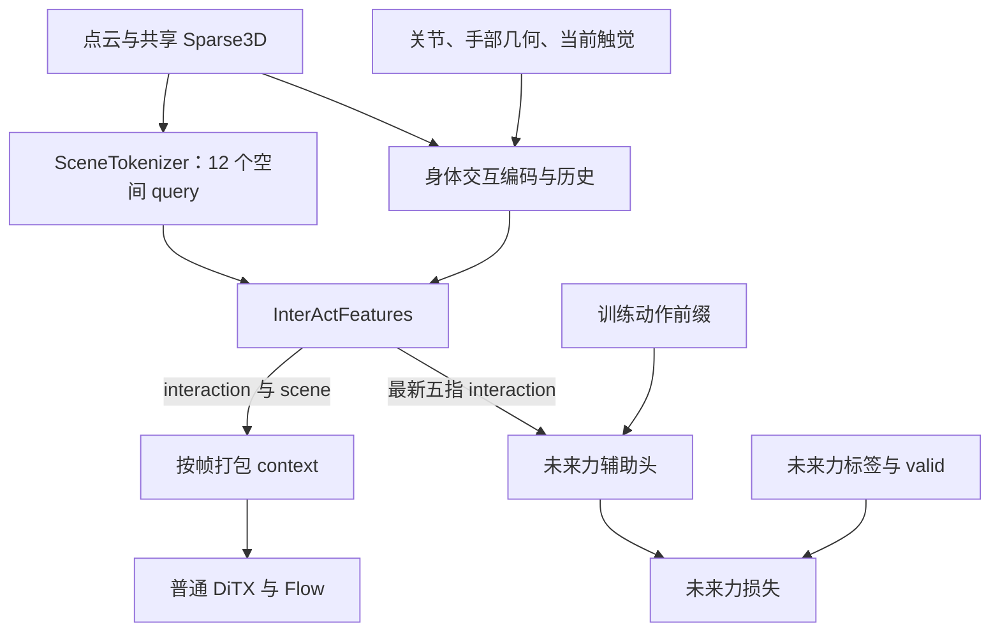

# InterAct-Dex：12-query 场景表征与清晰数据流实施任务书

> 状态：**scene12 已实施；实际验证范围见第12节，历史要求不自动视为通过。**
> 日期：2026-11-04（Asia/Shanghai）。
> 仓库：`haoyangzhanglab/dexmani_policy`；审查分支：`main`。
> 代码基线：[`5ac4aa48d82f3f5a5351b845fd3efc601ad8580d`](https://github.com/haoyangzhanglab/dexmani_policy/tree/5ac4aa48d82f3f5a5351b845fd3efc601ad8580d)。
> 定位：个人机器人策略研究项目。优先正确、直接、易读易改，以最小完整改动完成一套可训练、可恢复、可推理的研究配方。
> 本版替代旧任务书中“删除独立 scene context、仅保留六个身体 token”的设计要求。已完成的 FiLM、身体注意力、普通 DiTX 和未来力监督继续保留。[旧任务书及其历史实施记录](https://github.com/haoyangzhanglab/dexmani_policy/blob/5ac4aa48d82f3f5a5351b845fd3efc601ad8580d/docs/interact_dex_implementation_task.md)仅作历史参考，不能当作本版的验收结果。

## 0. 执行范围与完成标准

先阅读 [AGENTS.md](../AGENTS.md)，再阅读本文件。核对实施时 HEAD 与上述基线的差异，尊重现有工作区修改；按真实接口实施，不回退后来已经完成的正确修改。

本轮完成：

1. 重新引入一个轻量 SceneTokenizer：每帧 **12 个真实三维锚点 query**，一次 3D cross-attention 读取全部场景 patches，再经过一个小 FFN。
2. Encoder 固定交付 `interaction`、`scene` 两个具名张量；动作分支负责 context 打包，未来力分支直接读取最新五指表征。
3. 归一化、动作条件和训练目标在 Policy 边界准备；同步配置、参数分组、保存恢复、相关检查与说明。
4. 完成可执行的定向检查；有可用数据和设备时运行有限 fresh/save/resume/inference smoke，诚实记录未验证项。

本轮不是全仓库重构，也不默认启动长训练、超参网格、闭环大规模评测或真实机器人运行。缺少依赖、数据或设备时，继续完成可执行部分，并记录具体限制。

代码结构以一个新 SceneTokenizer 类、一个两字段 NamedTuple、几处明确的 Policy 方法为限。不要为架构图中的每个方框创建包装类、registry、适配框架、迁移系统或持久特征缓存。

## 1. 固定决策与基线事实

### 1.1 唯一实施主线

**共享一次 Sparse3D 编码；场景分支生成 12 个 scene tokens，身体分支生成 6 个 interaction tokens；编码器交付具名表征；动作分支按帧打包；未来力分支直接消费 finger tokens。**

| 项目 | 5ac4aa4 基线 | 本次目标 |
| --- | --- | --- |
| Sparse3D | 默认 96 patches、384D、2 层 global attention | 保留 |
| 身体表征 | 每帧 6×192，含几何读取、五指 Force FiLM、身体历史 | 保留 |
| SceneTokenizer | 已删除 | 12-query、192D、单层三维 resampler |
| Encoder 输出 | 展平的身体 context | 固定具名输出：interaction 与 scene |
| 默认四帧动作 context | 24×192 | 72×192，即 4×(6+12)×192 |
| 动作模型 | 普通 DiTX + RectifiedFlow，19D absolute joint targets | 保留 |
| 未来力输入 | 从展平 condition 反向切出 finger | 直接读取 interaction 最新五指 |
| 未来力条件与目标 | 动作前缀；跨度 [1,2,4] 的力增量 | 数学语义保留，接口收窄 |
| 未来力 MLP | 默认 272→128→3，35,331 参数 | 保留 |
| 归一化 | Policy normalizer | 保持唯一归属 |

主实验每帧固定 **12** 个 scene queries。本轮不围绕 4/6/8/12 做 token 数量搜索。可以保留一个正式构造参数 `scene_num_queries=12` 用于配置保存和重建；默认 YAML 明确写 12，不提供多套同义名称或不同默认值。

### 1.2 保持现有正确机制

保持以下逻辑和数据约定：

- Sparse3D、HandStateEncoder、原始点级 local surface、身体专用距离偏置/null memory、五指残差 Force FiLM、HandHistoryEncoder。
- 普通 DiTX、RectifiedFlow 的采样配方、16 步动作训练窗口、4 帧观测、执行 4 步、NFE=10、sync/async/RTC 接口。
- `future_force_horizons` 的单一配置来源及合法性检查，默认 [1,2,4]；非默认合法 horizons 仍能按既有规则构造条件和目标。
- InterAct-Dex 只接收 aggregate `finger_tactile_force`，不放宽为混合 taxel/aggregate 来源。
- 现有未来标签 reader、有效性 mask、各 horizon 损失归约、normalizer 统计与恢复语义。

不恢复旧 SceneTokenizer 的 top-3 soft assignment、区域 mass/covariance 描述、scene.mean 广播或 CoupledDiTX。此次不增加 slot/diversity loss、场景重建损失、双 action cross-attention、融合 gate、注意力配额或新动作表示。

## 2. 目标架构与研究含义



SceneTokenizer 和身体分支并列读取同一份 patch memory。身体分支仍读取全部 patches，不经过 12-token 场景瓶颈；scene 不反向广播到 body query。

- Scene tokens：以紧凑的空间读取保存环境、目标和布局信息。
- Interaction tokens：以固定身体身份组织手物几何、受力和历史。
- 动作模型：根据动作生成需求读取两类表征。
- 未来力监督：使 finger 表征包含可预测的交互信息。

两类表征允许信息重叠。接口职责分开，不要求梯度隔离或特征正交。三维 attention、Perceiver 式压缩、FiLM 均为已有机制；本次不预先宣称成功率提升、严格 SE(3) 等变或已经达到论文创新验收。

12:6 控制的是进入动作模型的表征数量，不保证 attention 权重按比例分配。保留独立的身体读取、触觉融合、身体历史与直接作用于 finger 的未来力监督，维持交互表征的语义；是否充分使用它，需通过同一 scene12 架构下的身体/触觉消融与闭环行为判断，而不是预先增加平衡 gate。

## 3. 数据、时间与归一化契约

### 3.1 时间和物理量

- `obs[t]` 位于执行 `action[t]` 之前，执行后得到 `obs[t+1]`。
- `joint_state[...,19]` 是观测关节位置；`action[...,19]` 是 absolute joint targets，不是动作增量或实际达到的未来关节状态。
- 五指顺序为 thumb/index/middle/ring/pinky；六个身体 token 为 wrist + 五指。
- 默认 `action_start_index=n_obs_steps-1=3`；16 个动作位置中在线返回后 13 个，执行步数保持 4。
- 点云 XYZ、EEF 位置、fingertip XYZ、patch centers 保持同一既定世界坐标系和米制。几何字段继续 identity normalization。
- SceneTokenizer 使用世界坐标；身体模块内部的 EEF 局部几何转换保留。不要借此改动触觉力的坐标轴约定或增加力向量旋转。
- 当前 batch 中 raw joint state 指归一化前、仍以原量纲表达的观测值；它可以已经经过现有数据增强。不要额外引入 clean-q 字段。
- 零力是合法观测，不代表缺测；未来标签有效性由现有 valid mask 决定。

### 3.2 责任边界

| 数据或操作 | 归属 |
| --- | --- |
| 观测归一化与帧展平 | 现有 Policy._preprocess_obs |
| 物理坐标处理、点云采样 | 观测编码路径 |
| 场景与身体特征 | InterActDexEncoder 及其子模块 |
| action target 归一化 | InterActDex.compute_loss |
| 动作前缀差分、尺度和 mask | Policy 的小型条件准备方法 |
| future force 差分目标与 valid loss | Policy 的损失准备方法 |
| 未来力数值预测 | 只接收特征与已准备条件的预测函数/MLP |
| episode 时间对齐与标签读取 | 现有 dataset/reader |

`_preprocess_obs` 生成模型输入，原 batch 保留供差分条件与目标使用。Encoder 只接收 obs，不接收完整 batch、action targets 或 future labels。SceneTokenizer、HandSceneFusion 和未来力 MLP 不拥有各自的 normalizer。

## 4. SceneTokenizer 的唯一主实现

### 4.1 模块位置与接口

新增：

`dexmani_policy/agents/obs_encoder/pointcloud/scene_tokenizer.py`

```python
SceneTokenizer(
    scene_channels: int,
    num_queries: int = 12,
    fps_random_config: dict | None = None,
)

forward(
    patch_features,  # [BT, M, C]，默认 M=96、C=384
    patch_xyz,       # [BT, M, 3]，世界坐标、米
) -> scene_tokens   # [BT, 12, 192]，FP32 输出
```

`scene_channels` 从 `pc_encoder.out_dim` 派生，不新增第二份输入宽度配置。宽度 192、heads=4、FFN ratio=2、depth=1 固定即可。复用现有 `positive_int`；实际 M 小于 query 数时明确报错，不自动裁剪数量或补零。

模块的输入契约只有 features/XYZ 对齐，不依赖上游 token 恰好保持 FPS 遍历顺序。

### 4.2 采样与梯度边界

复用现有 `farthest_point_sample`、`resolve_fps_random_config`、`index_points`。

1. 对收到的 M 个 centers 单独执行一次 FPS，选 12 个 query anchors。
2. 沿用 agent 既有 FPS 随机起点约定；eval 通过现有 helper 禁止随机采样。Scene query 不需要再 shuffle；对局部配置副本设置 `use_shuffle_output=False`，不要修改上游配置对象。
3. FPS 只接收 FP32、contiguous 的 XYZ。索引、坐标和 RoPE 相位可在 `no_grad` 与关闭 autocast 的局部范围内计算。
4. **离开 no_grad 后**再用同一索引 gather 可训练 patch features。query seed、K/V、attention、FFN 保留计算图。
5. 不把 XYZ 与 feature 拼起来后在 no_grad 中一起采样；现有 helper 的多通道 gather 会因此切断特征梯度。

这是 96→12 的小规模采样，不引入新依赖或另写 Python FPS 循环。先保证接口清楚，再依据实际 profile 决定是否值得复用上游采样。

### 4.3 一次三维读取

确定的层结构如下，Linear 均带 bias，LayerNorm 均有 affine 参数：

| 层 | 设置 |
| --- | --- |
| query_projection | C→192，只作用于 12 个选中 features |
| query_norm | LN192 |
| memory_norm | LNC |
| q | 192→192 |
| kv | C→384，拆为 K192、V192 |
| out | 192→192 |
| ffn_norm | LN192 |
| ffn | Linear192→384、GELU、Linear384→192 |
| output_norm | LN192 |
| rope | RotaryPositionEmbedding3D(head_dim=48, scale=0.10, base=100.0) |

数据顺序：

```text
query_xyz, query_idx = farthest_point_sample(patch_xyz, 12, ...)
query_features = gather(patch_features, query_idx)
z0 = query_projection(query_features)
Q = q(query_norm(z0))
K, V = kv(memory_norm(patch_features)).chunk(2, -1)
Q, K = 按对应真实 XYZ 应用三维 RoPE
z1 = z0 + out(SDPA(Q, K, V))
scene = output_norm(z1 + ffn(ffn_norm(z1)))
```

Q 长度为 12，K/V 长度为完整 M；每头 48 维，4 个头。SDPA 使用标准缩放、dropout=0，不加距离惩罚、局部半径 mask 或 null key。Scene 分支始终可读取全场景。

不要直接套用身体专用 `SpatialCrossAttention` 的全部行为：其中的 wrist 例外、局部 head 和 null memory 具有身体语义。复用 RoPE、FPS、SDPA 等基础原语即可，不抽象新的通用 attention 框架。

### 4.4 共同坐标原点与精度

主实现沿用当前身体 attention 的清楚写法：联合计算一次相位。

```python
cos, sin = rope(torch.cat((query_xyz, patch_xyz), dim=1))
# 前 num_queries 个相位用于 Q，其余用于 K。
```

当前 RoPE 会减去输入坐标均值，因此不能分别调用 `rope(query_xyz)` 与 `rope(patch_xyz)`。Q/K 的旋转操作本身必须保留梯度；V 不旋转。

- 几何、FPS 输入和相位使用 FP32。
- 投影和 SDPA 遵循外部 autocast/模型参数 dtype，进入 SDPA 的 Q/K/V dtype 一致。
- 残差用 FP32 累加；进入实际低精度权重层前沿用项目已有 dtype 转换方式。
- 最终返回 FP32，与现有 condition 约定一致。
- 保留普通初始化；不添加 layer-scale、learned shared seed 或新的零初始化 gate。

已有 Sparse3D features 包含位置内容，因此无需再增加 XYZ 内容 MLP。该结构具有三维相对位置注意力，但不保证整个策略严格平移/旋转等变。

### 4.5 参数与效率口径

默认 C=384 时参数量为：

`73,920 + 37,056 + 147,840 + 37,056 + 148,032 + 1,920 = 445,824`。

这里没有 learned latent array，参数量不随 query 数改变。小测试中 C=24 时参数量不同，不能套用默认断言。

旧版 SceneTokenizer 加外部 projection 为 891,328 参数，约为本模块两倍；相较本次代码基线 body-only，则是新增 445,824 参数。不要混用这两个比较口径。

SceneTokenizer 每次观测编码执行一次，不在 NFE 循环内重复。动作 context 默认为 72，而非全保留 patch 的 408，也不是模型基线 body-only 的 24。长度和参数变化都不直接等于端到端延迟变化。

## 5. Encoder 输出与动作打包

### 5.1 固定具名输出

与 InterActDexEncoder 放在同一策略模块中定义：

```python
class InterActFeatures(NamedTuple):
    interaction: torch.Tensor  # [B, T, 6, 192]
    scene: torch.Tensor        # [B, T, 12, 192]
```

这个容器只有两个张量引用，无参数、无方法、无序列化框架。无需 pytree 注册或输出模式开关。

Encoder.forward 始终通过正常 Module.__call__ 返回该结构：

1. 沿用现有点云预处理。
2. Sparse3D 仅执行一次，得到共享 patches。
3. SceneTokenizer 读取 patches，产生每帧 scene。
4. HandStateEncoder、HandSceneFusion 读取现有观测与同一 patches，产生 interaction。
5. 两者恢复 [B,T,...]；只有 interaction 进入 HandHistoryEncoder。
6. 返回 InterActFeatures，保持梯度。

不恢复 scene.mean→body query；不对任何可训练 features 做 detach；不把中间结果保存在 `self.last_features` 等模型状态中。

### 5.2 Policy 保持外部 tensor 契约

```python
def _encode_features(self, obs: dict) -> InterActFeatures:
    return self.obs_encoder(self._preprocess_obs(obs))

@staticmethod
def _pack_action_context(features: InterActFeatures) -> torch.Tensor:
    return torch.cat(
        (features.interaction, features.scene), dim=2
    ).flatten(1, 2).float()

def _encode_obs(self, obs: dict) -> torch.Tensor:
    return self._pack_action_context(self._encode_features(obs))
```

`_pack_action_context` 无参数、无状态，只在 token 维按帧拼接，再展平时间与 token 维。

默认布局为每帧 [6 interaction, 12 scene]，四帧共 [B,72,192]。一般形状为 [B,T*(6+12),192]，T=2 的已有 fixture 应为 36，不能到处硬编码 72。

此方案只在 InterActDex 内覆写 `_encode_obs`。Base Policy、Flow、DiTX、Runtime、RTC 和其他策略继续消费原有 tensor 接口。Encoder 不负责动作专用的序列展平，未来头也不反向解析该序列。

### 5.3 时间身份

Interaction 的六个索引具有固定身体身份，保留现有空间/因果时间编码。

Scene 每帧独立采样，相同 FPS index 没有跨帧物体身份；不进入 HandHistoryEncoder，不增加按 scene index 的 tracking/temporal attention。DiTX 仍读取全部历史 scene，并用现有 frame embedding 区分时间。

## 6. 动作损失与未来力监督

### 6.1 统一训练顺序

InterActDex.compute_loss 统一为一条主路径：

```python
features = self._encode_features(batch["obs"])
condition = self._pack_action_context(features)
actions = self.normalizer["action"].normalize(batch["action"])
kwargs["dim_groups"] = self.loss_groups
action_loss, metrics = self.action_decoder.compute_loss(
    condition, actions, log_metrics=log_metrics, **kwargs
)
if self.future_force_head is None:
    return action_loss, metrics

fingers = features.interaction[:, -1, 1:6]
action_condition = self._prepare_future_action_condition(
    batch["action"], batch["obs"]["joint_state"][:, -1]
)
prediction = self._predict_future_force(fingers, action_condition)
future_loss, valid = self._compute_future_force_loss(prediction, batch)
# 沿用现有加权、log_metrics 行为与指标名称。
```

这里的代码是顺序与接口约定，按实际类补齐日志和返回值。lambda=0 不进入辅助条件、future labels 或 future loss 路径。不要先调用 `_encode_obs`，再为取 interaction 编码第二次。

### 6.2 动作条件准备

新增一个小方法：

```python
_prepare_future_action_condition(
    raw_actions,        # [B, horizon, 19]
    current_raw_joints, # [B, 19]
) -> action_condition  # [B, H, K*(19+1)]
```

令 H 为 horizons 数量，K=max(horizons)：

- 取 raw_actions[:, action_start_index:action_start_index+K]。
- 计算 (raw_actions_prefix - current_raw_joints[:,None]) * normalizer["action"].scale。
- 对每个 h，只允许 prefix 的前 h 步，其他位置置零。
- 保持步序，展平 K×19 后追加长度 K 的 0/1 mask。
- 默认 H=3、K=4，输出 [B,3,80]。

不把 action 和 joint_state 各自 normalize 后再相减；它们的 scale/offset 可能不同。这里表示相对当前关节位置的指令差，不是实际实现的位移。条件准备只读取动作与当前 q，不读取未来力标签。

### 6.3 预测函数只接收模型输入

```python
_predict_future_force(
    fingers,          # [B,5,192]
    action_condition, # [B,H,80]，一般维度按 K 推导
) -> prediction       # [B,H,5,3]
```

该函数只做 broadcast、concat 与现有 MLP。沿用 `future_force_head` 属性及默认 272→128→3 网络、末层零初始化和 optimizer 分组；不需要另建 head 包装框架。

不再接收完整 batch、packed condition 或 scene tokens，不做 context.unflatten，不持有另一份 normalizer。

未来头在 `model.eval()` 下仍可用于离线诊断；只是在线 predict_action/采样不调用它。不要用 `self.training` 禁用该能力。

### 6.4 目标和 loss 保持现有正确语义

保留 `_compute_future_force_loss(prediction, batch)` 对目标准备的责任：

- target_h = (raw_future_force_h - raw_current_force) * force.scale；差分不加 offset。
- 先用 valid mask 将无效目标替换为安全值，再进入逐元素损失，避免 NaN×0。
- 保留 SmoothL1(beta=1)、每个 horizon 内按有效样本计数归约，再对 active horizons 等权平均。
- 全无效时返回可微零；不能除零。
- 保留未加权 loss、加权 loss、valid fraction 等既有指标，不新增监控系统。

未来标签只进入目标和损失。默认 future MLP 参数仍为 35,331，改变 horizons 时按既有动态 K 逻辑构造。

### 6.5 梯度关系

| 损失 | Sparse3D | SceneTokenizer | Interaction 分支 | Future head |
| --- | --- | --- | --- | --- |
| Action loss | 可达 | 可达 | 可达 | 无直接路径 |
| Future-force loss | 经 interaction 可达 | 无直接路径 | 可达 | 可达 |

这是计算图关系，不保证每一步梯度数值非零。保留端到端训练，不将“解耦”实现为 detach 或梯度隔离。

## 7. 配置、参数归属、checkpoint 与推理

### 7.1 唯一新增的公开配置

在 InterActDex 构造函数、Encoder 传参和 YAML 中统一使用：

```yaml
agent:
  scene_num_queries: 12
```

传到内部 SceneTokenizer.num_queries 即可。不要同时创建 num_scene_tokens、num_latents、scene_tokens 等同义配置。其余 scene 内部固定常量写在实现与本文中，不展开 depth/head/query_mode 等配置矩阵。

### 7.2 effective_config 的真实约束

当前 assemble_effective_config 会把 model.effective_config 合并到 cfg.agent，恢复时 Hydra 用其重新构造 InterActDex。因此：

- effective_config 必须显式记录实际 `scene_num_queries`，对应一个真实构造参数。
- 不把 `scene_tokenizer={...}`、`tokens_per_frame=18`、`context_tokens=72` 等无对应构造参数的诊断字段塞进 agent effective_config。
- 保留现有 pc_encoder_config、fps_random_config、tactile_encoder 和 horizons 等字段。
- 结构摘要可写日志/说明文档；无需为了记录常量扩展新配置协议。

**重要：data-anchored tokenizer 的权重形状不依赖 query 数量。strict state_dict 不能识别 12→6 的语义变化，必须从已保存有效配置恢复实际数量。**

### 7.3 参数与优化器

SceneTokenizer 注册为 obs_encoder 的子模块，由现有 observation LR/WD 参数组收集。检查无遗漏、无重复；不要再单独加入一次。

`_pack_action_context` 无可训练参数；本轮不在 Policy 上另挂 role embedding 或 shared LayerNorm。当前 optimizer 不会自动收集任意新挂到 Policy 的参数。

未来头继续使用既有主 LR/WD 分组，现有 FiLM/null 参数分组规则保持。

### 7.4 checkpoint 与缓存

这是新架构配方，正式比较从 fresh training 开始。保留旧 checkpoint/实验目录；不使用 strict=False 隐藏旧结构不兼容，不加入自动迁移器。

验证新结构自身的 raw/EMA strict load、有效配置重建、normalizer/optimizer/scheduler 恢复及原目录 resume。旧任务书中的历史 smoke 不能替代本版验证。

推理继承当前 predict_action，经 _encode_obs 得到 context。每个观测窗口编码一次，现有 Flow 在本次多步采样内复用 K/V；下一次观测重新计算。SceneTokenizer 不接 noisy action/timestep，也不增加跨控制周期缓存。

## 8. 文件修改范围与执行顺序

| 文件 | 必做内容 |
| --- | --- |
| agents/obs_encoder/pointcloud/scene_tokenizer.py | 新的 12-query tokenizer |
| agents/policies/interact_dex.py | 实例化 scene；NamedTuple 输出；纯打包；一次编码；收窄 future 接口 |
| configs/interact_dex.yaml | scene_num_queries:12 |
| test_tools/observation_checks.py | tokenizer、具名输出、坐标/精度等定向检查 |
| test_tools/training_checks.py | 更新形状/未来接口/一次编码检查；验证相关梯度和推理 |
| test_tools/config_checks.py | 新构造参数及 effective_config 重建 |
| test_tools/tactile_normalization_checks.py | 只在受影响处更新，保留实际 Trainer 的 lambda=0/resume 检查 |
| README.md、docs/项目架构.md、本任务书 | 同步当前结构与实际实施结果，历史表格标明版本 |

以上路径位于 dexmani_policy/ 下，README/docs 除外。按实际调用方同步少量必要引用即可。默认不改 Base Policy、Flow、DiTX、dataset、sampler 或其他策略；发现真实接口问题时可以做有证据的最小修正，并说明原因。

执行顺序：

- **T1：**读实现与调用方，确认 baseline、数据契约和工作区状态。
- **T2：**实现 SceneTokenizer 与一个针对实际压缩的定向检查。
- **T3：**接入具名 features、打包和未来头接口，统一一次编码训练路径。
- **T4：**接通配置/optimizer/恢复，更新受影响的既有检查与文档。
- **T5：**运行下节匹配风险的验证，记录结果；通过后停止扩大重构和测试范围。

新模块不需要新依赖、下载预训练权重或 shape VAE。不要给每个逻辑步骤再增加一个类或新目录。

## 9. 验收要求与可执行命令

### 9.1 必须覆盖的行为

| 项目 | 验收重点 |
| --- | --- |
| Scene 压缩 | 默认 96→12、输出 [BT,12,192]；K/V 仍覆盖全部 96；默认参数 445,824 |
| 特征梯度 | 采样与相位可无梯度，query seed 与 KV 对 patch features 的梯度不能被切断；使用非退化随机加权 probe，避免只对最终 LN 输出求通道和 |
| 三维关系 | feature/XYZ 使用同一索引；Q/K 共享原点；固定锚点后同步置换 memory/features/XYZ 的读取一致；不要求整个 FPS/策略严格排列或 SE(3) 等变 |
| 数值与采样 | 固定输入 eval 可重复；FP32 与实际支持的 BF16/autocast 路径数值有限；M<12 明确失败 |
| 表征与布局 | NamedTuple 两字段形状正确；按帧打包为 T×18；scene 不进入固定身体身份的 history |
| 单次编码 | compute_loss 内 _preprocess_obs、obs_encoder.forward、共享 Sparse3D 各一次 |
| 辅助分支 | 直接读取最新五指；改变 scene 不改变其输入；future labels 不进入 encoder/预测条件 |
| 前缀与损失 | 保留未来动作 mask、原量纲差分、valid 先屏蔽、horizon 等权与全无效可微零 |
| lambda=0 | 不读 future labels、不调用 future head；普通 Dataset 与既有 normalizer/resume 行为正常 |
| 保存和推理 | 新结构 raw/EMA strict restore、有效配置保留12、优化器参数无重无漏；在线不调用 future head；sync/RTC 与缓存一致 |

测试落在已有 test_tools 中。只补能够发现真实错误的检查，不新增测试框架、图可视化器或大量重复形状断言。

现有 InterAct 小模型 fixture 的 num_patches 已为 12（training_checks 两处、tactile_normalization_checks 一处），不应全局替换其他策略的 4/8-patch 配置。12→12 只验证边界；至少有一个 tokenizer 定向案例使用 M>12（例如 24 或 96），验证真正压缩和非 seed memory 的作用。

未来头末层为零初始化：检查动作前缀敏感性或 interaction 梯度前，在**测试 fixture** 中使末层非零，或完成有效训练更新；生产初始化保持。DiTX 的输出层/gate 也有零初始化，cached/uncached 或条件影响测试应使用短训后的非退化状态，不能让全零输出造成假通过。

旧检查中 spy _encode_obs==1 应改为检查实际预处理/encoder 的单次执行，因为带辅助训练现在直接调用 _encode_features。

### 9.2 命令

在当前项目的正确 Python 环境执行，先确认依赖和设备。下列已有入口不是已运行记录：

```bash
python -m compileall -q dexmani_policy
git diff --check
python -m dexmani_policy.test_tools.observation_checks --device cpu
python -m pytest dexmani_policy/test_tools/config_checks.py -k interact -q
python -m dexmani_policy.test_tools.tactile_normalization_checks --device cpu
```

training_checks 的 main 会运行多个策略检查。开发阶段可先调用现有 InterAct 入口；在 T4/T5 阶段按实际受影响范围补充原有 roundtrip/resume 检查，不要求为了本任务执行所有无关策略实验：

```bash
python - <<'PY'
import torch
from dexmani_policy.test_tools.training_checks import check_interact_representation
torch.manual_seed(7)
torch.set_num_threads(4)
check_interact_representation(torch.device("cpu"))
PY
```

CPU 路径同样可能需要项目既有 PyTorch3D 等依赖，不能仅因设备参数为 cpu 就声称无需依赖。设备或后端不支持时明确记录；不要在生产代码中加入未经需求支持的回退采样器。

有 GPU 时，对同一批定向检查运行实际 CUDA/BF16 路径；dtype、完整模型规模及运行结果如实记录。只有修改了通用 decoder 时才扩大 decoder 回归；只有修改了标签 reader 时才扩大 dataset 回归。不要为文档修改运行训练。

### 9.3 有条件执行的有限真实数据 smoke

先确认实际可读 Zarr、task 和可用 GPU；历史报告中的路径或设备不等于当前环境可用。使用新输出目录，保留正式 horizon、默认 96 patches/384D/2 层 Sparse3D、12 queries 和 768D/8 层 DiTX，只缩小 smoke batch。

替换下列示例变量后运行：

```bash
POLICY_ZARR="/absolute/path/to/available_data.zarr"
POLICY_TASK="actual_task_name"
POLICY_SMOKE_RUN="experiments/train/interact-dex/scene12_smoke"
python -m dexmani_policy.test_tools.smoke_test interact_dex --device cuda:0 --max-updates 4 --resume-updates 2 --output-dir "$POLICY_SMOKE_RUN" --override "zarr_path=$POLICY_ZARR" --override "task_name=$POLICY_TASK" --override dataloader.batch_size=2 --override agent.scene_num_queries=12
```

smoke_test 本身会关闭该次运行的 wandb，并走正式 fresh/save/原目录 resume。检查新产物的 raw/EMA strict load、72-token context、离线 future prediction、在线 future_actions [B,13,19] 与既有 sync/RTC 路径。不要为 smoke 将训练总预算改成 4 或 6；有限停止步数与保存的正式 scheduler budget 保持区分。

缺少真实数据时可以执行现有合成数据 Trainer 检查，但必须明确称为合成数据验证。4+2 smoke 不能证明收敛、成功率、正式 batch128 显存或端到端效率。

## 10. 默认训练配方与后续研究计划

### 10.1 首轮保持配方一致

| 项目 | 默认 |
| --- | --- |
| scene queries | 12 |
| horizon / obs steps / execute steps | 16 / 4 / 4 |
| Sparse3D | 96 patches，384D，depth=2，heads=8 |
| DiTX | 768D，8 layers，8 heads |
| future horizons / weight | [1,2,4] / 0.1 |
| 主 LR / obs LR | 1e-4 / 1e-4 |
| 主 WD / obs WD | 1e-3 / 1e-6 |
| Adam betas | (0.9,0.95) |
| batch / accumulation | 128 / 1 |
| warmup / gradient clipping | 500 / 1.0 |
| 总训练预算 | 100,000 optimizer updates |
| NFE / time_shift_alpha | 10 / 1.0 |
| EMA / BF16 / compile | true / false / false |

本轮不同时改动作模型宽度、Flow 分布、触觉公式或优化器设置。正式 batch 若 OOM，只在确认现有 accumulation 参数后等效调整 microbatch/accumulation，并让所有对照一致；smoke batch2 不作为正式配方。

### 10.2 后续实验，不默认自动启动

先比较同一 scene12 架构的 lambda=0 与 0.1；保持数据、训练预算和动作采样一致。优先用闭环行为而非单独未来力误差决定是否保留辅助监督。

场景机制可在明确实验预算后比较：

- 12 个 FPS patch 直接投影；
- 12 个 FPS query 的普通 cross-attention；
- 本任务的 12 个 FPS query + 3D RoPE cross-attention。

需要时保留现有 body-only 固定版本作参照；不为所有未来消融预先在主实现增加模式开关。没有证据时不继续搜索更深 latent stack 或叠加新的平衡模块。

至少区分接触前目标选择、搬运/放置目标变化、接触执行、无关背景变化。记录成功率与不确定性、同场景分支下身体/触觉消融、实际 encoder/context preparation/采样/端到端延迟。

当前 val_episodes 只留出 episode，Trainer 没有自动 validation loop 或 early stopping。不要声称配置一个验证比例就已经获得独立场景/物体泛化评估。实验数据划分与 selection/test 分离按真实任务另行明确，不扩展为本轮工程框架。

## 11. 机制来源与引用边界

| 来源 | 本次借鉴 | 明确边界 |
| --- | --- | --- |
| [Hunyuan3D-2 PointCrossAttentionEncoder](https://github.com/Tencent-Hunyuan/Hunyuan3D-2/blob/f8db63096c8282cb27354314d896feba5ba6ff8a/hy3dgen/shapegen/models/autoencoders/attention_blocks.py#L511) | FPS 真实三维点生成 query，少量 query 读取密集输入；残差 CA+FFN | 原码为 Fourier XYZ/point features，本适配用已有 patch features；原码此处没有 3D RoPE |
| [3DShape2VecSet AutoEncoder.encode](https://github.com/1zb/3DShape2VecSet/blob/8df9b7a55c42d4dcad152294755250a2ab1e34e5/models_ae.py#L229) | 数据依赖的空间查询与单次 cross-attention 压缩 | 不引入形状重建、VAE 或 mesh decoder |
| [3D FlowMatch Actor attention](https://github.com/nickgkan/3d_flowmatch_actor/blob/ab7093270371964c58fd6cd9169070920c82992c/modeling/utils/multihead_custom_attention.py#L110) | 真实空间位置作用于投影后的 Q/K，再执行 SDPA | 不给19D关节动作伪造XYZ；本轮三维化限定在观测读取 |
| [DeepMind Perceiver](https://github.com/google-deepmind/deepmind-research/blob/f5de0ede8430809180254ee957abf36ed62579ef/perceiver/perceiver.py#L284) | 少量query读取大量memory、Pre-LN、残差和FFN | 本模块是Perceiver式resampler，不是完整Perceiver IO |

使用本仓库已有原语独立实现。Hunyuan3D-2 采用 Tencent 自定义许可，不能标成 MIT/Apache；如直接复制第三方片段，保留相应版权与许可说明。任务不要求引入第三方代码包或权重。

旧 SceneTokenizer 本来已有 FPS 和 attention；本次实质是删除多步区域构造，采用清楚的三维查询读取，并解除观测语义与动作序列格式之间的耦合。论文叙事和结论应与这些真实改动及实验支持一致。

## 12. 最终交付与实施记录

实施结束时更新本节，不要把计划或历史结果写成已完成事实：

- 当前实施 commit/工作区范围，以及与基线的必要差异。
- 修改文件、默认数据形状、scene/future head 实际参数量。
- 命令、设备、dtype、数据类型、fresh/resume 步数、通过/失败/未运行项及原因。
- 新结构保存恢复、有效配置中的 scene_num_queries、在线推理和 lambda=0 行为。
- 未验证的闭环成功率、泛化与实际效率，以及下一步最小实验。

本次实施基于 c302959 工作区（模型基线5ac4aa4），没有后续模型差异或预存工作区修改。新增一个 SceneTokenizer，其余修改局限于 InterActDex、YAML、既有 checks及相关说明；未修改公共decoder、dataset或Runtime。实现与审查修改随本记录一同提交，旧实验目录保留。

实际结构：interaction `[B,T,6,192]`、scene `[B,T,12,192]`，按帧打包 `[B,T*18,192]`；默认动作context `[B,72,192]`，未来条件 `[B,3,80]`、预测 `[B,3,5,3]`、在线动作 `[B,13,19]`。默认模型实测123,483,129参数，其中SceneTokenizer445,824、future head35,331；C=24 tokenizer为237,744。

验证环境：Python3.10.20、Torch2.4.1+cu124、PyTorch3D0.7.8；CPU及sandbox外RTX4090。CUDA在sandbox内不可见，外部可用并支持BF16。使用 `/home/zhanghaoyang/miniconda3/envs/policy/bin/python` 执行：

```bash
python -m compileall -q dexmani_policy
git diff --check
python -m pytest dexmani_policy/test_tools/config_checks.py -k interact -q
python -m dexmani_policy.test_tools.observation_checks --device cpu
python -m dexmani_policy.test_tools.tactile_normalization_checks --device cpu
python -m dexmani_policy.test_tools.tactile_normalization_checks --device cuda:0
```

另以seed7、4个CPU线程直接调用 `check_scene_tokenizer`、`check_interaction`、`check_interact_representation`，分别使用cpu/cuda:0；覆盖FP32、BF16 autocast、96→12压缩与非seed memory、共同RoPE原点、梯度、单次编码、lambda=0、非退化DiTX条件和缓存/RTC检查。正式参数及raw/EMA离线恢复使用现有checkpoint API检查。

真实数据smoke命令：

```bash
OMP_NUM_THREADS=4 python -m dexmani_policy.test_tools.smoke_test interact_dex --device cuda:0 --max-updates 4 --resume-updates 2 --output-dir experiments/train/interact-dex/scene12_smoke --override zarr_path=/home/zhanghaoyang/Desktop/dexmani_policy/robot_data/pick_apple_messy.zarr --override task_name=pick_apple_messy --override dataloader.batch_size=2 --override agent.scene_num_queries=12
```

RTX4090/FP32、正式96/384/2 Sparse3D及768D/8层DiTX，fresh4步+原目录resume2步通过；保存预算100,000步、query数量12。正式产物raw/EMA strict恢复、72-token context、离线未来力、在线13步动作及RTC检查通过。CPU observation检查与20项InterAct配置检查通过。

合成Trainer的最终CPU/CUDA检查全部通过，包含limits/rms/max_abs、lambda=0不读取未来标签、raw/EMA strict恢复、normalizer不重拟合、optimizer/scheduler恢复与连续训练对照。开发过程中修正了测试fixture缺失Hydra输出目录、optimizer字符串元数据及跨设备比较、额外train模式shape检查消耗RNG的问题，未因此改动生产恢复逻辑。最终日志保存在smoke目录中的observation_cpu.log、tactile_cpu.log、tactile_cuda.log、smoke.log；定向检查与正式产物检查结果见本节。

未验证长训练收敛、闭环成功率、泛化、正式batch128显存或端到端性能；未运行真实机器人及async控制调度闭环，保留既有sync/async/RTC接口。下一步最小实验为固定scene12、数据/训练预算/采样一致的lambda=0与0.1比较，以闭环行为判断辅助监督收益。本次有限smoke不构成这些结论。


### 本轮审查与清理

沿点云原语、Encoder/Policy、Dataset、配置组装、优化器、checkpoint/resume及Flow/Runtime审查。当前链路没有SHA校验、旧结构迁移器或双轨加载；保留strict恢复、参数覆盖、query数量和动作跨度等实际正确性边界。`interaction_horizon` 的显式拒绝防止旧顶层键被Hydra接受后静默忽略，不提供兼容行为。

预测函数的broadcast数量直接来自已准备输入，删除Encoder末尾重复FP32转换。修正数据格式文档遗漏的72-token条件、Dataset表格中的单后继描述；移除失效的旧scene组件计时。测试使用真实构造的零权重和非默认horizons，不再删head或修改既有head契约；优化器检查包含正权重future head，gate测试从实际bias维度取切片，完整检查逐帧身体/场景布局以及effective_config对过期输入配方的覆盖。

本轮验证：compileall、git diff --check、20项InterAct配置测试通过；`check_scene_tokenizer`、`check_interaction`、`check_interact_representation` 在CPU/CUDA通过，包含FP32/BF16 autocast、非默认horizons、lambda=0及缓存/RTC。两个生产文件的定向类型检查通过：

```bash
python -m mypy --follow-imports=silent --ignore-missing-imports --cache-dir=/tmp/scene12_mypy dexmani_policy/agents/obs_encoder/pointcloud/scene_tokenizer.py dexmani_policy/agents/policies/interact_dex.py
```

通过现有checkpoint API重新加载前次正式smoke的raw/EMA，72-token context、离线未来力、普通/RTC推理均通过。生产权重键、参数数量、训练配方和推理输出保持一致。前次4+2 smoke产物及optimizer/scheduler/normalizer恢复记录保留；本轮未追加训练，也未重跑全套合成Trainer，避免把既有记录写成新运行结果。
