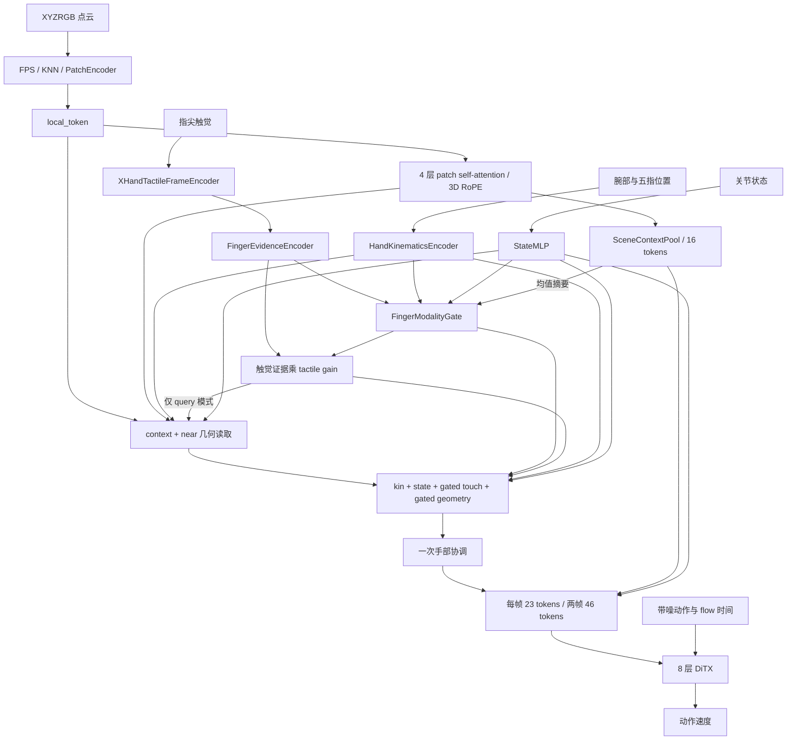

# Interaction Flow：逐指交互表征、实现与实验边界

实现核对日期：2026-10-15。以当前 [单卡配置](../dexmani_policy/configs/interaction_flow.yaml)、[DDP 配置](../dexmani_policy/configs/ddp/interaction_flow.yaml) 和实际 Python 调用链为准；历史实验须读取各自保存的配置与对应源码。

`InteractionFlowAgent` 用腕部和五个指尖作为身体锚点，把点云、运动学、关节状态与同指触觉组织成策略条件，再用标准 flow matching 生成完整动作序列。研究变量主要在 observation encoder：**触觉是否直接参与身体锚点对点云 patch 的读取，以及逐指几何/触觉增益是否由当前观测决定。**

默认每帧输出 `16 scene + 6 hand + 1 state = 23` 个 `192` 维 token；两帧共 `[B,46,192]`。8 层 DiTX 预测 `[B,16,19]` 动作，默认 Euler NFE 为 10，返回的执行窗口为 `pred[:,1:9]`。条件 token 在一次动作预测中只编码一次。

阅读顺序：第 1–3 节说明研究定位；第 4–5 节对应实际模型与源码；第 6 节给出数据契约；第 7–8 节说明消融、诊断与验证。本文区分实现事实、论文机制和研究假设，不以结构合理性代替闭环结果。

## 1. 研究问题

灵巧操作需要同时判断三件事：可见表面在哪里、哪根手指能作用于它、该手指当前感受到什么。
点云提供可见几何；运动学提供腕部和指尖的位置关系；触觉提供局部物理交互的测量。
它们不是互相替代的传感器。例如，指尖到最近可见点很近，不足以证明已建立接触；接触读数也不能恢复被遮挡物体的完整几何。

当密集点云被压缩成少量策略条件后，后端网络需要从这些条件中恢复“哪根手指—哪部分几何—哪种触觉状态”的对应关系。
我们研究的瓶颈是：**有限的交互 token 应在什么阶段、按照什么空间粒度整合这些证据？**
这是一项待验证的结构假设，不是关于所有独立编码方法必然失败的结论。

核心假设：在 patch 到身体锚点 token 的空间聚合阶段，用当前逐指触觉参与同指几何读取，
同时保留该触觉的直接残差，可能比几何聚合完成后的晚期融合更适合接触建立和调整。
无接触时的收益应主要来自身体位置与几何对应；实时触觉通常不能提前指出尚未触碰的目标位置。

同时需要区分**融合位置**与**融合强度**：模态的任务价值随交互状态改变，同一时刻不同手指也可能承担不同作用。
AdapTac 报告了到达阶段更重视觉、操作阶段更重触觉的 attention 变化；这支持考虑动态调制，但不构成固定阶段切换规则或门值的因果解释。
当前实现使用读取前计算的逐指模态门控，让关系更新与触觉证据的增益随当前状态变化；不预测离散阶段，也不预设接触后视觉失效。它不控制独立 scene 分支，因此不能把 geometry gain 直接解释成整个策略的视觉权重。

建议工作标题：**Touch-Conditioned Hand–Scene Relations for Dexterous Manipulation**。
研究目标仍是手–物交互；代码使用 `HandScene`，因为输入尚未要求可靠物体分割，也不能保证已去除机器人自身点云。

## 2. 相关工作的约束，而非模块拼接

| 研究线索 | 一手来源中的机制 | 对本研究的实际约束 |
|---|---|---|
| [PointNet++](https://arxiv.org/abs/1706.02413)，2017 | 米制邻域中的层级局部聚合 | 复用 FPS/KNN patch；固定 K 不代表固定物理接触半径 |
| [Point Transformer](https://arxiv.org/abs/2012.09164)，2021 | 相对位置参与局部 attention 权重和 value | 保留关系层的几何 bias/value；不把位置 MLP 当新贡献 |
| [Perceiver](https://proceedings.mlr.press/v139/jaegle21a.html)，2021 | 小 latent 集通过 cross-attention 读取大量输入 | 小 token 瓶颈有方法基础，也可能损失任务细节 |
| [Multimodal Bottleneck Transformer](https://proceedings.neurips.cc/paper/2021/hash/76ba9f564ebbc35b1014ac498fafadd0-Abstract.html)，2021 | 少量共享 latent 限制模态间交换 | 区分直接编码与交互融合；压缩本身不构成新颖性 |
| [3D Diffuser Actor](https://arxiv.org/abs/2402.10885) | 带三维位置的场景与动作 token 交互 | 保留多个场景 token；本策略的 joint-action DiTX 不自动获得其空间性质 |
| [DexRepNet++](https://arxiv.org/abs/2602.21811)、[CordViP](https://arxiv.org/abs/2502.08449) | 显式手–物几何，或接触/协调表征学习 | 手–物相对表示和接触建模已有充分先例 |
| [FINGR](https://arxiv.org/html/2609.33973v2) | 逐指相对几何及多时间跨度交互预测 | 逐指相对坐标、flow、未来交互预测都不能单独作为新贡献 |
| [FingerViP](https://arxiv.org/html/2604.21331v1)、[SaTA](https://arxiv.org/html/2510.14647v2) | 逐指感知与位姿对应；或腕部相对传感器位姿调制触觉 | 身体锚定已有先例。本文只有指尖位置，不能假设每个 taxel 的完整位姿 |
| [ThinkProprio](https://arxiv.org/html/2602.06575v2)、[GeoProp](https://arxiv.org/html/2607.07101v1) | 状态参与视觉选择，或末端位置引导局部视觉 | “状态引导感知”已经存在；本版不加入运动外推或 hard pruning |
| [AdapTac](https://arxiv.org/html/2505.13982v1) | 观测/预测力引导视触觉 attention | “力引导融合”不是新贡献；其统一坐标合力依赖 taxel 位姿，不能照搬硬件通道 |
| [TransDex](https://arxiv.org/html/2603.13869v1) | 触觉力 query 多轮读取已编码的全局、局部手–物及触觉位置分支 | “触觉作为 query”已有直接先例；本研究需验证逐指 patch 聚合的粒度与位置 |
| [TACIT](https://arxiv.org/html/2609.24507v1) | 用示范接触中心监督较早点云的空间注意力，注意力头推理时看相机点 | 接触引导空间注意力也已有先例；本版用当前触觉 query，不使用未来接触标签 |
| [FingerEye](https://arxiv.org/html/2604.20689v3)、[DeCAL](https://arxiv.org/html/2609.09119v1) | 分组模态处理，或局部触觉读取与全局门控 | 引入一个逐指模态门控，单独检验融合强度；不引入预测体系 |
| [MoPA](https://mopa-policy.github.io/)、[GeoHAT](https://icr-lab.github.io/GeoHAT/) | 为不同执行部件组织感知/动作交互 | 支持按身体作用位置组织证据的动机，不代表本模型学习了语义动作角色 |
| [ProxiDex](https://arxiv.org/abs/2609.16586)、[UniDex](https://arxiv.org/abs/2603.22264)、[TacEx](https://arxiv.org/abs/2609.40134) | 邻近状态建模、功能执行器表示、或触觉探索 | proximity 不等于真实接触；当前 attention 不是主动探索，也没有角色标签监督 |

以上保留与本研究相关的文献线索；本次核对了所链接来源，并重点对照 TransDex、AdapTac、FINGR 和 TACIT 的融合/监督机制。2026 年条目按所链接版本讨论，不依据时间推断录用。表中“对本研究的实际约束”是本文的设计判断，不是这些论文对当前实现的实验结论。

## 3. 可提交论文的候选贡献

1. **表征粒度**：以腕部和五个指尖作为稳定身体索引，将可见几何和同指触觉保留为六个交互 token，另保留场景上下文。
2. **融合位置**：在共享直接触觉残差的前提下，让当前触觉进入 patch→身体锚点的 attention query，并提供参数结构和参数量相同的晚期融合对照。
3. **证据与实验**：分别处理几何邻近、真实传感器读数、无局部观测和缺失传感器，检验这种组织方式在接触歧义与局部遮挡下的效果。

这些贡献围绕同一个问题。第二项与第一项的联合效果需要闭环实验支撑；缺失 mask、普通 sigmoid 门控和目录重构不应拆成独立算法贡献。
不使用“首次触觉引导注意力”“首次手部锚定”“完整 SE(3) 等变”“重建真实接触场”等表述。

## 4. 实际架构与数据流

### 4.1 从 batch 到动作

真实训练链路为 `train.py → build_train_components → Trainer → BaseAgent.compute_loss`；`PCDataset` 复用 `BaseDataset` 的采样、增强和字段读取。Dataset 返回 `obs [B,T,…]` 与 `action [B,H,Da]`；`BaseAgent.preprocess` 先归一化，再取前 `n_obs_steps` 帧并展平为 `[BT,…]`。因此直接调用 observation encoder 时，不能传入未归一化的原始 batch。

下文用 `B` 表示 batch size，`T=2` 表示观测帧数，`M=128` 表示 patch 数，`K=32` 表示每个 patch 的邻居数，`D=192` 表示 token 宽度。每帧独立编码，最后恢复 batch 和历史顺序：

| 阶段 | 默认张量形状 | 语义 |
|---|---|---|
| 输入点云 | `[BT,N,6]` | XYZRGB；`N >= max(M,K)`，点数由数据提供 |
| patch 邻域 / local token | `[BT,128,32,6]` / `[BT,128,192]` | 中心相对 XYZ + RGB，逐 patch 编码 |
| 全局混合后的 patch token | `[BT,128,192]` | 4 层带 3D RoPE 的 self-attention |
| scene / hand / state | `[BT,16,192]` / `[BT,6,192]` / `[BT,1,192]` | 场景上下文、身体交互、关节状态 |
| observation condition | `[B,46,192]` | 每帧依次为 scene、wrist、五指、state，按帧拼接 |
| DiTX condition / action hidden | `[B,46,768]` / `[B,16,768]` | 观测和动作分别线性投影 |
| 速度 / 完整动作 / 执行窗口 | `[B,16,19]` / `[B,16,19]` / `[B,8,19]` | 速度在归一化动作空间；输出动作反归一化 |



图中省略了 `finger_tactile_force` 与有效位到 evidence/gate 的直接输入，具体见 4.5–4.6 节。Observation encoder 没有跨帧 attention、循环状态或未来预测头；两帧条件由动作端的 cross-attention 共同读取。

### 4.2 点云与场景分支

`GeometryPatchEncoder` 对每帧执行 FPS 选中心和 KNN 分组。`PatchEncoder` 用共享逐点 MLP、max pooling、局部/池化特征拼接与再次 max pooling 得到 `local_token`；随后 4 层 patch self-attention 用中心 XYZ 构造连续 3D RoPE，得到 `patch_token`。这里复用了 `uni3d.py` 的局部编码类，当前策略没有加载 Uni3D 预训练 backbone。

训练时默认随机 FPS 起点并打乱输出顺序；`eval()` 强制确定性 FPS。分组索引在 `no_grad` 下计算，不通过邻居选择反传。默认 `pc_dim=6` 已使用点的 RGB；未接入独立 RGB image encoder 或 `PointImageFusion`，不能将其描述为纯 XYZ 输入。

`SceneContextPool` 的 16 个 token 也不是固定 learned latent：先从 patch 中心确定性选取空间锚点，按最近锚点分区，区域内均值池化作为初始 query；加上锚点位置编码后，cross-attention 读取**全部** patch，再经过 FFN、1 层 scene self-attention 和 LayerNorm。区域给出初始化位置，最终感受野可以是全局。各帧重新分区，不保证同一个 scene 槽位持续跟踪同一物体。

scene 分支不以手部或触觉为输入，保留整体目标和环境信息；它的均值摘要参与逐指门控。由此产生一条不经过 hand token 的视觉条件路径：即使某指 geometry gain 很小，DiTX 仍可读取 scene token。

### 4.3 身体锚点与融合位置

`HandKinematicsEncoder` 输出顺序固定为 wrist、thumb、index、middle、ring、pinky。每个 token 包含锚点绝对位置及 Fourier 编码、身体 identity，以及共享的腕部朝向和五指相对腕部位移编码。后者沿输入基坐标轴表达；指尖本身没有独立姿态输入。`eef_pose[3:9]` 是旋转矩阵前两列依次拼接，必须非退化。

令 `k_i` 为身体运动学 token，`s` 为状态编码，`e_i` 为同指触觉证据；腕部 `e_0=0`。
Q（query）与 L（late）使用相同的模块与参数布局：

\[
q_i^{Q}=k_i+s+g_i^t e_i,\qquad q_i^{L}=k_i+s,
\]
\[
u_i=\operatorname{ReadGeometry}(q_i),\qquad
z_i=\operatorname{LN}_{out}\!\left(\operatorname{HandAttention}
(\operatorname{LN}_{in}(k_i+s+g_i^t e_i+g_i^v u_i))\right).
\]

其中 `ReadGeometry` 返回 `context_update + near_update`，不包含 query 残差；`HandAttention` 表示带 residual 和 FFN 的一次 6-token self-attention。State 同时用于 query、门控、hand 残差，并作为独立 state token 输出。

**Q/L 唯一的结构开关是几何 attention query 是否加触觉证据。** 两者直接残差、归一化顺序与手部协调次数一致；相同权重、相同输入下，读取前的 gain 相同，独立训练后数值不必相同。开启门控时，L 的 geometry gain 仍依赖触觉，因此 L 不是“所有几何计算都与触觉无关”的基线。

`none` 将全部触觉有效位设为 false，保留 token 布局与几何/状态分支；若门控开启，geometry gain 仍可依赖几何、状态和 scene。该模式仍构造并调用触觉模块，也仍要求配置中的触觉字段，不能当作已裁剪触觉计算或删除传感器输入契约的实现。

### 4.4 context / near 双路几何读取

| 属性 | context 分支 | near 分支 |
|---|---|---|
| memory | 全局混合后的 `patch_token` | 全局混合前的 `local_token` |
| 相对边 | 锚点 → patch 中心 | 锚点 → patch 内最近有效成员 |
| 每头高斯尺度 | `0.08 / 0.08 / 0.20 / ∞ m` | `0.015 / 0.015 / 0.04 / 0.04 m` |
| 硬支持范围 | 无半径截断；保留有效 patch | 最近成员距离不大于 `3σ`，即 `0.045 / 0.12 m` |
| 无局部支持时 | 仍可读远处上下文或 learned null | 所有头均无支持时，最终 `near_update` 严格置零 |

每条边构造六维输入：`[Δ/0.10, d/0.10, exp(-0.5(d/0.015)^2), exp(-0.5(d/0.04)^2)]`，经 MLP 得到边特征 `φ_ij`，再分别生成 attention bias 和 edge value。令 `m_j` 为该分支的 patch memory，对头 `h`、锚点 `i` 和 patch `j`，真实 patch 的 logit 为：

\[
\ell_{ijh}=\frac{\langle W_q\operatorname{LN}(q_i),W_k\operatorname{LN}(m_j)\rangle_h}{\sqrt{D/4}}
+b_h(\phi_{ij})-\frac{d_{ij}^2}{2\sigma_h^2}.
\]

无效/超范围项置为 `-∞`，再加入 learned null key 的 logit，一起 softmax；value 汇聚同时包含 memory value、edge value 和 null value，最后做输出投影。logits/softmax 用 FP32。`σ=∞` 的 context 头没有高斯距离惩罚，但仍使用 learned edge bias/value，不能称为完全不含几何信息的头。

near 的硬 mask 只约束“该 patch 是否存在足够近的成员”，**不把整个 KNN patch 裁剪进接触半径**。读出的 `local_token` 仍可能汇聚较远成员；一个 patch 也可能含机器人自身、其他物体或背景点。所有头无支持时才整体清零；某一头无支持而其他头有支持时，该头的 learned null 仍可参与输出。null mass 表示模型分配的读取权重，不是接触概率或空域证明。

默认 `edge_frame=wrist` 将两路边向量表示为 `R_wrist^T(p-c_i)`，距离保持米制。它不改变点云输入、patch/RoPE 坐标、运动学绝对位置或动作空间，因此整体网络不具备由此保证的 SE(3) 等变性。这些距离尺度目前是实现默认值，尚无最优性结论。

### 4.5 当前交互状态条件的模态调制

`FingerModalityGate` 接收读取前的运动学+状态、同指触觉证据、共享场景摘要、规范化 finger_tactile_force 和有效位：

\[
(g_i^v,g_i^t)=2\sigma(f_\theta(k_i+s,e_i,\bar c,\tilde f_i,m_i)),\qquad
 g_i^t\leftarrow m_i g_i^t.
\]

- 两个 gain 独立，范围为 0 到 2，允许两种模态同时增强。输出层零初始化，初始 gain=1，延续原融合幅度。
- `use_modality_gate=false` 时跳过门控 MLP，五指 geometry gain 固定为 1、tactile gain 为有效位；腕部仍固定为 `1/0`。模块参数仍被构造，因此参数量相同不代表实际计算量相同。
- 门控 MLP 跟随 autocast；FP16/BF16 logits 转为 FP32 后计算并保留 gain，避免单位增益附近的小幅更新被舍入。仅有有限 loss 或非零梯度不足以证明前向增益实际发生变化。
- 每指输出两个标量 gain，对 token 通道广播；五指共享门控 MLP，输入中的身体 identity 保留指别信息。
- 几何 gain 在读取后缩放 `context + near` 的总更新；触觉 gain 控制直接残差，并在 Q 模式额外控制 query 注入。
- 16 个 scene token 保留，腕部固定 geometry gain=1、tactile gain=0。
- 门控不接收 relation_update、attention 或 null mass，避免 Q/L 的读取结果反过来改变残差对照。
- 规范化 finger_tactile_force 保留幅度通道；只对触觉 embedding 做 LayerNorm 会弱化这部分信息。无效通道先 mask 再送入 MLP，避免 NaN 污染视觉 gain。
- 门值是特征调制强度，不是接触概率、可信度或经校准的模态重要性。当前门没有时序输入；两帧 DiTX 能使用历史，不等于门本身已识别接触建立/释放的方向。

以下是设计预期，不是硬编码策略或已经观察到的结果：

| 交互状态 | 视觉几何的作用 | 触觉的作用 |
|---|---|---|
| 接近 | 目标、可达表面及指尖对齐 | 有效零接触与意外碰触信息 |
| 接触建立 | 几何对齐与物体位姿 | 接触出现、局部载荷反馈 |
| 保持与调整 | 目标进展、整体姿态、环境约束 | 局部接触变化与稳定性相关读数 |
| 释放与重新接触 | 下一个接触位置 | 卸载和是否仍存在接触 |

同一时刻，支撑手指与移动手指的模态需求可能不同，因此采用逐指 gain，不给整只手规定一个全局视觉/触觉开关。

### 4.6 触觉与缺失

`XHandTactileFrameEncoder` 直接编码每帧每指数据：聚合三通道使用已有 MLP；120 taxel 阵列复用已有 ArrayEncoder。
`FingerEvidenceEncoder` 将 frame 特征和归一化的聚合读数投影到 token 维度，加入有效读数标记，并把无效指证据严格置零。
具体为 `e_i = mask_i × (W_frame LN(frame_i) + W_force force_i + valid_embedding)`；实现用 `torch.where` 屏蔽无效值，避免 `NaN × 0` 污染。即使使用 `tactile_force` 阵列，`finger_tactile_force` 仍由证据直连和门控消费，不能删去。默认聚合输入的 3 维读数同时走 `3→64→64` MLP 和直接线性投影；腕部证据始终为零。
三通道读数保留其传感器语义，不旋转成未标定的世界系力，也不假定 taxel 的完整姿态。

有效零接触读数与传感器缺失不同。默认所有输入有效；可显式启用 bool `tactile_valid`。
训练期 `tactile_dropout_prob` 在样本/手指层采样有效位，并在同一历史窗口共享，不通过把坐标或原始读数直接乘零来模拟缺测。
当前 dataset 的有限值过滤会拒绝包含 NaN 的数据窗口；normalizer 也不会按有效位排除有限占位值。
因此，encoder 的缺测屏蔽不能替代数据过滤与统计拟合的缺测处理，含缺测污染的数据不能直接用于当前训练链路。
主消融优先在正常归一化后使用 `tactile_dropout_prob`，保持 Q/L 的统计与缺测分布一致。

### 4.7 动作生成与训练目标

动作端使用标准 flow matching。令 `a` 为归一化示范动作、`ε` 为同形状标准高斯噪声：

\[
x_t=(1-t)\epsilon+ta,\qquad
\mathcal L=\mathbb E\left[\|v_\theta(x_t,t\mid c)-(a-\epsilon)\|^2\right].
\]

代码用 `F.mse_loss` 对 batch、时间和动作维度取均值；没有额外的未来交互、接触分类或重建损失。默认 `t=0.999 × Beta(1,1.5)`，`time_shift_alpha=1` 不偏移；大于 1 时仅把训练时间采样向噪声端 `t=0` 偏移。`num_flow_train_timesteps` 只影响离散采样模式，不决定当前 beta 模式或推理 NFE。

`DiTX` 每个动作时间步对应一个包含完整动作向量的 token，8 个 block 依次执行动作 self-attention、对全部观测 token 的 cross-attention、FFN；仅当前 flow 时间通过 AdaLN 调制。观测 token 投影到 768 维后，同一帧共享 learned frame position embedding，空间/身体/type 信息来自 observation encoder。复用 `consistency_ditx.py` 的 block 不代表采用 consistency training；EMA 用于权重平均/评测，不参与这里的目标速度构造。

推理从噪声开始，执行 `x ← x + v(x,t,c)/NFE`，默认 10 次均匀 Euler 更新，时间为 `0,0.1,…,0.9`。观测编码在循环外完成；当前 DiTX 在每次速度调用中重新投影 condition，未启用跨步 K/V 缓存。反归一化后，`BaseAgent` 返回完整 `pred_action [B,16,19]`、`control_action=pred[:,1:9]` 和 `tail=pred[:,9:]`。训练监督全部 16 步，执行从与当前观测对齐的索引 `n_obs_steps-1` 开始，不是直接执行 `pred[:,:8]`。

切换 `action_key=action_ee` 时配置解析为 21 维动作，`joint_state` 仍为 19 维；动作含义沿用数据与 runner 契约。该策略没有逐指独立动作头，也没有将 hand token 与某些动作维度硬绑定。

## 5. 文件与职责

以下链接直接指向实现；修改共享模块前仍需搜索其他调用者。

| 文件 / 类 | 职责 |
|---|---|
| [geometry_patch.py](../dexmani_policy/agents/obs_encoder/pointcloud/geometry_patch.py) / GeometryPatchEncoder | FPS/KNN、局部编码、3D RoPE 与 patch self-attention |
| [hand_kinematics.py](../dexmani_policy/agents/obs_encoder/proprio/hand_kinematics.py) / HandKinematicsEncoder | 腕部/指尖位置、朝向、手形与身体 identity |
| [xhand_frame.py](../dexmani_policy/agents/obs_encoder/tactile/xhand_frame.py) / XHandTactileFrameEncoder | 直接逐帧逐指触觉编码 |
| [hand_scene_relation.py](../dexmani_policy/agents/obs_encoder/interaction/hand_scene_relation.py) / HandSceneRelationEncoder | 双路几何检索、最近成员与支撑诊断 |
| [scene_context.py](../dexmani_policy/agents/obs_encoder/interaction/scene_context.py) / SceneContextPool | 空间分区初始化、全局读取与场景协调 |
| [attention.py](../dexmani_policy/agents/obs_encoder/interaction/attention.py) | GeometryCrossAttention、InteractionSelfAttentionBlock |
| [finger_evidence.py](../dexmani_policy/agents/obs_encoder/interaction/finger_evidence.py) / FingerEvidenceEncoder | 逐指触觉证据与有效位 |
| [modality_gate.py](../dexmani_policy/agents/obs_encoder/interaction/modality_gate.py) / FingerModalityGate | 读取前计算独立几何/触觉 gain，支持单位 gain 对照 |
| [encoder.py](../dexmani_policy/agents/obs_encoder/interaction/encoder.py) / InteractionObsEncoder | Q/L/N 开关、统一残差、手部协调、frame-major 输出 |
| [interaction_flow.py](../dexmani_policy/agents/core/interaction_flow.py) / InteractionFlowAgent | 装配 encoder/decoder，限制层数与几何归一化 |
| [base.py](../dexmani_policy/agents/core/base.py) / BaseAgent | 归一化、训练/推理调用、动作窗口、优化器分组 |
| [ditx.py](../dexmani_policy/agents/action_decoders/backbone/ditx.py) / DiTX | 单一 flow 时间条件的动作速度网络 |
| [rectified_flow.py](../dexmani_policy/agents/action_decoders/rectified_flow.py) / RectifiedFlow | FM 目标与 Euler 推理 |

可选 [PointImageFusion](../dexmani_policy/agents/obs_encoder/interaction/point_image_fusion.py) 由通用 patch encoder 提供，但当前 InteractionFlowAgent 没有配置或传入其语义输入。模块存在不等于本策略已接入。

## 6. 数据与配置

### 6.1 默认 SIM 配方

以下 shape 是进入 `BaseAgent` 前的 batch 形状，`T=2`；可接受更长观测窗口，但 preprocess 只取前两帧。

| 字段 | 形状 | 当前用途 / normalization |
|---|---|---|
| `joint_state` | `[B,T,19]` | 状态编码 / `limits` |
| `point_cloud` | `[B,T,N,6]` | XYZRGB patch / `identity` |
| `fingertip_xyz` | `[B,T,5,3]` | 五指锚点 / `identity` |
| `eef_pose` | `[B,T,9]` | 位置 XYZ + rotation-6D 的腕部输入 / `identity` |
| `finger_tactile_force` | `[B,T,5,3]` | 触觉 MLP、证据直连、门控 / `gaussian` |
| `action` | `[B,16,19]` | 示范动作监督 / `auto` |

指尖和逐指触觉严格保留 `(5,3)`，指序为拇指、食指、中指、无名指、小指；不接受平铺 15 维、旧字段名或拆分末端字段。
normalizer 保留每指每轴独立的 15 个统计通道，只跨训练源行汇总，scale/offset 保存为 `(5,3)`；字段重排不会改变原 SIM 的归一化数值语义。统计粒度见 [数据与模态说明](./data_modality.md#54-触觉有效性与归一化)。

| 配方项 | 当前配置值 | 对实验的影响 |
|---|---|---|
| 数据与划分 | `pick_apple_messy`，最多 80 个训练 episode，`val_ratio=0` | 默认没有留出验证集 |
| 训练预算 | batch 128，100000 optimizer steps，seed 42 | DDP 为每卡 32 × 4 卡，梯度累积均为 1 |
| 优化器 | AdamW；obs/action lr 均 `1e-4`，weight decay 均 `1e-6`，betas `[0.95,0.999]` | cosine schedule、warmup 500、梯度裁剪 1.0 |
| 数值与评测 | BF16、编译 action backbone、EMA 均开启 | eval 默认选择 EMA，NFE=10 |
| 点云增强 | XYZ noise std `0.002 m`、color jitter、最大 dropout ratio `0.8`，均 `prob=1` | 增强发生在 patch FPS 前；不把随机缺点视作接触标签 |
| 状态增强 | noise std `0.0002`，`prob=1` | 在 Agent 归一化之前作用于 joint_state |

这些是当前 YAML 的值，不是历史实验事实或推荐最优值。类构造与 YAML 均使用固定 `eef_pose` 字段，不再提供 `wrist_pose_key` 选项。

### 6.2 稠密触觉与 Real 接入边界

当前 `dexmani_real` 仍生产 `fingertip_points` / `contact_force`，其数据导出与在线部署协议尚未迁移，不能直接运行当前 interaction 策略。完成生产者适配后，稠密触觉配方如下；这里只声明消费接口，不改写真机数据：

```yaml
agent:
  tactile_input_key: tactile_force   # 若只用聚合读数，保留 finger_tactile_force
dataset:
  sensor_modalities: [joint_state, point_cloud, fingertip_xyz, eef_pose, finger_tactile_force, tactile_force]
normalization:
  joint_state: limits
  action: auto
  point_cloud: identity
  fingertip_xyz: identity
  eef_pose: identity
  finger_tactile_force: gaussian
  tactile_force: gaussian
```

稠密模式在默认逐指字段之外增加 `tactile_force`；dataset 与 normalization 必须一起声明。Real `eef_pose` 为 `[B,T,9]`；阵列 `tactile_force` 为 `[B,T,5,120,3]`，且仍需 `[B,T,5,3]` 的 `finger_tactile_force`。
`eef_pose` 必须来自当前测量/FK，不能来自未来 action_ee。
采用 Real 数据还需使用仓库已有的 Real runtime 数据配方与评测流程；默认配置中的 SimRunner 不代表真机评测入口。
所有几何字段强制 identity，跨模态坐标增强必须保持点云、腕部和指尖的一致性。
这里的坐标增强指整体旋转/平移；默认仅对点云加测量噪声，并未同步扰动运动学锚点，表达的是传感器噪声而非共同坐标变换。
实机与仿真 finger_tactile_force 虽可统一 shape，测量含义和归一化统计不能直接混用。

启用 `agent.use_tactile_valid=true` 时，dataset 字段集合需增加 bool `tactile_valid [T,5]`，normalization 增加 identity。
真实硬件仍需提供实际有效位；warmup 仅构造全有效 bool 合成输入。

### 6.3 配置入口

在 README 指定的 `policy` 环境中，从仓库根目录运行：

```bash
conda activate policy
PYTHONPATH=. python dexmani_policy/smoke_test.py --config-only interaction_flow
PYTHONPATH=. python dexmani_policy/smoke_test.py --config-only ddp/interaction_flow
```

实际训练沿用仓库 `train.py`/训练脚本入口，选择配置 `interaction_flow`。
不要在未检查数据字段、指序、坐标系与真实采样后直接启动长训练。

## 7. 最小判别实验

### 7.1 已有开关与对照解释

| 对照 | 固定条件与目的 | 当前状态 |
|---|---|---|
| N：`tactile_fusion=none` | 同 token 布局，屏蔽全部触觉证据，检验传感器信息价值 | 已实现 |
| L：`tactile_fusion=late` | query 不含触觉，聚合后加入同指触觉残差；adaptive gain 仍可依赖触觉 | 已实现 |
| Q：`tactile_fusion=query` | 触觉参与聚合，同时保留与 L 完全相同的直接残差 | 已实现；主假设 |
| `use_modality_gate=true/false` | 与 Q/L 交叉组成四组，独立检验状态条件调制 | 已实现 |
| Q 的 `edge_frame=base/wrist` | 仅比较关系边坐标表达 | 已实现 |
| 无身体约束的同容量 tactile attention | 排除普通触觉 query 已足够的解释 | 待实现论文对照 |
| FINGR 式逐指相对点 pooling | 排除相对坐标加简单汇聚已足够的解释 | 待实现论文对照 |
| 同预算 latent resampler | 排除压缩容量与通用重采样的解释 | 待实现论文对照 |

最重要比较是 **Q−L**，不是 Q−N。保持 demonstrations、编码器、token/参数数、骨干、动作窗口、NFE、优化器和训练种子一致。
L 与 Q 保持相同直接残差和归一化顺序，闭环收益需通过实际任务评测验证。
先在 `use_modality_gate=false` 下比较 Q−L，直接检验触觉进入 query 的作用；再加入 adaptive gain 的 Q/L，组成四组。分别在 Q 与 L 内比较 adaptive−unit gain，避免把融合位置和融合强度的效应混在一起。相同 seed 用于匹配实验配方；严格的同权重前向诊断应显式加载同一 state_dict，并固定输入及随机操作。
若需证明状态依赖超越一般幅度校正，应再加入可学习但输入无关的常数 gain 对照。
按外部事件划分阶段，联合报告闭环效果与门值诊断；门曲线本身不足以证明模态贡献的因果性。

至少设计常规场景和接触歧义场景：例如接触建立后局部遮挡、同一可见几何下不同载荷/接触配置、单指触觉缺失。
缺失测试使用有效位；错配指序仅作为受控诊断，不改变正常数据的指序约定。
接近、接触建立、接触调整阶段应由任务事件/人工核查定义，不能由模型 attention 反向定义。
主要指标为成功率，辅以接触后失败率、重新接触次数和每次尝试耗时；同时报告实际硬件延迟。

先做低成本 Q/L 先导；再用多个训练种子与匹配重置条件确认效应。
置信区间区分训练种子与同 checkpoint 重复执行，不把 rollout 次数当训练种子数。
预设最小有用效应；若 Q 相对 L 的效应上界仍小于该阈值，应采用更简单的 L 并收缩论文主张。
若只有更多参数带来提升，或者简单逐指 pooling 已相当，不能继续以“触觉条件化几何读取”为核心创新。

### 7.2 可直接读取的诊断

`InteractionObsEncoder.forward(..., return_intermediate=True)` 返回 `(cond, aux)`。默认 `BaseAgent._build_cond` 未开启它，训练日志也不会自动记录这些数组。检查已加载的策略时，应在 `agent.eval()` 和 `torch.no_grad()` 下调用 `agent.preprocess(raw_obs)`，再把结果送入 `agent.obs_encoder(..., return_intermediate=True)`；已经预处理的数据不要再次归一化。

| `aux` 字段 | 形状（默认） | 能回答的问题 |
|---|---|---|
| `geometry_gain` / `tactile_gain` | `[BT,6,1]` | 各锚点特征增益是否偏离初始值；腕部/缺测约束是否满足 |
| `finger_evidence` / `gated_finger_evidence` | `[BT,6,192]` | 缺失证据是否为零，门控前后特征幅度如何变化 |
| `tactile_valid` | `[BT,5]` | encoder 实际使用的有效位，包含 dropout 或 none 的结果 |
| `context_update` / `near_update` | `[BT,6,192]` | 哪条几何路径在提供更新 |
| `near_has_support` | `[BT,6,4]` | 各 attention head 是否至少有一个受支持 patch |
| `min_observed_distance` | `[BT,6]` | 锚点到所有已分组 patch 成员的最短距离；不保证覆盖原始全点云 |
| `context_attention` / `near_attention` | `[BT,6,4,129]` | 对 128 个 patch 与最后一个 null 槽的读取分配 |
| `context_null_mass` / `near_null_mass` | `[BT,6,4]` | 各头分配给 null 的权重 |
| `interaction_center` / `frame_tokens` | `[BT,6,3]` / `[BT,23,192]` | 锚点坐标与最终逐帧 token 布局 |

这些诊断不是辅助监督。几何 attention 还依赖 query 内容、edge bias、距离先验及 null 竞争；门值又在 LayerNorm 和手部协调之前作用，因此单看某个权重大小无法归因最终动作。应联合观察 `gain × update` 的范数、支撑比例、输入有效位与任务结果，并用受控干预验证解释。

### 7.3 优先处理的研究不确定性

当前设计的明确作用是把身体索引与几何/触觉对应关系前移到策略条件形成阶段。独立 scene 路径和触觉残差为几何读取失败时保留了其他信息来源；策略是否利用这些信息、是否有收益，仍由 Q/L 和闭环测试回答。

优先诊断三个问题：near 支撑是否经常来自机器人自身或宽 KNN patch；动作端是否主要依赖 scene/state 而绕过 hand token；接触建立/释放是否需要显式的时序触觉信息。前两项先用现有中间量和受控输入检查，第三项先验证两帧条件是否足够。分割、额外时序模块、未来监督或 K/V 缓存都属于后续独立改动，不应同时加入主 Q/L 实验。

## 8. 运行检查

先运行第 6 节的 config-only 命令，解析配置、检查现有配置约束、定位 Hydra target 模块并导入 Agent target。该模式不读取真实数据、不构造 Dataset 或 Agent，也不运行 GPU 算子；它不逐一验证构造参数兼容性，该项需通过正式 smoke 的实际构造路径确认。
确认数据配方和运行环境后，使用正式 smoke 入口验证真实 batch、训练更新、动作预测与 raw/EMA 保存恢复：

```bash
PYTHONPATH=. python dexmani_policy/smoke_test.py interaction_flow --max-updates 4
```

smoke 使用当前配置的 batch、BF16、compile 和生产 PyTorch3D 算子；`training.use_compile` 编译 action backbone，并不代表整个 observation encoder 被编译。临时产物在退出时清理，不创建 W&B run。

smoke 不接受 Hydra 字段覆盖。需要保存产物并按 episode 留出验证集时，可从仓库根目录使用正式入口运行有界训练：

```bash
PYTHONPATH=. python dexmani_policy/train.py --config-name interaction_flow \
  dataset.val_ratio=0.2 +max_updates=50
```

这会使用独立输出目录，仅以 `max_updates` 限制本次执行，不修改学习率、warmup 或总训练计划。留出集合由 Dataset 管理，normalizer 只拟合训练源行；当前 Trainer 不自动计算验证集 loss。Real 数据须先按第 6 节替换配方，不能直接套用默认 SIM 配置。

从实际保存的实验目录恢复时：

```bash
PYTHONPATH=. python dexmani_policy/train.py --config-name interaction_flow \
  '+resume_from=experiments/interaction_flow/<task>/<run>' +max_updates=4
```

将 `<task>/<run>` 替换为真实目录。恢复使用来源实验保存的配置、模型、normalizer、optimizer、scheduler、EMA 和训练进度，结果写入新目录；多 worker 的随机增强不保证逐位复现。

`ddp/interaction_flow` 可执行 config-only 检查；多卡运行需使用 `train_ddp.py` 或对应训练脚本，单卡 smoke 不验证多卡执行。短程检查只能证明相应实现链路，不能证明闭环收益或门控已学会阶段切换。

本次文档更新的验证记录（2026-10-15）：

- **PASS**：在 `policy` 环境执行 `interaction_flow` 与 `ddp/interaction_flow` 两个 config-only 检查，均通过配置校验与 6 个 Hydra target 引用检查。
- **PASS**：文档 diff 与仓库内链接/引用路径检查。
- **NOT VERIFIED**：真实数据训练/推理 smoke、DDP 执行、checkpoint 恢复、闭环成功率和硬件延迟；本次仅更新说明文档，未启动这些运行。
