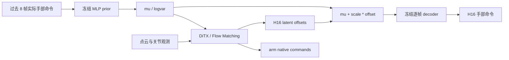
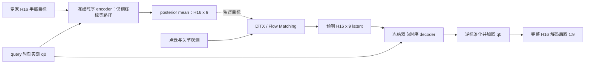

# LAMP-FM 与 Temporal-codec-FM：设计、实验与 Review 记录

> 记录日期：2026-10-14。研究范围：单灵巧手、Behavior Cloning、Flow Matching。
> 实验截至 `action_space_followup/2026-10-14_10-18-00` 完成；本文整理已有实现和产物，不代表新一轮训练。
> 当前代码、历史实验配置、论文方法是三个不同的事实来源，本文分别说明。历史结果以对应实验目录的 resolved config、checkpoint、JSON 和源码快照为准。

## 目录

1. [研究目标与当前结论](#1-研究目标与当前结论)
2. [证据与实验目录索引](#2-证据与实验目录索引)
3. [共同的数据、策略与执行约定](#3-共同的数据策略与执行约定)
4. [LAMP-FM 当前设计](#4-lamp-fm-当前设计)
5. [Temporal-codec-FM 当前设计](#5-temporal-codec-fm-当前设计)
6. [论文对应关系与复现边界](#6-论文对应关系与复现边界)
7. [历史实验时间线](#7-历史实验时间线)
8. [当前主要实验结果](#8-当前主要实验结果)
9. [诊断实验的定义与结果](#9-诊断实验的定义与结果)
10. [累计代码改动与验证范围](#10-累计代码改动与验证范围)
11. [配置、权重与复跑入口](#11-配置权重与复跑入口)
12. [后续 Review 与实验优先级](#12-后续-review-与实验优先级)

## 1. 研究目标与当前结论

### 1.1 目标

在现有 raw joint、SAT、DQ-RISE 的研究背景下，为单灵巧手操作增加两个可解释、可比较的结构化动作空间 baseline：

- **LAMP-style / LAMP-FM**：历史条件手部 prior、连续逐帧 decoder，与本项目 chunk Flow Matching 结合。
- **Temporal-codec-FM**：实测手姿条件化的时序 hand codec，与本项目 Flow Matching 结合。

当前工作不涉及 DAgger、RL 或真机运行。后续可研究这些动作接口在后训练中的用途，但本文没有其实现或性能结果。

本轮系列实验没有重新训练严格匹配的 raw joint / SAT / DQ-RISE 对照，因此不能据下表宣称新方法优于它们。

### 1.2 已有证据支持什么

| 条件 | 同一组 25 个开发场景的成功数 | 当前定位 |
|---|---:|---|
| LAMP-FM，`latent_loss_weight=1` | 5/25，20% | 原始 16k 对照、当前默认权重 |
| LAMP-FM，`latent_loss_weight=0.1` | **13/25，52%** | 新的 scratch16k 候选，尚未升级默认 |
| Temporal-codec-FM，`decoded_loss_space=standardized` | 1/25，4% | 当前默认；完整重跑可复现 |
| Temporal-codec-FM，`decoded_loss_space=physical` | 2/25，8% | 独立消融，尚无可靠改善证据 |

四项结果均为 **seed42 的 policy 训练、最终 16k EMA、NFE10、fresh-reset 仿真**。25 个场景已被多轮开发使用，不是独立最终测试集。LAMP 的新实验只新训 λ=0.1，λ=1 复用核查后的归档模型；Temporal 的两个条件都重新从头训练了 16k。[E5][e5]、[E6][e6] 保存详细协议。

当前判断：LAMP 的 latent 监督强度是得到实验支持的优化因素；Temporal 的基础数据/解码路径已核查，但闭环质量仍弱，尚未识别唯一原因。**实现自洽、表示可以重建、策略闭环有效、完整论文复现，必须分别判断。**

## 2. 证据与实验目录索引

### 2.1 外部依据

| 来源 | 本文使用方式 |
|---|---|
| [LAMP 论文：arXiv:2607.06323v1](https://arxiv.org/abs/2607.06323v1) | 历史 prior、连续 latent offset 控制接口、原始 BC 定义 |
| [LAMP 固定源码版本](https://github.com/dex-lamp/LAMP/tree/0467ba3504e0d199727a0586ba525c5fe14f8138) | 核对实际 encoder、数据索引、μ/logvar 条件及 BC 正则 |
| [Temporal 论文：arXiv:2609.19666v1](https://arxiv.org/abs/2609.19666v1) | §3、Eq.2–10、Appendix B、Table 3–5 的 codec/SFT 描述 |

LAMP 固定 commit 为 `0467ba3504e0d199727a0586ba525c5fe14f8138`。论文 PDF 的本地文件与 SHA 记录在 [source_references.json][paper-sources]；最近一次 LAMP 源码审计副本记录在 [sources/manifest.json][lamp-sources]。

E5 还核查过作者关联的 `wuji-technology/wuji-openpi`，固定 revision 为 `be6b32540546fb4fdd274f5cc86a7f9a67148a4c`。所检路径是 raw 54-D SFT，而非该论文的 Temporal hand codec 实现，不能用它消除 codec 细节歧义。此处仅描述当时核查的版本，详见 [E5 sources][wuji-sources]。

### 2.2 本地实验索引

以下编号用于全文交叉引用。目录时间是归档名称，不意味着目录下全部工作在该分钟完成。

| 编号 | 实验目录（相对仓库根目录） | 主要内容 |
|---|---|---|
| [E0][e0] | `experiments/action_space_16k/2026-10-13_16-19-52_seed42` | 初始表示预训练；LAMP、Temporal 各 scratch16k；训练/恢复审计 |
| [E1][e1] | `experiments/action_space_audit/2026-10-13_20-18-18` | LAMP inversion 正则；Temporal reference-noise 1k/5k 对照 |
| [E2][e2] | `experiments/action_space_baselines/2026-10-13_20-56-02` | fresh-reset 协议；5 场景 oracle；25 场景 BC；72 窗口；2k warmstart |
| [E3][e3] | `experiments/action_space_reaudit/2026-10-13_22-19-25` | 深度论文审计；LAMP 手/臂干预；Temporal 预训练、q0 与 metric 诊断 |
| [E4][e4] | `experiments/action_space_reaudit/2026-10-14_00-38-56` | 共享参数梯度、有限差分；physical decoded loss 选项与 smoke |
| [E5][e5] | `experiments/action_space_bc_ablation/2026-10-14_01-41-29` | Temporal 两种 decoded metric 各 scratch16k；LAMP 标签/几何诊断 |
| [E6][e6] | `experiments/action_space_followup/2026-10-14_10-18-00` | LAMP λ=0.1 scratch16k；1913 窗口；Temporal 手/臂干预与联合分布 |

这些链接指向本地实验产物，通常不随 Git 仓库分发。对外 review 时需另附所引用的 config、JSON、manifest 和必要图表；本文内的数值表可独立阅读。

旧报告中的“待运行”“待授权”“尚未验证”是当时状态。例如 E3 的 LAMP 干预后来已经完成，E4 提出的两项 scratch16k 对照分别在 E5/E6 完成。当前状态以本文和较晚产物为准，不修改旧记录来抹去过程。

## 3. 共同的数据、策略与执行约定

### 3.1 真实数据来源与划分

历史主实验使用 `robot_data/pick_apple_messy.zarr`：125 episodes、21,293 帧，数据形状和时序证据见 [E0 preflight_data.json][data-preflight]。

| 项目 | 历史主实验实际值 |
|---|---|
| `action` | `[T,19]`，物理关节位置目标，arm7 在前、hand12 在后 |
| `joint_state` | `[T,19]`，实测关节位置；与 command 不是同一数组 |
| `point_cloud` | `[T,1024,6]`，XYZRGB |
| 记录周期 | 约 `0.0625 s`，即 16 Hz |
| split | seed42、`val_ratio=0.1`、`max_train_episodes=80` |
| episode 数量 | train80 / val12 / 未用33 |
| 合格 policy windows | train13,073 / val1,913 |
| 唯一 action 源帧 | train13,633 / val1,997 |
| 窗口 | H16、Nobs2、执行 A8、pad_before1、pad_after7 |

两套 dataset 的 train/val masks、窗口索引及 observation/action 源行均核对一致。Temporal 相对动作统计按训练窗口总体拟合，重叠和 padding 重复计数；LAMP latent scale 按唯一训练 action 源行拟合，二者统计总体不同。

旧 Zarr 未保存 `obs_alignment` 和精确 source commit。依据历史采集器先保存 reset observation、再记录 step、最终对齐动作长度的逻辑，运行显式声明了 `dataset.obs_alignment=obs_before_action`。这是有生产代码证据支持的断言，不是原数据自带的 provenance，也没有为此改写 Zarr。

### 3.2 时间索引

设当前 query 为 `t`，`obs[t]` 位于 `action[t]` 执行之前。在非 padding 区域：

```text
观测输入：          obs[t-1], obs[t]
H16 动作目标：      action[t-1:t+15]  # Python 半开区间；最后一帧是 t+14
真正执行的切片：    pred_action[1:9] # action[t] ... action[t+7]
LAMP 历史：         action[t-8:t] 的 hand 部分
Temporal reference：joint_state[t] 的 hand 部分
```

因此本地 chunk 含一帧历史动作，不能把 H16 全部描述成未来 16 帧。episode 边界按 sampler 规则重复端点；Temporal 预训练的重建和差分损失没有单独 mask 掉 padding。

LAMP 的历史缺口使用 **episode 初始实测手姿** 补齐，不使用尚未执行的第一个 expert target。实测手姿和上一条命令不能互换：E6 的全源帧检查中，前一命令与当前 measured hand 的坐标 MAE 为约 `0.058253 rad`。

### 3.3 共享 BC 主干与训练配置

两种 Agent 都复用 `SATObsEncoder` 的 PointNeXT tokenizer 路径；类名中的 SAT 不表示启用了 SAT 动作空间。观测来自两帧 point cloud 和 joint state。

| 项目 | 配置 |
|---|---|
| 点云输入 | 1024 点，6 维；96 patches，token channels256 |
| PointNeXT 局部设置 | radii `[0.05,0.10]`，neighbors `[20,48]`；4 层、4 heads patch attention |
| proprio 输出 | state MLP 输出64维 |
| FM 主干 | DiTX，8 layers、hidden768、8 heads、MLP ratio4 |
| 训练 | batch128、8 workers、BF16、compile、EMA |
| 优化器 | AdamW，lr/obs_lr `1e-4`，weight decay `1e-6`，betas `[0.95,0.999]` |
| 调度 | warmup500，cosine 到 16k，gradient clip1 |
| 数据增强 | PC 坐标噪声、颜色增强、点丢弃；state 小幅噪声 |
| 评测 | 最终 EMA16k、NFE10；诊断使用 FP32 highest |

**当前 YAML 默认是 `total_train_steps=100000`、`dataset.val_ratio=0.0`；历史实验通过保存配置显式改为 16k 和 0.1。** 不应直接运行当前默认值后称其为本报告实验的复跑。

各方法的 latent 维数、条件信息和损失权重仍不同。共享主干不等于“只改了动作维数”的严格单变量对照。

### 3.4 Flow Matching 的统一记号

用 `s` 表示 flow time，以免与机器人 query 时间 `t` 混淆。令 `y` 为各策略的 native action target，`ε ~ N(0,I)`：

$$
x_s=(1-s)\epsilon+s y,\qquad v^*=y-\epsilon,
\qquad \hat y=x_s+(1-s)v_\theta(x_s,s,c).
$$

当前采样为 `s = 0.999 × Beta(1,1.5)`，默认无额外 time shift。`hat y` 是训练时的一步 clean estimate，用于 decoded loss；推理则从噪声进行完整 flow 积分。两种误差口径不能混为一谈。

### 3.5 运行与恢复

两套模型均输出物理关节命令 `pred_action`、执行段 `control_action` 和未执行的 `tail`。环境继续实施 joint-limit clipping。

LAMP 在 reset 时初始化历史，并在每一个实际 `env.step` 后读取 `info['executed_joint_action']` 更新历史；未执行的预测 tail 不进入历史。Temporal 推理取当前原始 measured hand state 为 q0，训练由 dataset 显式提供增强前的同一 reference。

prior/codec 和归一化统计随 policy checkpoint 内嵌；独立恢复推理不需要重新打开外部表示文件。新的训练和续训仍需核对数据与表示产物。当前两套 Agent 的实现只支持同步 chunk 调用，RTC 参数非零会明确拒绝；真机链路未验证。

## 4. LAMP-FM 当前设计

主要代码：[hand_prior/lamp.py][lamp-prior]、[core/lamp_flow.py][lamp-agent]、[lamp_dataset.py][lamp-data]。

### 4.1 历史 prior 的 encoder 和 decoder

`HandMotionPrior` 的 encoder 输入是 K8 条过去的手部 **command target**，不是未来动作，也不是当前 target 的 autoencoder：

$$
(\mu_t,\ell_t)=E(N_h(a^h_{t-8:t})),\qquad \ell_t=\log\sigma_t^2.
$$

`N_h` 是表示产物保存的手部 affine normalization。96 维历史展开后经过 `Linear→SiLU→Linear→SiLU`，hidden256，再由两个线性 head 输出 Z2 的 μ 和 logvar。

decoder 为 `2→256→256→12` 的 MLP，中间使用 SiLU。它逐帧把绝对 latent 解码为归一化手部命令，没有时间 attention，也不额外接收 q0。



### 4.2 prior 预训练

入口为 [train_lamp_prior.py][lamp-train]。在训练源帧上，以 history 编码、重参数化采样 latent、重建下一条命令：

$$
z=\mu+\exp(\ell/2)\epsilon,\qquad
L_{prior}=\operatorname{MSE}(D(z),N_h(a^h_t))+
\beta\operatorname{mean}\left[-\tfrac12(1+\ell-\mu^2-\exp\ell)\right].
$$

历史主实验使用默认 pretrain 参数：20k updates、batch256、AdamW、lr `2e-3`、warmup500、cosine minimum lr `1e-5`、weight decay `1e-4`、clip1。β 在前2k线性升至 `1e-3`；history 噪声标准差0.01，以归一化关节坐标定义。

有验证集时按 `D(mu)` 的验证 normalized MSE 选择模型；本次选中20k。没有验证集时保存最终模型。预训练 history noise 不等于 BC 阶段对在线历史做同样增强；当前 BC history 没有这项噪声。

### 4.3 离线反演与标签缓存

入口为 [export_lamp_latents.py][lamp-export]。对每个合格的唯一源帧 r：

$$
z_r^*=\arg\min_z\;\operatorname{mean}_j(D(z)-N_h(a^h_r))^2
+\gamma\operatorname{mean}_k(z-\mu_r)^2.
$$

这里是有限步数值反演，不是求得了数学上的全局最优。默认 `γ=center_penalty=0`；初始化为该源帧历史 μ，Adam100步、lr0.05。逐样本选择最优迭代，并把初始化包含在候选中；反传时对逐样本目标求和，避免 batch size 改变每样本优化尺度。

缓存保存 **每个源帧唯一的 absolute latent**。只导出 train/validation 所需源行；验证目标参与标签构建，但不参与 prior 优化或统计拟合。`latent_scale` 是唯一训练源帧 absolute latent 的逐维 population std，下限 `1e-6`，不是 offset 的 std。

artifact 会校验数据指纹、历史定义、bootstrap、split、源行和 prior SHA。相同源帧在重叠窗口中复用同一个标签。

### 4.4 BC 坐标与损失

一次 query 的全部 H16 标签共用当前 μ：

$$
u_{t,h}=\frac{z^*_{r(t,h)}-\mu_t}{s_z},\qquad
y_{t,h}=[N_a(a^{arm}_{r(t,h)}),u_{t,h}].
$$

非 padding 区域 `r(t,h)=t−1+h`。policy native action 维数为 `7+2=9`。μ/logvar 拼接到观测条件 token；`s_z` 只参与坐标缩放。推理解码为：

$$
\hat a^h_{t,h}=N_h^{-1}\!\left(D(\mu_t+s_z\hat u_{t,h})\right).
$$

**偏移不乘 posterior σ，也不经过 tanh。** 在执行整段 chunk 时不为未来每一帧重新构造中心；下一次 query 才使用更新后的历史。

arm/latent 的 FM velocity MSE 分别在各自坐标和完整 H 上取均值：

$$
L_{LAMP-FM}=\frac7{19}L_{arm}
+\frac{12}{19}\lambda_{lat}L_{latent}
+\lambda_{dec}L_{decoded}.
$$

`L_decoded` 使用 clean estimate 经 decoder 后的 **prior-normalized hand MSE**。默认 `λ_lat=1`、`λ_dec=1`。`12/19` 按物理 hand 组维数定义，不是 native latent 的2维占比。

降低 `latent_loss_weight` 只改变 latent FM 项系数，不改变标签、推理解码或 arm/decoded 项权重。冻结 decoder 的参数，但保留对 policy latent 的梯度。

## 5. Temporal-codec-FM 当前设计

主要代码：[hand_prior/temporal_codec.py][temporal-codec]、[core/temporal_codec_flow.py][temporal-agent]、[temporal_codec_dataset.py][temporal-data]。

### 5.1 相对动作与 reference

输入为物理手部 command chunk `A ∈ R^(B×H×12)` 和 query 时刻实测 `q0 ∈ R^(B×12)`：

$$
\tilde A_{h,j}=\frac{A_{h,j}-q_{0,j}-m_j}{s_j}.
$$

`m,s` 由训练集的实际 policy windows 拟合，包含重叠和 padding，std floor 为 `1e-6`。q0 token 使用原始物理手姿；只有动作位移按上述公式标准化。

### 5.2 时序 VAE 结构

encoder 和 decoder 各3层双向 Transformer，hidden128、4heads、MLP ratio2；本地 block 使用 Pre-LN、GELU、dropout0、可学习时间位置编码，层参数分别初始化。

encoder 序列为一个独立投影的 q0 prefix token 加 H 个相对动作 token，输出每帧 Z9 的 μ/logvar。decoder 序列为 q0 token 加 H 个 latent token，输出 H×12 标准化相对命令。

$$
(\mu_{1:H},\ell_{1:H})=E(A,q_0),\qquad
\hat A=D(z_{1:H},q_0)\odot s+m+q_0.
$$

时间长度始终是 H；这是每帧降维、跨帧建模，不是把整段 chunk 压成一个9维向量。H16 时 hand latent 总计144个标量。



推理不使用专家目标，也不调用 target-conditioned encoder；encoder 只用于预训练、BC 标签和 oracle/诊断。

### 5.3 codec 预训练损失

入口为 [train_temporal_codec.py][temporal-train]。预训练使用 sampled posterior，而非只重建 μ。令 `Δ^k` 为沿时间轴的离散 k 阶差分：

$$
L_k=\frac{1}{B(H-k)J}
\sum_{b,h,j}w_j\operatorname{Huber}_{\delta=1}
\left(\Delta^k\hat{\tilde A}_{b,h,j}-\Delta^k\tilde A_{b,h,j}\right),
\quad J=12,
$$

$$
L_{codec}=L_0+0.2L_1+0.05L_2+\beta L_{KL},
\qquad L_{KL}=-\tfrac12\operatorname{mean}_{B,H,Z}(1+\ell-\mu^2-e^\ell).
$$

关节权重按本地 XHand 顺序为 `[1,1,1,1,1,1,1,1,0.5,0.5,0.5,0.5]`：thumb/index/middle 为1，ring/pinky 为0.5。分母仍为有效时间帧数乘关节数，不按权重之和归一化。差分没有除以 dt；名称 velocity/acceleration 不代表物理 rad/s 或 rad/s²。

历史预训练为30k updates、nominal batch4096、AdamW lr `3e-4`、cosine、weight decay `1e-4`、clip1。13,073个窗口产生循环 batch `4096/4096/4096/785`，并非每一步都4096。

KL 前4k为0，随后4k ramp 到 `3e-4`。每1k验证，按 full-H、posterior-mean **物理关节 MAE** 选点。本次实际保存的是 **step6000、β=1.5e-4**，其全1,913窗口验证 MAE 为 `0.00194824 rad`；不是30k末态。

可选 `--reference-noise-std` 默认0。非零时仅扰动训练 q0，physical targets 保持原值；E/D 和相对目标共用扰动后的 reference，独立 RNG 不改变 posterior-noise 序列。它是本地鲁棒性实验选项，不是论文 baseline 要求。

### 5.4 BC 标签、损失与解码

冻结 encoder 在线计算 posterior mean，不采样、不做 inversion cache，也没有额外对 μ 做 affine whitening：

$$
y_{t,h}=[N_a(a^{arm}_{r(t,h)}),\mu_h(A,q_0)].
$$

native action 维数为 `7+9=16`。当前损失为：

$$
L_{Temporal-FM}=L_{arm}+0.25L_{latent}+0.75L_{decoded}.
$$

三项各自取完整 batch/time/组内坐标均值。decoded loss 使用训练 clean estimate，并允许两种明确配置：

| `decoded_loss_space` | 物理误差记作 e 时的目标 | 当前用途 |
|---|---|---|
| `standardized` | `mean((e_j / s_j)^2)` | 默认及原始 baseline |
| `physical` | `mean(e_j^2)`，rad² | 只改变 BC 损失的消融 |

同一个 q0 和 m 在误差中抵消，故 physical 分支直接将标准化误差乘 `action_std`。此选择同时改变关节相对权重与整体梯度幅度；不是只换日志单位。

推理必须先解码完整 H16，再取 `[1:9]`。双向 attention 使得“先裁 latent 再解码”通常不等价。BC 期间 codec 权重保持冻结，但 decoded loss 可以经过 decoder 向 latent/policy 反传。

## 6. 论文对应关系与复现边界

### 6.1 LAMP：保留控制接口，BC 目标是本地适配

论文的 history prior 和连续 `D(mu+delta)` 接口是本地设计依据。公开代码实际使用 μ/logvar 作为 policy 条件；论文记号中出现 σ，不能据此给本地 offset 擅自乘 σ。原始论文与固定代码分别见 [LAMP 论文](https://arxiv.org/pdf/2607.06323)、[policy_jax.py](https://github.com/dex-lamp/LAMP/blob/0467ba3504e0d199727a0586ba525c5fe14f8138/imitation_learning/common/model/policy_jax.py)。

| 层面 | 原论文/公开实现与本地的关系 |
|---|---|
| encoder 信息 | 都只读过去手部历史；本地落实为 command target 历史 |
| decoder | 保留连续逐帧 decoder |
| 数据时间 | 上游以含 `actions[t]` 的历史预测 `actions[t+1]`；本地 before-action 约定要求历史止于 `t−1`，预测 `action[t]` |
| BC | 原始为 decoded action 监督的确定性 head；本地为 chunk FM，加离线反演标签 |
| 正则 | 论文 Eq.6 为 latent-offset L2；所读公开默认 BC 是 decoded-action drift；本地两者均未直接照搬 |
| 本地额外选择 | hand12、Z2、H16、固定 query center、train-only latent scale、clean-endpoint decoded loss |

本地没有给整个未来 chunk 加“回缩到当前 prior 姿态”的 drift。LAMP 的准确名称应保留 **LAMP-style / LAMP-FM**，而非“官方 LAMP BC 完整复现”。完整审计见 [E6 reproduction boundary][lamp-boundary]。

### 6.2 Temporal：明确机制与未公开细节分开记录

论文 Eq.2–7、Table4 支持 relative measured-q0、每帧 posterior、时序 E/D、q0 token 和时序重建；这些在本地源码中有对应路径。详细逐项证据见 [论文 PDF](https://arxiv.org/pdf/2609.19666) 和 [E3 审计表][temporal-audit]。

| 项目 | 本地事实与边界 |
|---|---|
| 时间方向 | 本地 noise→data；令 `s=1−t_paper`、`v_local=−v_paper` 后 clean estimate 等价，不是符号错误 |
| KL reduction | 本地 `mean(B,H,Z)`；论文未公开作者代码归约，不能宣布某一种 sum 是唯一正确实现 |
| KL 强度 | `mean(B,H) sum(Z)` 是本地值的9倍；完整 chunk 求和是144倍；相同 β 数字不保证同一目标 |
| SFT 三组损失 | 本地分别取 mean；若把论文 squared norm 理解成 sum，组间权重不再只差一个公共常数 |
| decoded 单位 | Eq.10 的 preprocessing 边界不足以消除歧义；standardized/physical 均需明确标注 |
| Transformer 细节 | q0 token 有文献依据；prefix、Pre-LN、GELU、可学习位置等是明确的本地实现选择 |
| 参数量 | 本地 hand12/H16 为809,886；换成论文 hand20/H32 仍为818,086，低于表中约851.4K；差异未定位，不能为凑数猜一层 |
| 选模 | best validation MAE 选到6k符合记录的选择规则；不能把“强制 ramp 后选点”冒充论文要求 |
| 窗口/执行 | 本地 H16 含一帧过去动作、执行8；论文为未来 H32、执行25 |
| 硬件/主干/数据 | 本地 hand12、单臂绝对关节命令、从头 PointNeXT/DiTX、80条任务示范；不同于论文 hand20、双臂/VLA 和大规模预训练条件 |

论文后续 RL 的 reference dropout 或 latent envelope 不能直接作为 BC 缺失项补入。当前没有证据把这些复现选择中的任一项认定为低成功率的唯一原因。

### 6.3 如何表述验证结论

独立公式/有限差分验证证明的是 **给定本地定义下的实现自洽**；本地重复训练证明的是 **同一程序的可重复性**；oracle 重放证明的是 **部分专家计划经该表示仍可执行**。这些都不能单独证明作者未公开细节已完全复刻，也不能把原论文最终后训练成功率移植为本项目 BC 的预期成绩。

## 7. 历史实验时间线

### 7.1 E0：表示预训练与首轮各16k BC

先训练 LAMP prior20k并选中20k，反演100步；再预训练 Temporal codec30k并按验证 MAE 选中6k。两套 policy 依次各训练16,000个 optimizer updates，每套处理2,048,000个窗口。

optimizer/scheduler/EMA 的 step、有限参数、冻结表示、checkpoint 恢复和实际解码均检查通过。早期5个种子的记录为 LAMP3/5、Temporal0/5；这批场景及环境复用协议与后来的 fresh25 不同，**保留作历史记录，不进入当前主结果表**。相关最初判断的强度也被后续审计收紧。[E0][e0]

### 7.2 E1：两个默认关闭的表示优化选项

**LAMP inversion center penalty。** 比较 `γ=0` 与 `1e-4`，覆盖13,633个train及1,997个val唯一源帧：

| 指标 | γ=0 | γ=1e-4 |
|---|---:|---:|
| val physical hand MAE（rad） | 0.009054 | 0.009128 |
| train 相同相邻目标的 raw latent 最大跳变 | 5.0549 | 1.9989 |
| train 相同相邻目标的 raw latent 跳变 P95 | 0.00398 | 0.05825 |
| val 相同相邻目标的 raw latent 跳变 P95 | 0.00374 | 0.05112 |

极端跳变降低，但重建与更广泛的跳变分布变差；按各自 latent scale 转为 FM 坐标也未得到整体改善。默认保留0。默认0重新导出的关键缓存张量与原缓存逐位一致。[E1][e1]

**Temporal reference-noise continuation。** 从原6k codec 出发，分别做1k和5k配对续训；每对只改 q0 Gaussian noise std0/0.05 rad。均使用新 AdamW、batch512、lr1e-4 cosine、固定窗口和 posterior-noise 序列。这不是原30k pretraining，也没有配套重训 BC。

| control-slice physical MAE（rad） | 1k 无噪声 | 1k noise0.05 | 5k 无噪声 | 5k noise0.05 |
|---|---:|---:|---:|---:|
| clean validation | 0.001595 | 0.005252 | 0.002248 | 0.005097 |
| val q0 Gaussian std0.05 | 0.061740 | 0.012243 | 0.056951 | 0.005819 |
| val q0 Gaussian std0.10 | 0.111551 | 0.033071 | 0.104425 | 0.014137 |

人工 reference 扰动下的重建改善，clean 精度恶化；旧策略5条 executed-command trace 仅2条重建改善。这里“2/5”是轨迹误差改善数，不是任务成功率。没有把这些 probe 权重替换进旧 policy；默认 noise仍为0。

### 7.3 E2：修正评测协议、oracle 与2k warmstart

专家重放发现复用环境会留下小幅状态差异，故两份默认配置显式设置 `clear_cache_freq=1`。旧结果全部保留。

| 相同16k checkpoint 的25场景评测 | LAMP | Temporal |
|---|---:|---:|
| 旧环境复用协议 | 3/25 | 0/25 |
| fresh-reset 协议 | **5/25** | **1/25** |

fresh25 在最初选取时排除了125条示范及早期5个诊断 seed；后来反复用于开发，所以现在必须称开发场景。

固定5个源验证场景的 raw expert、LAMP cached oracle、Temporal E→D oracle 均5/5成功。增加正确观测上的72窗口诊断，明确 oracle、policy 和训练支持距离是不同指标，详见第9章。

另从各自16k EMA做2k warmstart：以该 EMA 初始化 raw model及新EMA，使用新optimizer、scheduler、EMA counter，lr5e-5、warmup100。它不是原始 optimizer/RNG 的精确 resume，也不是从头18k。

| 条件 | fresh25成功数 |
|---|---:|
| 原 LAMP16k | 5/25 |
| LAMP EMA16k→2k，λ=1 | 8/25 |
| LAMP EMA16k→2k，λ=0.1 | 8/25 |
| 原 Temporal16k | 1/25 |
| Temporal EMA16k→2k，原损失 | 1/25 |

LAMP两支共同成功5个、各自独有3个；没有证据表明在该短追加阶段 λ=0.1 更好。Temporal成功场景也发生替换，不能把相同1/25理解为轨迹完全相同。[E2][e2]

### 7.4 E3：论文细节与参考条件审计

审计明确记录了 Temporal KL reduction、三组 loss reduction、decoded 单位、Transformer参数量及窗口约定的不确定性，没有把任意一种猜测包装成 bug 修复。

复算 Temporal train mean/std 与产物误差小于 `1.4e-8`，没有发现验证集统计泄漏。抽样256个val windows、每个8次 posterior samples：mean重建 MAE约 `0.001927`，sample重建约 `0.002807 rad`；没有发现典型 posterior collapse 或数值下溢。原6k最后一个训练日志点中 `β×KL≈0.0003674`、reconstruction约 `0.0001225`，不能据 β 小就认定 KL 可忽略。

完整 E→D 的 q0 扰动试验显示明显敏感性；之后 LAMP 手/臂干预在授权后完成：完整policy1/5、expert arm＋policy hand5/5、policy arm＋cached expert hand0/5。诊断含义见第9章。[E3][e3]

### 7.5 E4：共享梯度与 physical loss 入口

在实际共享参数上分别计算带权 arm/latent/decoded 梯度，并用有限差分验证。旧LAMP在18组固定“batch×flow time”中，有9组沿总梯度的足够小 SGD 下降方向会使同批 arm loss 上升；把 latent 梯度乘0.1后为3/18。Temporal为0/18。

这给出降低 LAMP latent 权重的动机，但不是 AdamW 训练轨迹或闭环改善的证明。同期新增 `decoded_loss_space`，通过46项Temporal测试、config smoke、真实数据2-update BF16/compile/EMA训练和恢复检查。[E4][e4]

### 7.6 E5：Temporal 两种 metric 各 scratch16k

同一 frozen codec、相同模型初始化及全部RNG、同一数据和训练配方，分别训练 standardized/physical。两个条件的 step、LR、processed windows、flow-time 日志逐项匹配。

standardized 的最终 raw/EMA 各374个状态张量与最初Temporal16k逐位相同；72窗口输出和fresh25逐场成功、成功步数、总步数也复现。physical 从1/25变为2/25，但丢掉原唯一成功场景，且手部与时序误差恶化，因此不升级默认。

LAMP诊断进一步确认：相同完整输入的反演缓存基本一致；固定零起点反演的val MAE由约0.009055恶化至0.012045 rad，约差33%，未采用。更多结论见第9章。[E5][e5]

### 7.7 E6：LAMP scratch16k 候选与Temporal后续诊断

新训练 λ=0.1 的 LAMP16k，耗时约38分22秒；复用经过归档代码、配置和初始化核查的 λ=1 对照。160个日志位置的 step/LR/flow time/processed windows 完全匹配。旧对照没有 step0 RNG hash，因此不声称本轮逐步重放了全部旧训练。

完成两条件各1,913个验证窗口、新候选72窗口与25场景评测；Temporal新增15个手/臂干预回合、reference诊断和联合latent分布分析。该轮合计新增40个仿真回合。

训练期间共享工作区出现其他并行改动；评测固定到启动时146文件源码快照，并逐模块校验加载路径与SHA，未覆盖工作区改动。训练相关import和构造先于已记录的改动时间，未发生重启/热加载；没有做运行进程的bytecode attestation。完成记录为 [verification.json][latest-verification]，含315个产物哈希。[E6][e6]

## 8. 当前主要实验结果

### 8.1 指标口径

本文的 arm/hand MAE、RMSE 都在物理关节命令空间、以rad计。除明确标为 full-H 外，取完整解码后的执行切片 `[1:9]`。

- **72窗口**：12个val episodes，每集query40/48/56/64/72/80，正确且未增强的示范观测、逐窗口采样。
- **全验证1,913窗口**：所有合格val窗口，包含重叠与padding，batch32，policy seed为 `290001 + batch index`。
- **闭环25场景**：fresh environment、配对物理初始化/初始点云、最终EMA、NFE10；policy噪声按episode seed固定。

1,913个重叠窗口不是1,913次独立试验；72窗口与全验证的采样RNG/批量不同，只能在各自协议内部比较。主表的SR来自环境返回的成功状态，不是仅靠低MAE、物体抬起或某一帧原始成功条件判定。

### 8.2 LAMP：降低 latent 权重的完整验证结果

数据来自 [E6 full_validation/summary.json][lamp-fullval]。

| 指标 | λ=1 | λ=0.1 | 变化 |
|---|---:|---:|---:|
| arm MAE | 0.051898 | 0.036959 | −28.78% |
| hand MAE | 0.015669 | 0.014863 | −5.15% |
| arm RMSE | 0.083862 | 0.059712 | −28.80% |
| hand RMSE | 0.027973 | 0.026283 | −6.04% |
| cached oracle hand MAE | 0.009442 | 0.009442 | 标签/解码逐位相同 |
| full-H native latent endpoint MSE | 0.252157 | 0.220606 | 同一native坐标内比较 |

arm MAE在12/12个episode改善；hand MAE在7/12改善。两个条件的targets、oracle和latent labels逐位相同。

抓取阶段的72窗口提供了不同侧面：

| 指标 | λ=1 | λ=0.1 |
|---|---:|---:|
| arm MAE | 0.056523 | 0.037703 |
| hand MAE | 0.017771 | 0.018833 |
| hand RMSE | 0.024879 | 0.029296 |
| oracle hand MAE | 0.014638 | 0.014638 |
| hand 一阶差分误差，rad/frame | 0.003014 | 0.003503 |
| hand 二阶差分误差，rad/frame² | 0.004022 | 0.004076 |

抓取窗口hand MAE增加约5.97%，一阶差分误差增加约16.2%。全验证均值改善并不等于接触阶段的手部精度全面改善。差分误差是 prediction−expert 的差分误差，不是直接测量物理 jerk。

fresh25：5/25→13/25；共同成功3个，旧条件独有2个，新条件独有10个。Wilson95%区间分别约 `[8.9%,39.1%]`、`[33.5%,70.0%]`。配对exact McNemar p约0.0386只作描述；单训练seed、重复使用的开发集不足以形成独立确认性结论。

最后1k中的10个日志采样点均值：arm velocity loss约0.004545→0.001928，latent velocity loss约0.013030→0.021600，decoded loss约0.000890→0.000882，gradient norm约1.4457→0.1885。它们不是全部1,000个batch的均值；训练velocity loss与ODE终点误差也不是同一指标。

![LAMP训练与开发集结果；左下为72窗口，而非1913窗口][lamp-figure]

图中的左下离线误差使用72个抓取窗口。完整验证结果以本节第一张表及其JSON为准。

### 8.3 Temporal：decoded metric 对照

来自 [E5 comparison.json][temporal-comparison]，离线部分统一为72窗口。

| 指标 | standardized | physical |
|---|---:|---:|
| fresh25成功数 | 1/25 | 2/25 |
| arm MAE | 0.042896 | 0.040248 |
| hand MAE | 0.013256 | 0.014926 |
| arm RMSE | 0.076221 | 0.069114 |
| hand RMSE | 0.025906 | 0.028764 |
| oracle hand MAE | 0.001985 | 0.001985 |
| full-H latent endpoint MSE | 0.071684 | 0.081755 |
| hand 一阶差分误差，rad/frame | 0.001939 | 0.002276 |
| hand 二阶差分误差，rad/frame² | 0.002258 | 0.002794 |

physical 的arm MAE下降约6.17%，hand MAE上升约12.60%。standardized独有成功seed15744；physical独有18200、24471；没有共同成功。描述性exact McNemar p=1.0既不能证明改善，也不能证明两者等效。

这项实验没有支持“BC decoded loss换成physical就修好了Temporal”的判断。默认仍为standardized。

### 8.4 跨方法阅读限制

在正确观测72窗口上，Temporal原始hand MAE优于LAMP原始值，但hand RMSE略差，闭环成功率也较低。这反映表示重建、生成误差尾部和闭环状态分布是不同维度。

不能拿两方法的训练总loss直接排名，也不能把 `policy MAE − oracle MAE` 当成严格可加的生成误差分解。LAMP的有限步反演oracle并非已证明的物理误差下界；方法间latent坐标、维数和权重也不同。

## 9. 诊断实验的定义与结果

### 9.1 表示 oracle：已知专家目标时能否执行

固定验证episode10/11/24/51/65，对应seed969/1081/1813/3761/5096。每回合新建环境：

| 模式 | 实际执行 | 成功数 |
|---|---|---:|
| raw expert replay | 示范中的arm和hand命令 | 5/5 |
| LAMP cached oracle | 专家arm＋缓存absolute latent经decoder得到的hand | 5/5 |
| Temporal E→D oracle | 专家arm＋用live q0编码/解码专家未来hand chunk | 5/5 |

三者成功步数均为148/152/155/162/175。raw replay成功前的pre-action measured joint states与源轨迹对应前缀逐位相同；源episode尾部各11步未执行。LAMP每集hand command MAE约0.00656–0.01162 rad，Temporal约0.00278–0.00541 rad。[E2][e2]

这些模式使用未来专家动作，因此不是 learned-policy SR，也不是“raw joint BC baseline”的结果。它们说明这些专家计划可以通过表示执行，不覆盖所有非专家状态。

源数据的部分physics metadata为NaN，不能证明历史质量/摩擦等配置完全相同；当前配对初始化和实际轨迹重放的证据仍成立。早期v1的fingerprint gate阻塞不计为任务失败，后续使用v2协议。

### 9.2 手/臂干预：expert arm＋policy hand 的准确含义

这是**只在评测中替换动作分量**的诊断。模型仍基于当前仿真观测产生整段动作；执行时把其中一部分换成示范对应源时间的命令。

$$
a^{hybrid}_t=[a^{expert,arm}_t,\;a^{policy,hand}(o^{live}_t)]
$$

即7维arm来自示范，12维hand来自当前策略。机器人仍经过正常动力学和clipping执行，不是强制传送到专家状态。policy使用live观测、live q0或实际执行历史，而不是整段教师强制回放。

反向干预保留policy arm，替换hand。专家分量按源时间索引，源轨迹结束后保持最后命令；它不会根据混合轨迹的进度重新规划。

| 干预 | 原LAMP16k，E3 | Temporal standardized16k，E6 |
|---|---:|---:|
| full policy | 1/5 | 1/5 |
| expert arm＋policy hand | 5/5 | 5/5 |
| policy arm＋expert hand | 0/5 | 2/5 |

**最后一行两方法的expert hand不同**：LAMP用缓存latent解码的命令，Temporal用raw source hand command，不能把0/5与2/5视为完全相同干预下的严格方法比较。

Temporal完整策略仅episode10成功；替换hand后51/65成功，但10失败。完整策略中11/24未抬起2cm；51抬起约20.62cm但未到目标XY区域；65接近目标却触发杂物位移失败。证据支持继续研究arm生成与手臂协同，不能推导“手部完全解决”或“全部失败只由arm导致”。[E6 Temporal报告][temporal-followup]

### 9.3 LAMP 标签复杂性与梯度

E3按唯一训练action源行拟合PCA，前两维解释约99.8975%物理动作方差。这不证明所有精细接触都只需2维，但反对仅凭Z2认定容量是当前主瓶颈。E2按另一训练query总体得到99.8906%，两数的统计总体不同。

E5检查15,630个有效源帧：相同目标加相同完整history的重复输入组，其normalized latent最大组内差异约 `5.875e-6`；明显的缓存随机不一致不是当前支持的解释。同一目标配不同history可落到decoder弱敏感方向上的不同反演解。

原16k policy在72窗口执行段的latent平方误差中，约97.39%落在decoder的局部弱方向；局部condition number中位数约54。降低λ后的该比例仍约97.62%，但强弱两方向误差的绝对量都下降。局部线性几何不保证整条非线性路径等价，不能据此直接删掉弱坐标。

共享梯度诊断使用24个固定观测窗口、6批、`s=0.1/0.5/0.9`，共18组：

| 条件 | 使同批arm loss局部上升的组数 | median `norm(g_lat+g_dec)/norm(g_arm)` |
|---|---:|---:|
| 原LAMP带权目标 | 9/18 | 29.385 |
| 同一模型的latent梯度乘0.1 | 3/18 | 2.938 |
| 原Temporal带权目标 | 0/18 | 2.489 |

第二行是梯度代数反事实，不是新训λ=0.1模型。统一两方法的标量损失系数后，LAMP仍有4/18冲突、比例约4.285，说明29倍本身也受损失权重影响，不能视为独立的表示属性。

有限差分验证了局部方向判断，但实际AdamW、gradient clipping、跨batch和EMA会改变训练轨迹。E6的scratch16k结果支持监督强度优化，却没有唯一确认“弱方向梯度”就是全部因果机制。[E4][e4]、[E5][e5]、[E6][e6]

### 9.4 Temporal reference 鲁棒性与阶段错位

E3固定physical专家目标、扰动q0后**重新encode和decode**，在72窗口的full-H上得到：

| q0扰动的每样本joint RMS（rad） | E→D hand MAE（rad） |
|---:|---:|
| 0 | 0.002282 |
| 0.001 | 0.002425 |
| 0.01 | 0.008570 |
| 0.05 | 0.062574 |
| 0.10 | 0.118045 |

这是人工扰动分布上的reference敏感性证据，与第7.2节Gaussian std的定义、执行段口径不同，数值不能直接混合。

E6则对真实闭环query作分解，以下只统计源轨迹结束前：

| physical MAE（rad） | full policy | expert arm＋policy hand | policy arm＋raw expert hand |
|---|---:|---:|---:|
| 源时间专家目标＋live q0，重新E→D | 0.099457 | 0.007602 | 0.004685 |
| 同一专家目标＋source q0，重新E→D | 0.001470 | 0.001522 | 0.001491 |
| policy自身输出的E→D round trip | 0.006068 | 0.000986 | 0.001717 |

full policy 的0.099457混入了源时间目标与当前策略动作阶段的错位，不能直接称为“decoder无法表示policy动作”。固定源latent后换q0，输出近似随q0移动，也包含relative动作定义中的显式 `+q0`，不构成shortcut证明。

同设备验证方面：E6的374次query在原CUDA、batch1下重编码/解码与保存输出逐位一致。最初CPU `<2e-5 rad` 检查未通过，最大差约 `9.98e-5 rad`；保留失败日志并单列CPU/GPU数值差异，没有靠放宽原阈值或改模型来宣布通过。

### 9.5 Temporal 的联合 latent 分布

逐坐标min/max不是充分的支持检查。E6使用13,073个训练window的posterior mean拟合完整144维chunk的协方差/PCA，再评估原始val和rollout：

| 总体 | chunk数量 | joint score超过train P99 | PCA99.9%子空间残差超过train P99 |
|---|---:|---:|---:|
| 全validation | 1,913 | 0.16% | 0.31% |
| standardized的25场景rollout | 617 | 15.07% | 2.76% |
| physical的25场景rollout | 628 | 18.63% | 2.55% |
| standardized正确观测policy | 72 | 0% | 0% |
| physical正确观测policy | 72 | 0% | 0% |

这里joint score使用正则化协方差的Mahalanobis距离，eigenvalue floor为最大eigenvalue的 `1e-6`；P99由训练集经验分布确定。90/95/99/99.9%方差对应rank6/9/18/39，participation ratio约4.1536。

它是全局描述性统计，没有建模q0条件或多模态，也不是校准的失败概率。三条成功轨迹都没有高joint-score query，但很多失败轨迹也没有，因此不能当成成功/失败分类器。

E5还发现rollout q0明显偏离训练逐维范围；这既可能影响解码，也可能是已有控制错误的后果。成功episode同样可能越出该范围，不能单向作因果推断。

![Temporal分量干预、reference与联合分布诊断][temporal-figure]

## 10. 累计代码改动与验证范围

### 10.1 本研究新增与修改

| 类别 | 文件 | 职责 |
|---|---|---|
| LAMP表示 | [hand_prior/lamp.py][lamp-prior] | 历史encoder、pointwise decoder、冻结、反演和artifact载入 |
| LAMP策略 | [core/lamp_flow.py][lamp-agent] | native offset FM、条件融合、decoded loss、推理解码 |
| LAMP数据 | [lamp_dataset.py][lamp-data] | causal history、bootstrap、source-row标签和缓存身份 |
| LAMP离线入口 | [train_lamp_prior.py][lamp-train]、[export_lamp_latents.py][lamp-export] | 预训练与绝对latent缓存导出 |
| Temporal表示 | [hand_prior/temporal_codec.py][temporal-codec] | relative q0、时序VAE、weighted Huber、artifact载入 |
| Temporal策略 | [core/temporal_codec_flow.py][temporal-agent] | 在线posterior-mean标签、两种decoded metric、完整解码 |
| Temporal数据/入口 | [temporal_codec_dataset.py][temporal-data]、[train_temporal_codec.py][temporal-train] | raw q0、窗口身份、train统计和codec预训练 |
| 配置 | [lamp_flow.yaml][lamp-config]、[temporal_codec_flow.yaml][temporal-config] | 两套baseline和默认关闭的研究选项 |
| runtime/smoke | [base_runner.py][runner]、[smoke_test.py][smoke] | LAMP实际执行历史；smoke透传action_context并检查恢复 |
| 使用说明 | [README.md][readme] | 稳定入口、适配边界与选项说明 |

另有 `agents/hand_prior/__init__.py` 和7个定向测试文件：`test_lamp_prior.py`、`test_lamp_dataset.py`、`test_lamp_flow.py`、`test_temporal_codec.py`、`test_temporal_codec_dataset.py`、`test_temporal_codec_flow.py`、`test_train_temporal_codec.py`，均位于 [tests/][tests]。

功能变化的主要顺序为：先完成两套最小端到端路径；E1增加默认关闭的inversion center penalty/reference noise与产物诊断；E2增加LAMP latent loss权重并固定fresh-reset；E4显式化Temporal decoded metric；E5/E6只增加实验目录下的脚本、配置、权重和分析产物，没有在这两轮改动生产模型默认值。

当前Git工作区还包含其他并行工作对通用训练、resume、augmentation、RGB等模块的修改，不全部归属本研究。E6的 [concurrent_source_review.json][concurrent-review] 只记录当时识别的部分，并非当前工作区所有修改的完整归属清单。不能据它宣称目前整个生产树与旧训练完全相同。

### 10.2 已执行的验证及其边界

| 验证 | 历史状态 | 能说明什么 |
|---|---|---|
| E1定向pytest | 72 passed | 当时prior/dataset/flow/训练选项的定向行为 |
| E2定向pytest | 76 passed | 包括新增权重与数据/执行契约；与E1有重复，不能相加 |
| E4 Temporal pytest | 46 passed | 当时四个Temporal测试文件，包括physical metric |
| 两套config-only smoke | PASS | 当时配置与构造链路 |
| BF16/compile/EMA真实训练和恢复 | PASS | 已实际运行的smoke及正式训练配置；不是所有未来配置 |
| LAMP NumPy参考、Temporal差分/梯度检查 | PASS | 明确本地定义下的数值和梯度 |
| 官方JAX运行时逐张量对照 | NOT VERIFIED | JAX/Flax缺失，NumPy检查不能替代官方runtime parity |
| fresh-reset初始状态与point cloud配对 | PASS | 对所报告回合的公平初始化 |
| Temporal standardized完整重跑 | PASS | 本地raw/EMA、离线输出、25场景结果可重复 |
| E6 snapshot加载、有限值/冻结状态 | PASS | 对已归档评测和checkpoint的来源核查 |
| 多policy seed、独立最终测试、真机、DAgger/RL | NOT VERIFIED | 尚无相应结论 |

本次仅写文档并核对来源/链接，不重新运行上述训练或测试；这些PASS保留其历史执行范围。测试通过不能推导闭环有效或完整论文等价。

## 11. 配置、权重与复跑入口

### 11.1 当前默认与候选

| 设置 | 当前默认 | 已研究候选 | 是否采用为默认 |
|---|---|---|---|
| LAMP `agent.latent_loss_weight` | 1.0 | 0.1 | 否；优先进一步确认 |
| LAMP inversion `--center-penalty` | 0 | 1e-4 | 否 |
| Temporal `agent.decoded_loss_space` | standardized | physical | 否 |
| Temporal `--reference-noise-std` | 0 | 0.05 rad | 否 |
| policy训练预算 | 100k默认 | 历史对照16k | 历史配置单独保存 |
| 数据val ratio | 0.0默认 | 历史0.1 | 历史配置单独保存 |

默认val_ratio=0时没有held-out验证集：Temporal按train physical MAE选点，LAMP保存最终prior；不能报告为held-out重建表现。

### 11.2 关键表示和policy产物

表示文件均位于 [E0 representations/][representations]，后续主BC消融冻结并复用它们：

| 文件 | SHA256 |
|---|---|
| `lamp_prior.pt` | `f55627b3957d834e5afb77f19cf12dcb64b15d0b4f526834e59722079caddf53` |
| `lamp_latents.pt` | `86cef0f2bf74bb4c75df3be09cebc731f5afdb589c6fa437584ca739187948cd` |
| `temporal_codec.pt` | `0806d1bddafae31399dd16f11b07a17544372e9528260b57dccea9dd8299bd04` |

| policy产物 | 配置/目录 | 最终checkpoint SHA256 |
|---|---|---|
| 原LAMP λ=1 | [E0 lamp_flow/][lamp-original] | `d0515f933fa383b519acdc0102a81dd29d7a68b64a3a5bd5a784dd76e56aa55e` |
| 新LAMP λ=0.1 | [候选配置][lamp-candidate-config]、[候选运行目录][lamp-candidate-run] | `9dc195d51300006fe627e834bbb6bbc502f8a8391978898bbd549e941fc7af8c` |
| Temporal standardized重跑 | [E5 runs/standardized/][temporal-standard-run] | `a17145ae3b6cd08a50fa2d1f1af0275dcde5e8d6baf6511008d83d0ea0a309d3` |
| Temporal physical | [E5 runs/physical/][temporal-physical-run] | `0052f998dfdc3fea793109fe1b751282c92839fb93062394845a278a5a38d21a` |

以上最终checkpoint basename为 `epoch=0156-step=00016000-milestone=100pct.pt`，位于各运行目录的 `checkpoints/`。使用保存的config和EMA选项恢复，不凭当前默认配置重建历史行为。

E6评测源码快照SHA为 `d5f3669ec90647ee70344b33bdebf98206ee822fe3dae3539a890244de4a15d7`；其 [verification.json][latest-verification] 和 [artifact_manifest.json][latest-manifest] 记录完整身份。源文件、统计结果若被重算修改，旧manifest不再自动证明新文件。

### 11.3 使用与复跑顺序

常规入口如下，应在激活项目 `policy` 环境后从仓库根目录执行；当前机器的Python为 `/home/zhanghaoyang/miniconda3/envs/policy/bin/python`。下面是**入口说明**，不等价于带所有历史override的复跑命令。

```bash
# LAMP：三个入口使用同一数据、split、window和lamp.*路径。
python -m dexmani_policy.training.train_lamp_prior --config lamp_flow
python -m dexmani_policy.training.export_lamp_latents --config lamp_flow
bash scripts/training/train.sh lamp_flow

# Temporal：两个入口使用同一数据、split、window和codec.*路径。
python -m dexmani_policy.training.train_temporal_codec --config temporal_codec_flow
bash scripts/training/train.sh temporal_codec_flow

# 最轻量的配置检查，不等于性能验证。
python dexmani_policy/smoke_test.py --config-only lamp_flow temporal_codec_flow
```

历史数据还需要已验证的 `dataset.obs_alignment=obs_before_action` 声明；新数据应优先检查其自身metadata，不能无条件照抄断言。

复跑已有实验应从 [E0 commands.json][original-commands]、E5保存config、[E6候选config][lamp-candidate-config] 和相应源码快照构造新运行，显式换到新输出目录。不要直接覆盖旧表示或把旧output路径照搬为新实验路径。实验脚本可能写死旧目录并拒绝覆盖，先阅读脚本。

多policy seed对照尤其要固定dataset seed：默认 `dataset.seed=${training.seed}`。若研究模型seed43而保持原seed42的数据和表示，应明确设置类似 `seed=43 dataset.seed=42`，并核对最终resolved值、sampler indices和artifact metadata；否则会同时改变split，破坏单变量对照或触发身份校验。

GPU训练在本机器的受限sandbox内曾不可见，授权的外部执行已完成真实CUDA实验；不能把sandbox探测失败写成物理GPU不可用。正式重跑仍应检查当时的运行环境，不以历史成功代替当前preflight。

## 12. 后续 Review 与实验优先级

### 12.1 优先确认 LAMP 候选的稳定性

先冻结原prior/cache、dataset seed42和全部训练/执行协议，增加两个policy training seeds；每个seed分别从头训练λ=1/0.1，再评估独立于现有25开发场景的新固定场景。

同时报告成功率、逐场配对结果、全验证物理误差和接触阶段误差。已有52%只来自一个训练seed，不应先据它更改baseline默认或追逐同一开发集选checkpoint。

### 12.2 Temporal 优先隔离 reference 与阶段错位

下一项需要明确区分：正确physical目标在不同reference下的E→D鲁棒性、policy生成latent的联合条件分布、arm误差导致的任务阶段变化。保持codec固定的诊断先于同时改KL、Z、q0和控制器。

如果进一步研究reference增强、不同KL强度或codec选模，应每次只改一个核心假设，保存干净/扰动重建、sampled/mean重建和生成端指标，再**配套重新训练BC**。不能把新codec直接替换进使用旧latent坐标训练的policy。

### 12.3 形成可发表baseline比较前需要补齐

| Review问题 | 当前状态/需要补的证据 |
|---|---|
| 表示与生成能否分开评价 | 已有oracle、正确观测、闭环三级诊断；继续保留统一物理指标 |
| loss是否公平 | 当前方法间权重、维度、单位不同；需要披露，并将统一loss作为独立消融 |
| 信息输入是否公平 | LAMP额外K8 command history；需要控制信息量或明确方法定义 |
| 数据与统计是否匹配 | 已有指纹、split/window核查；换seed/数据/增强后重新检查 |
| 原论文哪些部分确定 | 有明确机制对应；KL reduction、block细节、SFT单位仍有未公开信息 |
| 与raw/SAT/DQ-RISE的比较 | 尚未在本轮协议下补齐matched training/evaluation，不能提前排名 |
| 多训练seed与独立场景 | 尚未完成，是当前LAMP结论最重要的外部确认 |
| 支持范围指标能否解释失败 | 仅相关性；不能把PCA距离、q0越界或joint score当作失败定理 |
| 产物与当前工作区是否一致 | 历史以source.zip/config/checkpoint为准；当前并行改动需另做preflight |
| 后训练与真机 | 未研究、未验证，属于后续工作 |

当前最值得保留的研究结论是：**较低的表示重建误差不必然转化为较好的闭环BC；动作空间的几何、监督度量、条件信息和策略访问的状态分布需要一起报告。** 这是一条由本地诊断支持的研究方向，不是对两篇论文方法普遍优劣的结论。

[e0]: ../experiments/action_space_16k/2026-10-13_16-19-52_seed42/result_summary.txt
[e1]: ../experiments/action_space_audit/2026-10-13_20-18-18/analysis_report.txt
[e2]: ../experiments/action_space_baselines/2026-10-13_20-56-02/baseline_report.txt
[e3]: ../experiments/action_space_reaudit/2026-10-13_22-19-25/findings.txt
[e4]: ../experiments/action_space_reaudit/2026-10-14_00-38-56/findings.txt
[e5]: ../experiments/action_space_bc_ablation/2026-10-14_01-41-29/report.txt
[e6]: ../experiments/action_space_followup/2026-10-14_10-18-00/report.txt
[paper-sources]: ../experiments/action_space_audit/2026-10-13_20-18-18/source_references.json
[lamp-sources]: ../experiments/action_space_followup/2026-10-14_10-18-00/sources/manifest.json
[wuji-sources]: ../experiments/action_space_bc_ablation/2026-10-14_01-41-29/sources/wuji_openpi_selected_sources.json
[data-preflight]: ../experiments/action_space_16k/2026-10-13_16-19-52_seed42/preflight_data.json
[lamp-boundary]: ../experiments/action_space_followup/2026-10-14_10-18-00/lamp_reproduction_boundary.txt
[temporal-audit]: ../experiments/action_space_reaudit/2026-10-13_22-19-25/temporal_paper_audit_table.json
[lamp-prior]: ../dexmani_policy/agents/hand_prior/lamp.py
[lamp-agent]: ../dexmani_policy/agents/core/lamp_flow.py
[lamp-data]: ../dexmani_policy/datasets/lamp_dataset.py
[lamp-train]: ../dexmani_policy/training/train_lamp_prior.py
[lamp-export]: ../dexmani_policy/training/export_lamp_latents.py
[lamp-config]: ../dexmani_policy/configs/lamp_flow.yaml
[temporal-codec]: ../dexmani_policy/agents/hand_prior/temporal_codec.py
[temporal-agent]: ../dexmani_policy/agents/core/temporal_codec_flow.py
[temporal-data]: ../dexmani_policy/datasets/temporal_codec_dataset.py
[temporal-train]: ../dexmani_policy/training/train_temporal_codec.py
[temporal-config]: ../dexmani_policy/configs/temporal_codec_flow.yaml
[runner]: ../dexmani_policy/env_runner/base_runner.py
[smoke]: ../dexmani_policy/smoke_test.py
[readme]: ../README.md
[tests]: ../tests/
[lamp-fullval]: ../experiments/action_space_followup/2026-10-14_10-18-00/full_validation/summary.json
[lamp-figure]: ../experiments/action_space_followup/2026-10-14_10-18-00/lamp_weight.png
[temporal-comparison]: ../experiments/action_space_bc_ablation/2026-10-14_01-41-29/comparison.json
[temporal-followup]: ../experiments/action_space_followup/2026-10-14_10-18-00/temporal_report.txt
[temporal-figure]: ../experiments/action_space_followup/2026-10-14_10-18-00/temporal_diagnostics.png
[concurrent-review]: ../experiments/action_space_followup/2026-10-14_10-18-00/concurrent_source_review.json
[representations]: ../experiments/action_space_16k/2026-10-13_16-19-52_seed42/representations/
[lamp-original]: ../experiments/action_space_16k/2026-10-13_16-19-52_seed42/lamp_flow/
[lamp-candidate-config]: ../experiments/action_space_followup/2026-10-14_10-18-00/configs/latent0p1.yaml
[lamp-candidate-run]: ../experiments/action_space_followup/2026-10-14_10-18-00/runs/latent0p1/
[temporal-standard-run]: ../experiments/action_space_bc_ablation/2026-10-14_01-41-29/runs/standardized/
[temporal-physical-run]: ../experiments/action_space_bc_ablation/2026-10-14_01-41-29/runs/physical/
[latest-verification]: ../experiments/action_space_followup/2026-10-14_10-18-00/verification.json
[latest-manifest]: ../experiments/action_space_followup/2026-10-14_10-18-00/artifact_manifest.json
[original-commands]: ../experiments/action_space_16k/2026-10-13_16-19-52_seed42/commands.json
