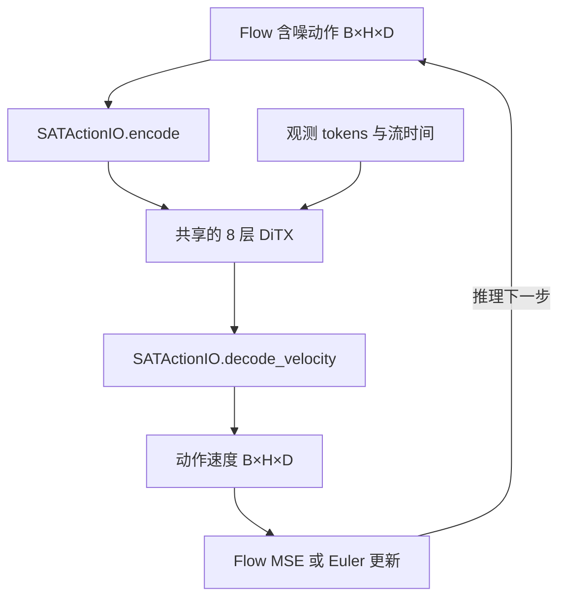

# SAT 动作表示插件化：DiTX-8 + 标准 Flow Matching 实施任务书

状态：待实施。本文规定下一次代码改动；本文提交本身只增加任务书，不表示实现或验证已经完成。

编写日期：2026-11-01。审阅基线：`haoyangzhanglab/dexmani_policy@c2fa2c290e5059fa4e79c062de3020a3ced50b06`。执行时以实际工作区为准，先阅读根目录 `AGENTS.md`，保留用户已有改动，不回退到上述提交。

## 1. 目标与范围

将当前 SAT 策略改为 **SAT 关节轨迹动作表示 + 共享的 8 层 DiTX + 标准 Flow Matching**。观测编码器由用户指定，继续使用当前 `SpatialObservationEncoder`。

本次交付必须同时满足：

- 中间主干直接复用现有单时间条件 `DiTX` / `DiTXBlock`，正式 SAT 配方使用 8 层。
- 训练和推理继续使用现有 `RectifiedFlow`：uniform 时间、高斯噪声、速度 MSE、均匀 Euler。
- SAT 专属的轨迹 token 化、关节身份和速度读出集中到一个小型 `SATActionIO(nn.Module)`。
- 普通 DiTX 的默认路径、其他策略的训练行为和已有公共接口保持稳定。
- 不新增运行时校验、异常处理、回退、兼容层、测试组件或通用框架；只实施本目标所需的代码与文档修改。

固定研究对象为当前 xArm7 + XHand 的 19D 绝对关节目标。此任务不包含跨本体训练、官方预训练权重迁移、URDF/旋转轴编码、VQ 动作量化或新观测模块。方法名称应写成“SAT 动作表示 + DiTX-8 的本地适配”，不宣称完整复现原论文网络或实验结果。

## 2. 官方依据与明确取舍

一手来源：

1. [SAT 论文 v1](https://arxiv.org/pdf/2603.03960v1)，重点为 §3.2、§3.3.2、§3.3.3；可读 [HTML](https://arxiv.org/html/2603.03960v1)。
2. [官方动作模型](https://github.com/XiaohanLei/SAT/blob/cd7c0a8877d6090a9a85ebee0ceca961830b3654/sim/sat/model/diffusion/sat.py)，重点为 `x_embedder`、两个 embedding、`forward` 中的转置/拼接/输出。
3. [官方策略与采样](https://github.com/XiaohanLei/SAT/blob/cd7c0a8877d6090a9a85ebee0ceca961830b3654/sim/sat/policy/sat.py)。
4. [本仓库 DiTX 基线](https://github.com/haoyangzhanglab/dexmani_policy/blob/c2fa2c290e5059fa4e79c062de3020a3ced50b06/dexmani_policy/agents/action_decoders/backbones/ditx.py) 与 [RectifiedFlow 基线](https://github.com/haoyangzhanglab/dexmani_policy/blob/c2fa2c290e5059fa4e79c062de3020a3ced50b06/dexmani_policy/agents/action_decoders/flow.py)。

论文以每个关节的整段轨迹作为 token，并用关节身份消除歧义。论文描述三类语义 embedding 相加；上述官方代码实际采用 robot/joint embedding 拼接，再与轨迹特征拼接。本任务沿用已审查的官方代码构造及本地唯一身份编号，不另造语义映射。

原 SAT 的 attention、归一化、时间嵌入和输出调制属于被替换的主干。本任务采用公共 DiTX 的这些机制，不要求新模型与官方 SAT 数值等价。论文的高斯起点 Flow 作为生成定义；官方策略代码中的零起点推理不迁入本实现。

## 3. 张量与职责契约

记 `B` 为 batch，`H` 为动作窗口长度，`D` 为物理控制维数，`C` 为 Transformer 宽度。正式配置为 `H=16, D=19, C=256`。

| 位置 | 张量 | 所属模块 |
| --- | --- | --- |
| 数据、归一化动作、含噪动作、监督速度、积分状态 | `[B,H,D]` | 现有 Policy / RectifiedFlow |
| 每个关节的含噪轨迹 | `[B,D,H]` | SATActionIO |
| 编码后的关节 token | `[B,D,C]` | SATActionIO |
| 经过 8 层 DiTX 的 token | `[B,D,C]` | DiTX |
| 逐关节读出的速度 | `[B,D,H]` | SATActionIO |
| 返回给 Flow 的速度 | `[B,H,D]` | SATActionIO |
| 观测条件，当前默认配置 | `[B,194,256]` | 现有观测编码器 |

数据流：



外部 `horizon` 永远表示 H，`action_dim` 永远表示 D。禁止为了复用现有 DiTX 而把二者交换传入。时间坐标保留在每个关节轨迹的 H 个特征槽内；流时间 `timestep` 仍然是逐样本标量。

## 4. SATActionIO 的唯一实现

新增 `dexmani_policy/agents/action_decoders/action_io.py`，只实现本次需要的 `SATActionIO`，不新增抽象基类、Protocol、注册表、工厂或另一套通用 tokenizer 系统。

构造参数只需 `horizon, hidden_dim`；D=19 由现有机器人布局和 SATPolicy 的边界约束确定，不增加未使用的可变动作维数参数。插件只注册实际参与计算的模块：

- `x_embedder = Linear(H,64) → Mish → Linear(64,C//2)`。
- `robot_embed = Embedding(2,C//4)`。
- `joint_embed = Embedding(12,C//4)`。
- `robot_ids = [0]*7 + [1]*12`。
- `joint_ids = [0,1,...,6, 0,1,...,11]`。
- `final_layer = DiTXOutput(C,H)`，直接复用现有层型。

两个 ID 数组沿用当前实现的 `long`、非持久 buffer；由固定代码重建，随模块迁移设备。动作列顺序继续使用数据已有的 `arm:7 → thumb:3 → index:3 → middle:2 → ring:2 → pinky:2`，不在插件中重排物理关节。

### 4.1 输入编码

`encode(x)` 接收 `[B,H,D]`，返回 `[B,D,C]`：

```python
trajectory = self.x_embedder(x.transpose(1, 2))
descriptor = torch.cat((
    self.robot_embed(self.robot_ids),
    self.joint_embed(self.joint_ids),
), dim=-1)
descriptor = descriptor.to(trajectory.dtype).expand(x.shape[0], -1, -1)
return torch.cat((trajectory, descriptor), dim=-1)
```

保留 dtype 转换，避免 BF16 轨迹因 FP32 embedding 拼接而将整个残差流提升到 FP32。使用 `expand`，不复制 B 份 embedding。

SAT 输入不添加普通 DiTX 的 `input_pos_embed`。关节身份绑定物理关节，不能再叠加一份按 token 槽位编号的位置表。默认 attention dropout 为 0，现有共享计算具有联合置换轨迹与身份后的等变性，本次无需增加 shuffle 训练逻辑。

### 4.2 速度读出

`decode_velocity(tokens, *, return_features=False)` 使用上述 `DiTXOutput(C,H)`，将 prediction 从 `[B,D,H]` 转回 `[B,H,D]`。

保留现有 DiTX 的 `return_features` 协议：

- `False`：返回速度 Tensor。
- `True`：返回 `(velocity, features)`；`velocity` 为 `[B,H,D]`，`features` 为输出头规范化后的关节特征 `[B,D,C]`。

features 的 token 轴是关节，不要将它解释成 H 个时刻或强行还原成 `[B,H,C]`。速度读出是可训练预测头，不是输入 MLP 的逆函数。

### 4.3 初始化与依赖

插件在自身构造期间完成初始化：对 Linear 复用 `initialize_linear`，embedding 沿用现有初始化方式，最后将 `final_layer.ffn_final.fc2.weight` 置零；bias 已由 Linear 初始化置零。保留现有 SAT 的轨迹 MLP 初始化，不改成额外的输入归一化或新的初始化配方。

`action_io.py` 可以导入 `backbones.ditx.DiTXOutput`；`ditx.py` 只接受传入的 `nn.Module`，不反向导入 `SATActionIO`，因此不需要移动或复制 `DiTXOutput`，也没有循环依赖。

## 5. DiTX 的最小扩展

只修改单时间条件 `DiTX`，在构造参数末尾增加 `action_io: nn.Module | None = None`。保持 `DiTXBlock`、`DiTXOutput`、`ConsistencyDiTX` 的数值定义和公共默认参数不变。

### 5.1 构造与前向

将插件注册为 `self.action_io`。

- `action_io is None`：保持现有 `input_embedder`、`input_pos_embed`、`final_layer` 的名称、布局与计算。
- 传入插件：仅使用插件的输入/输出模块，不再构造闲置的默认动作投影、动作位置表或默认输出头。
- 两条路径共用同一份 context 投影、观测帧 embedding、时间 MLP、8 层 `ditx_blocks` 和 K/V 缓存实现。

前向变化仅发生在 block 循环的两端：输入选择现有普通嵌入或 `action_io.encode(x)`；输出选择现有 `final_layer` 或 `action_io.decode_velocity(..., return_features=...)`。循环、时间处理、观测处理和缓存参数传递均沿用原实现。

保留现有外部 `[B,H,D]` 形状契约及已有边界检查，不添加插件专属动态校验、反射式接口探测或异常捕获。普通 DiTX 的时间位置编码只在默认分支使用；SAT 分支由插件提供身份。

### 5.2 初始化不能覆盖插件

当前 `DiTX.initialize_weights()` 的 `self.apply(initialize_linear)` 会遍历插件并覆盖其最终零输出初始化，必须调整。

直接对 DiTX 的非插件子模块执行现有通用初始化即可，例如按 `self.children()` 的原顺序遍历，跳过 `self.action_io`，其余调用 `module.apply(initialize_linear)`。继续保留 block 的 MHA/AdaLN 初始化、context/time 初始化；普通动作投影、位置表和最终输出初始化只在默认分支执行。

插件由自己的构造函数初始化一次，主干不调用额外初始化协议。默认无插件时保留原有初始化次序和参数键，避免改变其他策略的现有行为。

### 5.3 参数和缓存归属

插件必须处于 `action_decoder.model` 的模块树内。这样现有 optimizer 分组、EMA、state_dict 和 `torch.compile` 自动覆盖插件，无需修改 Trainer、BasePolicy 或优化器。

继续使用现有 `prepare_context_kv(context)`：一次推理请求缓存各层观测 K/V，训练和跨请求不缓存。插件不新增缓存，不持有观测或流时间状态。

## 6. Policy 与正式配置

`SATPolicy` 直接构造 `SATActionIO`，注入单时间条件 `DiTX`，再交给现有 `RectifiedFlow`。保留 `SATPolicy` 名称和现有训练入口。

不增加 representation 字符串选择器、插件注册配置或新 Policy 基类。普通时间 token 路径由 DiTX 的缺省 `action_io=None` 提供，SATPolicy 始终注入 SAT 插件。

原有 `n_obs_steps=2`、`action_dim=19` 和 `hidden_dim` 可被 4 整除的约束，如随旧类删除需要搬迁，合并保留在 SATPolicy 的既有构造边界一次；不在插件、DiTX、Dataset 各层重复增加检查。

SATPolicy 新增并透传已有 DiTX 的 `qkv_bias`、`qk_norm` 参数；将其 Python 默认值和 SAT YAML 对齐为下表。其他观测参数原样传递。

| 设置 | 本次最终值或处理 |
| --- | --- |
| backbone | 单时间条件 `DiTX` |
| `n_layers` | 8 |
| `hidden_dim` | 256 |
| `n_head` | 8 |
| `mlp_ratio` | 4.0 |
| `p_drop_attn` | 0.0 |
| `qkv_bias` | true |
| `qk_norm` | true |
| `timestep_embed_dim` | 128，取代当前 SAT 的 256 |
| `horizon / n_obs_steps / n_action_steps` | 16 / 2 / 8 |
| `num_inference_steps` | 10 |
| Flow 时间分布 / shift | `uniform` / 1.0，继续在 Policy 组装时显式传入 |
| 编码器、优化器、训练预算、EMA、数据增强 | 沿用当前 SAT 配方 |

上述 DiTX 主干设置对齐当前 DQ-RISE 使用的公共配方。不要修改全局 DiTX 默认值去影响其他调用方，也不要新增 `n_layers == 8` 的运行时断言。

构造插件使用普通 Python 组装即可；保存配置继续是现有的标量/字典参数，不把 `nn.Module` 对象放入 Hydra 配置，不引入新的 checkpoint 元数据或版本系统。

## 7. 标准 Flow 与动作接口保持不变

令 `a` 为经过现有 normalizer 的 `[B,H,D]` 动作：

```text
epsilon ~ N(0, I)
t ~ Uniform(0, 1)
x_t = (1 - t) * epsilon + t * a
v_target = a - epsilon
v_pred = DiTX_with_SATActionIO(x_t, t, observation_tokens)
loss = mean((v_pred - v_target) ** 2)
```

推理为 `x_0 ~ N(0,I)`，在 `t=k/S` 上执行 `x <- x + v(x,t,obs)/S`，默认 `S=10`。

这些计算继续由已有 `RectifiedFlow` 完成，本任务不改写 `flow.py`。尤其要保持：

- 在 `[B,H,D]` 动作坐标采样噪声、构造目标、计算 MSE 和执行积分。
- 编码插件处理每次网络调用的含噪动作，不能先把干净动作编码成 learned features 再对 features 做 Flow。
- 速度仍处于归一化动作坐标；动作反归一化由现有 Policy 在积分结束后执行。
- 仅使用单个流时间，不引入 `target_t`、ConsistencyFlow、teacher 或一致性损失；EMA 沿用现有参数平均。
- 保留现有 FP32 时间网格、generator 传递、AMP 与请求内 K/V 缓存，不为本任务另加采样器或精度处理分支。

数据与部署外部协议继续是 19D 关节动作。Policy 生成完整 16 步窗口，`future_actions` 返回原窗口 `[1:]` 共 15 步，默认执行其中前 8 步，即原窗口 `[1:9]`。不更改 Dataset、normalizer、执行器的切片或动作列顺序。

## 8. 具体文件改动与清理

| 文件 | 操作 |
| --- | --- |
| `dexmani_policy/agents/action_decoders/action_io.py` | 新增一个 SATActionIO 类，按第 4 节实现 |
| `dexmani_policy/agents/action_decoders/backbones/ditx.py` | 单时间 DiTX 增加可选动作插件与必要的初始化分支 |
| `dexmani_policy/agents/policies/sat.py` | 改为 SATActionIO + DiTX + 原 RectifiedFlow，调整相关构造参数 |
| `dexmani_policy/configs/sat.yaml` | 显式设置第 6 节主干参数，更新方法注释 |
| `dexmani_policy/agents/action_decoders/backbones/sat.py` | 更新实际引用后删除旧专用主干；不保留旧 SATBlock、StructuralAttention、SATOutput 或兼容包装类 |
| `dexmani_policy/test_tools/agent_checks.py` | 仅适配旧 SAT import、已有 `check_precision` 中的模型构造和 hook 名；不新增检查函数、用例或测试组件 |
| `README.md`、`docs/项目架构.md`、`docs/手部动作表示.md` | 更新本次变化直接涉及的说明、路径与实验表述 |

先用 `rg` 检查旧 SAT 类和路径的实际引用，再做局部替换。现有 `check_precision` 的小模型应替换为 `DiTX(..., action_io=SATActionIO(...))`，保持原有小规模配置、输入 shape 和断言，hook 从 `blocks` 改为 `ditx_blocks`。该既有检查可继续使用 1 层小模型，正式训练 YAML 为 8 层。

不新增测试文件、fixtures、校验器、诊断 CLI、benchmark、CI job、依赖、通用框架或多个备选实现。不因本次任务顺带重构其他策略、共享 Flow、观测编码器或训练系统。

旧 SAT checkpoint 对应不同主干，新方案重新训练；不编写权重迁移、旧类兼容、宽松加载或静默回退。普通 DiTX 默认路径保留原参数键，现有 checkpoint 的严格加载机制不变。

文档同步时需明确：

- 新 SAT 使用关节轨迹插件与公共 DiTX，不再描述旧 SAT attention 的 64D head、softcap 50、独立 action gate 或旧 final AdaLN。
- 与 DQ-RISE 现在共享 DiTX 主干层型和配置，但表示维度、token 数、输入/输出头及量化机制仍不同；不能把两者比较称为“只交换 token 轴”的消融，也不能直接横比两者 Flow MSE。
- 保留历史验证记录时标明对应旧实现，不能将旧 SAT 的官方数值/梯度对齐或旧训练检查结果套用到新 DiTX 方案。

## 9. 最小验证：执行后收敛，不增加组件

本节是一次性实施验收，不是要求建设新的测试体系。利用现有环境、现有入口和不落盘的临时 Python 命令完成必要验证即可。

1. **静态检查。** 检查最终 diff、导入、配置拼接、旧主干引用清理；确认默认 DiTX 没有被加入 SAT 参数或修改计算，SAT 插件没有闲置投影/位置表。检查两种路径的输出及 `return_features` 维度。
2. **已有精度检查。** 执行适配后的现有 `check_precision`，无需运行所有无关组件检查。可在临时 Python 会话中调用该函数；不新增永久脚本。
3. **一次小规模计算检查。** 在可用 PyTorch 环境，以小 batch、真实 8 层结构、合成动作和观测 token，确认标准 Flow loss 可反传、短程优化后轨迹 MLP/identity/block 参数获得有效梯度，推理输出 `[B,16,19]` 且有限；在同一次会话核对缓存/非缓存输出。零初始化时第一步部分上游梯度为零是预期行为，不能据此判错；结构比较使用已更新的权重或临时激活的非零输出/门控，避免全零输出造成假通过。不新增检查函数或 fixture。
4. **条件具备时复用既有 smoke。** 已有数据、视觉权重和训练依赖可用时，运行 `python -m dexmani_policy.test_tools.smoke_test sat --max-updates 4 --resume-updates 2`；需要指定现有任务或设备时使用该入口已有参数。验证新模型保存与续训，不启动完整长训练或闭环 benchmark。条件不足时如实记录未验证项，不造数据、不增加绕过依赖的后备实现。

默认 DiTX 的数值/参数键保持是代码审查与本次临时比较的要求，不为此新增永久回归测试。不得为了删除旧 SAT 类而删掉现有精度检查。

## 10. 完成标准与执行顺序

按“插件 → DiTX 最小接入 → Policy/YAML → 清理旧主干与直接引用 → 文档 → 必要验证”完成一次连贯改动，不同时实现多套架构。

完成时应满足：

- [ ] SATPolicy 实际使用 8 层单时间 DiTX，SAT 特有逻辑集中于 SATActionIO。
- [ ] 动作编码为 19 个关节轨迹 token，身份无重复组合，速度回到 `[B,H,D]`。
- [ ] SAT 分支不叠加普通动作时间位置表，观测帧位置编码仍由公共 DiTX 处理。
- [ ] 插件参数参与 optimizer/EMA/checkpoint，初始化未被主干覆盖，现有缓存与 features 接口正确。
- [ ] 标准 Flow、归一化、动作窗口和执行切片保持第 7 节语义。
- [ ] 默认 DiTX 和其他策略未被改变；旧 SAT 专用主干及直接失效引用已清理。
- [ ] 没有新增额外校验、异常处理、兼容回退、依赖或测试组件。
- [ ] 相关文档与实现一致，验证报告区分实际运行结果和未验证内容。

实施报告使用中文，简要说明改了什么、为什么、实际执行了哪些验证及结果，并提醒新 SAT 需要重新训练。遇到当前代码相对审阅基线的局部演进，按相同契约做最小适配并说明；只有真实冲突导致无法正确实施时才向用户提问。
