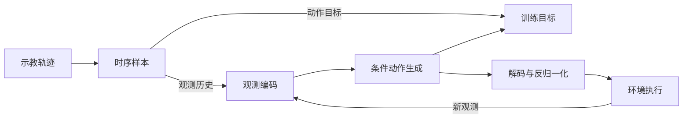

# 项目架构

项目以示教学习为核心，将数据组织、观测编码、动作生成和闭环评测连接起来。项目概览与阅读导航见 [README](../README.md)。

## 数据流



训练利用观测历史学习示教动作；推理生成动作窗口，由执行端按控制周期执行并更新观测。观测预训练和手部先验按方法需要参与策略初始化。

`dexmani_sim` 负责示教生成与仿真执行，本仓库负责策略学习、动作预测和评测组织。`deployment/` 提供外部执行端使用的推理接口，当前流程不包含 Real 数据训练或 Sim-to-Real。

## 核心模块

以下目录均位于 `dexmani_policy/` 下。

| 模块 | 代码目录 | 职责 |
| --- | --- | --- |
| 配置 | `configs/` | 定义公共运行设置与各方法配方 |
| 数据集 | `datasets/` | 读取示教回合，构造观测历史、动作窗口及辅助监督 |
| 策略 | `agents/policies/` | 组合编码器、动作表示和生成模型，定义学习目标 |
| 观测编码 | `agents/obs_encoder/` | 将视觉、状态与触觉编码为全局特征或空间特征序列 |
| 动作生成 | `agents/action_decoders/` | 通过 Diffusion、Flow 或 ODE 学习并生成动作表示 |
| 手部先验 | `agents/hand_prior/` | 提供关节轨迹组织、手姿码本与潜表示的变换 |
| 训练 | `training/` | 组织策略训练、独立预训练及训练状态保存 |
| 公共工具 | `common/` | 提供归一化、checkpoint 恢复与共享推理处理 |
| 仿真评测 | `evaluation/`、`env_runner/` | 执行闭环交互，统计结果并进行选模与测试 |
| 部署推理 | `deployment/` | 恢复策略，提供动作预测和输入输出描述 |

## 训练与推理流程

训练入口 `train.py` 根据配置构建数据集与策略，准备初始化权重、手部先验和归一化，再交给 `PolicyTrainer` 执行优化器更新、EMA、日志记录与 checkpoint 保存。观测编码器和手部先验的独立训练位于 `training/pretrain/`。

归一化连接原始物理量与模型内部表示，动作经解码和反归一化后输出。完整 checkpoint 保存模型权重、归一化参数、有效配置和训练状态，供续训、评测与推理恢复使用。

外部执行端通过 `deployment.load_policy` 恢复 `PolicyRuntime`，输入观测历史并取得物理单位下的动作窗口。`PolicyInfo` 描述所需模态、窗口长度、控制周期与策略能力；动作调度和发送由执行端负责。

## 策略组成

观测编码主要有三种组织方式：

- **全局表征**：DP 汇聚 RGB 特征，DP3 汇聚点云特征，再结合机器人状态。ODE 将点云历史编码为条件，最新实测关节状态另作为向量场输入。
- **空间表征**：R3D 使用 Uni3D，ManiFlow 保留逐点特征；SAT、DQ-RISE 和 DexLatent 通过相机标定融合点云局部几何与图像语义。
- **交互表征**：CordViP 建模手物接触与协调，AdapTac 融合场景与触觉，详见[观测预训练](观测预训练.md)和[触觉与交互建模](触觉与交互建模.md)。

动作生成以观测表征为条件，采用以下机制：

- **Diffusion**：学习去噪过程，从噪声逐步恢复动作表示。
- **Rectified Flow**：学习从噪声到目标表示的向量场，通过积分生成动作；ManiFlow 另引入 EMA 教师的一致性目标。
- **ODE**：从上一条实际下发目标积分生成关节轨迹。

生成空间可以是关节轨迹、手姿索引或连续潜表示，最终转换为控制目标，详见[手部动作表示](手部动作表示.md)。策略的任务表现通过[仿真闭环评测](仿真评测机制.md)衡量。

## 单尺度点云编码

[Point Transformer](../dexmani_policy/agents/obs_encoder/pointcloud/point_transformer.py) 由两个可独立调用的模块组成：`LocalPatchEncoder` 通过 FPS + KNN 分组，编码局部几何并加入绝对位置；`SpatialContextEncoder` 使用带 Metric 3D RoPE 的 Transformer 建模 Patch 之间的空间关系。

局部几何模块 `LocalGeometryEmbedding` 采用 R3D-style Point-Context Fusion：逐点 MLP → Patch 最大池化 → 将 Context 拼接到每个点 → 第二个逐点 MLP → 最大池化 → 线性投影。默认局部隐藏维度为 32，几何尺度为 0.10；RoPE 尺度为 0.05、base 为 100，空间编码使用 2 层、8 个 Attention Head 和 2.0 的 MLP ratio。

| 阶段 | 默认张量维度 |
| --- | --- |
| 输入点云 | `[B,1024,3或6]` |
| FPS + KNN 分组 | `[B,128,32,3或6]` |
| 局部几何和位置编码 | `[B,128,192]` |
| 完整编码器输出 | `tokens: [B,128,192]`、`xyz: [B,128,3]` |

AdapTac 使用完整的 `PointTransformerEncoder`。SAT、DQ-RISE 和 DexLatent 使用共享的 [RGBPointObservationEncoder](../dexmani_policy/agents/obs_encoder/rgb_point.py)：局部编码 → RGB Fusion → 空间编码。RGB Fusion 将几何与图像语义拼接为 384 维，每帧再加入一个关节状态 token，最终输出 `[B,T×129,384]`。

`pc_encoder_config.channels` 表示局部几何维度，RGBPoint 的空间编码维度由融合结构推导为其两倍。`local_hidden_dim` 随其他结构参数写入 `effective_config`；输入维度和 FPS 设置分别由策略的 `pc_dim`、`fps_random_config` 记录。完整点云编码器的权重按 `patch_encoder.*` 和 `spatial_encoder.*` 分组保存。策略恢复根据有效配置重新构建模型，并通过项目统一的 `restore_policy` 严格加载权重。

### 局部输入与配置

局部编码器接受非空 `[B,N,C]`，要求 `N >= max(num_patches, group_size)`、`C >= input_channels`。额外通道会被截取；有效通道统一转为 FP32 后执行一次 Gather，再拆分相对 XYZ 和 Attributes。XYZ-only 的 Attributes 为零通道张量。

四份策略配方显式设置 `local_hidden_dim: 32`，可通过 `agent.pc_encoder_config.local_hidden_dim=64` 切换。两种宽度的参数形状不同，恢复编码器时按保存的 `effective_config` 构建模型并严格加载权重。默认维度的选择依据是独立局部模块的效率测试，不代表经过任务训练验证的表征等价性。

### 验证与性能测量

```bash
python -m pytest -q -rs \
  dexmani_policy/test_tools/test_point_transformer.py \
  dexmani_policy/test_tools/test_point_transformer_integration.py \
  -k 'not policy_integration'
python -m dexmani_policy.test_tools.benchmark_point_transformer --precision fp32
python -m dexmani_policy.test_tools.benchmark_point_transformer --precision bf16
```

上述 pytest 命令只执行编码器测试和小规模接口测试，排除完整策略构建与恢复用例。[Benchmark 工具](../dexmani_policy/test_tools/benchmark_point_transformer.py) 只使用合成数据，PointNet Reference 仅用于局部对照。

以下为默认维度选型时记录的测量结果，使用 RTX 4090、PyTorch 2.4.1+cu124、CUDA 12.4，seed=17，预热 10 次、正式测量 50 次；FP32 matmul 使用 highest，BF16 使用 autocast。每次计时前后同步 CUDA，以下耗时为中位数。F+B 包含标量损失及 backward，不含清梯度、优化器更新。基础显存包含后端常驻分配；训练前向增量包含保存的激活和临时张量，F+B 峰值还包含参数梯度。

| 局部模块 | 参数量 | Linear MACs/帧 |
| --- | ---: | ---: |
| PointNet H=64，无 Context | 17,344 | 19.923M |
| Fusion H=32 | 10,944 | 18.350M |
| Fusion H=64 | 29,888 | 70.255M |

MACs 仅统计 Linear；所有方案固定 Cin=6、M=128、K=32、D=192。这里 B 表示展平后的观测帧数；AdapTac 默认训练 Batch 为 128、观测步数为 2，因此对应 B=256。吞吐量按 `B×M×K` 个局部点计算，包含邻域重叠的重复点。

**FP32 实测**

| 模块 | B | 前向 ms | F+B ms | 训练前向增量 MiB | F+B 峰值 MiB |
| --- | ---: | ---: | ---: | ---: | ---: |
| PointNet64 | 1 | 0.080 | 0.252 | 7.28 | 25.09 |
| Fusion32 | 1 | 0.094 | 0.384 | 7.31 | 23.90 |
| Fusion64 | 1 | 0.123 | 0.390 | 13.34 | 31.20 |
| PointNet64 | 16 | 0.495 | 1.408 | 102.25 | 156.62 |
| Fusion32 | 16 | 0.607 | 1.736 | 102.75 | 138.32 |
| Fusion64 | 16 | 0.873 | 2.546 | 199.25 | 253.67 |
| PointNet64 | 256 | 9.166 | 25.578 | 1609.00 | 2248.37 |
| Fusion32 | 256 | 10.762 | 32.813 | 1617.00 | 1956.32 |
| Fusion64 | 256 | 17.791 | 47.547 | 3161.00 | 3800.42 |

**BF16 实测**

| 模块 | B | 前向 ms | F+B ms | 训练前向增量 MiB | F+B 峰值 MiB |
| --- | ---: | ---: | ---: | ---: | ---: |
| PointNet64 | 1 | 0.092 | 0.409 | 6.83 | 24.50 |
| Fusion32 | 1 | 0.142 | 0.636 | 7.51 | 23.90 |
| Fusion64 | 1 | 0.140 | 0.545 | 13.80 | 30.26 |
| PointNet64 | 16 | 0.284 | 1.122 | 93.78 | 146.37 |
| Fusion32 | 16 | 0.400 | 1.585 | 105.01 | 122.81 |
| Fusion64 | 16 | 0.488 | 1.978 | 205.28 | 223.15 |
| PointNet64 | 256 | 6.657 | 24.142 | 1485.03 | 2096.37 |
| Fusion32 | 256 | 8.736 | 30.640 | 1665.01 | 1705.31 |
| Fusion64 | 256 | 13.122 | 43.777 | 3269.03 | 3309.40 |

FP32、B=256 时，H=32 相比 Fusion H=64 的前向时间减少约 39.5%，前后向时间减少约 31.0%，训练前向增量减少约 48.8%。但相较原始 PointNet，H=32 的前后向仍慢约 28.3%；相近的 MACs 不意味着相近的运行时间。

BF16、B=1 的 Fusion32/Fusion64 前后向首轮为 0.636/0.545 ms，100 次复测为 0.546/0.565 ms，排序发生变化，不能据此宣称单帧训练延迟有稳定优势。

**FP32 Gather 实测**

分组路径包含 FP32 转换、连续化和相对坐标计算。两种实现使用相同的固定合成邻域索引，均不计 FPS/KNN。

| B | 双 Gather ms | 单 Gather ms | 原分组路径 ms | 新分组路径 ms |
| ---: | ---: | ---: | ---: | ---: |
| 1 | 0.0149 | 0.0093 | 0.0225 | 0.0174 |
| 16 | 0.0154 | 0.0106 | 0.0227 | 0.0177 |
| 256 | 0.0404 | 0.0340 | 0.0525 | 0.0472 |

所有 Batch 均为实测，无 OOM。测试证明了基本工程性质，未运行策略训练、训练恢复、仿真或 Rollout，不能推断 H=32 与 H=64 的任务成功率或泛化能力相同。
