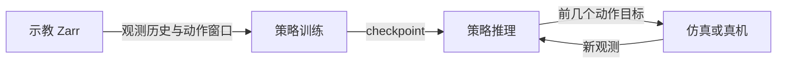

# 项目架构

## 数据流

`dexmani_sim` 和 DexJoCo 提供仿真示教与评测环境，`dexmani_real` 提供真机示教与执行环境。

数据集按回合采样窗口。训练与执行使用相同的观测字段、动作表示和控制周期。新训练可载入预训练权重，续训从原实验目录恢复模型、优化器和训练进度，并沿用原数据划分。 [快速使用](../README.md#快速使用) · [示教数据格式](仿真数据集格式.md)

## 代码入口

| 要做的事 | 代码入口 |
| --- | --- |
| 查数据来源、观测字段和采样窗口 | [策略配方](../dexmani_policy/configs/) · [数据集](../dexmani_policy/datasets/) |
| 新增策略或调整观测编码、动作解码 | [策略与模型组件](../dexmani_policy/agents/) · [InteractionFlow 架构示例](InteractionFlow模型架构.md) |
| 训练、预训练或续训 | [训练入口](../dexmani_policy/training/) |
| 比较 checkpoint 或调整仿真闭环 | [评测与选模](../dexmani_policy/evaluation/) · [环境运行器](../dexmani_policy/env_runner/) |
| 加载策略供真机执行 | [部署接口](../dexmani_policy/deployment/) |
