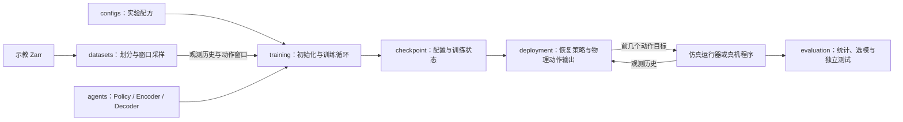

# 项目架构

## 数据流

`dexmani_sim` 和 DexJoCo 提供仿真示教与评测环境，`dexmani_real` 提供真机示教与执行环境。



数据集按回合采样窗口。训练与执行使用相同的观测字段、动作表示和控制周期。新训练可载入预训练权重，续训从原实验目录恢复模型、优化器和训练进度，并沿用原数据划分。 [快速使用](../README.md#快速使用) · [示教数据格式](仿真数据集格式.md)

InteractionFlow 使用常规观测历史与动作窗口，将 Scene 和 State 组成 Global Context，并以六个手物 Interaction Tokens 构成交互条件。训练和推理共用动作 Backbone，分别计算 Rectified Flow Matching Loss 和执行 Euler Sampling。EMA 为可选权重平均与评测能力。[训练与推理信息流](InteractionFlow模型架构.md#信息流) · [动作窗口](InteractionFlow模型架构.md#动作窗口与训练目标)

## 模块职责

| 模块 | 职责与调用关系 |
| --- | --- |
| [configs](../dexmani_policy/configs/) | 各方法独立展开观测、模型和训练参数，继承 `common.yaml` 中的通用运行设置。Hydra `_target_` 直接指定实现类。 |
| [datasets](../dexmani_policy/datasets/) | `EpisodeStore` 读取 Zarr，`SequenceSampler` 采样窗口，`DemonstrationDataset` 组织观测、动作及增强；预训练和辅助目标使用相应数据集变体。 |
| [agents](../dexmani_policy/agents/) | 每个 Policy 显式组装观测 Encoder 与动作 Decoder，负责动作表示和归一化。共享组件位于 `obs_encoder`、`action_decoders` 和 `hand_prior`。 |
| [training](../dexmani_policy/training/) | 组装有效配置、建立数据划分，提供通用初始化函数和训练循环，执行优化、EMA、日志和 checkpoint 保存。AFRO/CordViP 共用观测预训练循环；手部先验保留独立训练入口。 |
| [deployment.py](../dexmani_policy/deployment.py) | 仿真与真机共用权重选择、策略恢复、观测准备和物理动作输出；`load_policy` 将这些函数组合为真机可用的 `PolicyRuntime`。 |
| [env_runner](../dexmani_policy/env_runner/) | 对接 `dexmani_sim` 和 DexJoCo，维护观测历史、执行动作窗口并记录回合结果和视频。 |
| [evaluation](../dexmani_policy/evaluation/) | 选择评测种子、运行 checkpoint、汇总结果；多个 checkpoint 使用同一组选模种子，再对胜出模型做独立测试。 |
| [common](../dexmani_policy/common/) | checkpoint 读写、归一化、图像处理和少量张量、文件工具，供上述模块直接调用。 |
| [scripts](../scripts/) | 脚本提供训练、评测、预训练和远程运行入口。 |

## 训练、续训与 checkpoint

[train.py](../dexmani_policy/train.py) 读取配方后进入 `build_trainer`：建立数据集，检查动作维度与控制周期，加载可选预训练权重并拟合训练集归一化器，再交给 `PolicyTrainer` 执行训练。模型、优化器和 EMA 在编译 Backbone 前建立。归一化只拟合训练集；同源预训练资产会核对其回合划分是否超出策略预算。

开启 EMA 时，每次 optimizer 更新后直接同步 BatchNorm 的 affine 参数、运行均值、方差和批次计数，其余可训练权重做指数滑动平均。EMA 模型保持 eval 模式。DP 可通过 `agent.rgb_backbone_config.norm_mode=batch_norm` 和 `agent.rgb_backbone_config.tune_mode=full` 微调 ResNet。

主训练 CLI 在 Hydra 合成后调用 `assemble_policy_config`，统一策略、数据集和环境的配置。预训练入口用 `load_config` 合成配方。续训和部署直接读取 checkpoint 的有效配置。

`agent._target_` 决定策略类，`policy_name` 只用于实验命名与记录。公共入口调用 `Policy.build_for_training(cfg, dataset, field_dims, checkpoint=..., resuming=...)`，得到已完成初始化的 CPU 模型，再迁移到训练设备。默认实现复用 `training/initialization.py` 中的实例化、RGB 初始化、normalizer 拟合和权重恢复函数；特殊初始化由对应策略覆盖这一个方法。

DQRISE 负责先读取 codebook、确定 `num_codes`，DexLatent 负责在 hand prior 与 action affine 就绪后拟合 latent 范围，R3D 负责 Uni3D 初始化，AFRO/CordViP 负责继承 encoder 及其归一化参数，AdapTac 负责 warm start 时检查 tactile encoder。构造函数只建立模型结构，checkpoint 推理恢复不依赖外部预训练文件。

观测预训练入口各自解析方法特例，再将配置和模型构造函数交给共享循环。CordViP 自行选择 contact 数据；AFRO 自行限制单 batch，并传入 optimizer 更新前的 teacher 更新函数。公共循环按预训练轮数和每轮 batch 数计算更新预算，按轮保存。

策略训练目录包含 `config.yaml`、`metrics.jsonl` 和 `checkpoints/`。checkpoint 是普通字典，保存 `global_step`、`model_state`、可选 `ema_model_state`、`optimizer_state`、`scheduler_state` 和 `effective_config`。模型状态包含归一化参数；有效配置记录模型结构、观测维度、数据来源与划分、控制周期及观测处理参数。

[resume.py](../dexmani_policy/training/resume.py) 从原运行目录的 `checkpoints/latest.pt` 恢复模型、优化器、调度器和步数，并核对原 Zarr、回合布局与数据划分。它不重新拟合归一化器。初始化新实验使用 `initialization.policy`；续训则使用 `--run`。

## 仿真与真机推理

仿真评测通过 `select_inference_weights` 和 `restore_policy` 恢复策略，运行器每次调用 `prepare_observations`、`predict_actions`。真机程序通过同一模块的公开入口加载：

```python
from dexmani_policy.deployment import load_policy
```

`load_policy` 接受 checkpoint 路径或训练目录，返回 `PolicyRuntime`。调用方提供按时间排列的 NumPy 观测历史；`runtime.info` 给出所需字段、历史长度、动作格式和控制周期。`runtime.predict(observation)` 返回形状为 `(future_steps, control_action_dim)` 的完整未来物理动作窗口，由调用方决定本次执行多少步。真机观测历史由调用方维护。

标定 RGB-D 观测的空点云检查在训练样本读取与推理观测准备阶段完成。Encoder 直接消费已准备的张量。[示教数据约定](仿真数据集格式.md#几何坐标)

权重恢复只需要 checkpoint 中的有效配置与模型状态。raw/EMA 选择、RTC 前缀处理和 RGB 预处理在仿真与真机路径间共用实现。

## 修改实验的入口

- **新增策略**：在 `agents/policies` 中显式组装 Encoder 和 Decoder，继承 `Policy`，并新增独立配方。特殊动作表示或损失放在对应策略和 Decoder 中；需要预训练资产或专属归一化步骤时，覆盖 `build_for_training`，直接复用公共函数。无需登记策略名称或修改共享训练循环。
- **删除策略**：删除对应策略文件、独立配方及预训练入口。其独占的数据集或组件可一起删除；仍被其他方法使用的组件继续保留。组件直接从定义模块导入，包的 `__init__.py` 不集中加载各方法实现。
- **新增观测字段**：同步示教字段与配方的 `sensor_modalities`、`normalization`，在 Encoder 中消费；有固定形状或特殊预处理时，再修改字段约定与推理准备函数，并确保环境能提供同一字段。
- **调整实验配方**：直接修改对应 YAML 或使用命令行 override。共享代码用于相同计算，方法各自的默认参数保留在独立配方中。
- **新增预训练或评测行为**：分别从 `training/pretrain`、`evaluation` 和 `env_runner` 进入，数据窗口或辅助目标的变化同步对应数据集。
