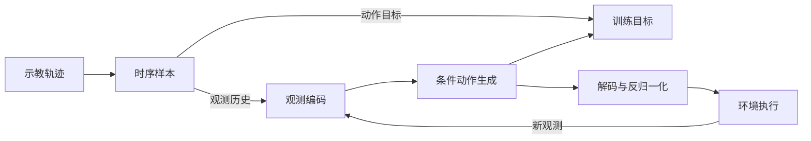

# 项目架构

项目以示教学习为核心，将数据组织、观测编码、动作生成和闭环评测连接起来。项目概览与阅读导航见 [README](../README.md)。

## 数据与策略的关系

训练时，模型利用观测历史学习示教动作；执行时，模型从噪声生成动作窗口，执行端取前缀执行并持续更新观测。观测预训练和手部先验按方法需要参与策略初始化。

数据按 episode 构造时序样本，窗口不跨回合。归一化连接原始物理量与模型内部表示，动作输出经过解码和反归一化后交给执行端。完整策略 checkpoint 保存模型及其输入变换，供恢复和推理使用。

训练和恢复仅支持 `identity` 和 `limits`；后者按训练回合分块累计逐特征 min/max，常数通道使用可逆平移。AdapTac 与 InterAct-Dex 的触觉使用 `identity`。identity 字段不注册 affine；仅 limits 字段注册，action 必须为 limits；DexLatent 自行声明内部 `hand_latent`。

策略和观测预训练共用配置驱动的 affine 字段规则；策略的有效配置同时保存 `normalization_dims`。先按配置创建结构，再拟合 limits 或严格载入预训练 affine；继承参数直接载入已有模块，策略内部字段不会被数据集拟合替换。恢复 raw、EMA 或部署模型时，先创建该结构，再 strict 加载，并拒绝非有限参数或零 scale，不重新拟合或重置保存的 affine。DQ-RISE 的手部尺度、DexLatent 的潜变量 limits、AFRO/CordViP 的预训练 affine 继承仍保留。针对性检查入口为 `python -m dexmani_policy.test_tools.normalizer_test`，完整训练恢复与部署检查复用 `smoke_test`。

## 核心模块

以下目录均位于 `dexmani_policy/` 下。

| 模块 | 代码目录 | 职责 |
| --- | --- | --- |
| 数据集 | `datasets/` | 读取示教回合，构造观测历史、动作窗口及辅助监督 |
| 观测编码 | `agents/obs_encoder/` | 将视觉、状态与触觉编码为全局特征或空间特征序列 |
| 动作生成 | `agents/action_decoders/` | 通过 Diffusion 或 Flow 学习并采样动作表示 |
| 手部先验 | `agents/hand_prior/` | 提供关节轨迹组织、手姿码本与潜表示的变换 |
| 策略 | `agents/policies/` | 组合观测编码、动作表示和生成模型，定义各方法的学习目标 |
| 训练 | `training/` | 组织策略训练、独立预训练及训练状态保存 |
| 仿真评测 | `evaluation/`、`env_runner/` | 执行闭环交互，统计结果并进行选模与测试 |
| 部署推理 | `deployment/` | 恢复策略，向外部执行端提供动作预测和输入输出描述 |

`dexmani_sim` 负责仿真环境，`dexmani_real` 负责真实传感器、硬件控制和执行调度。策略模块输出动作窗口，控制时序与设备交互由执行端管理。

## 观测如何成为动作条件

**全局表征**将每帧观测汇聚为特征，再组合历史。DP 使用 RGB，DP3 使用点云，两者都结合机器人状态。

**空间表征**保留局部特征的位置关系，供动作模型读取。R3D 使用 Uni3D 表征，ManiFlow 保留逐点特征。SAT、DQ-RISE 和 DexLatent 共享几何与图像语义融合：通过相机标定将点云局部中心对应到图像特征，再结合关节状态构成动作条件。

**交互表征**围绕手物关系组织特征。CordViP 学习接触与协调，AdapTac 融合视觉与触觉，InterAct-Dex 则显式建模身体部位、场景与交互历史。

## 动作如何生成

动作模型以观测表征为条件，在训练时学习目标动作，在推理时从噪声生成序列：

- **Diffusion**：学习去噪过程，使用 UNet 或 Transformer 逐步恢复动作。
- **Rectified Flow**：学习从噪声到目标表示的变化方向，通过积分生成动作。
- **ManiFlow**：在 Flow Matching 之外引入 EMA 教师的一致性目标。

生成坐标与实际控制量可以不同。SAT 在关节坐标中组织轨迹；DQ-RISE 生成手姿索引，再查表还原；DexLatent 生成连续潜表示，再由冻结先验解码。它们最终都输出物理关节目标，详见[手部动作表示](手部动作表示.md)。

## 预训练与评测

AFRO 和 CordViP 先学习观测表征，再将编码器迁移到动作策略；机制见[观测预训练](观测预训练.md)。触觉还可以提供动作生成条件或训练辅助目标，见[触觉与交互建模](触觉与交互建模.md)。

仿真评测检验策略的闭环任务完成能力，并将候选选择与独立测试分开。不同表示空间的训练误差不能直接比较，最终表现应依据共同任务条件下的[仿真评测](仿真评测机制.md)。
