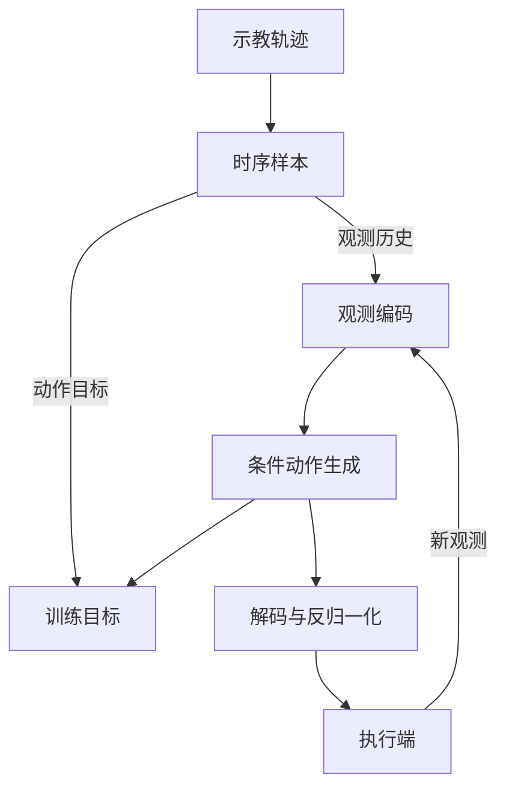

# DexMani Policy · 项目架构

本文介绍系统分工、共享数据流和各策略的核心机制。项目概览见 [README](../README.md)；具体数据、动作表示、预训练和评测协议分别由专题文档说明。

## 系统分工

项目围绕示教学习和闭环执行组织：训练时用示教动作监督条件生成模型，执行时根据新观测反复生成动作窗口。

图中的两个分支对应不同阶段：训练用示教目标及其加噪样本学习模型，执行用已训练模型从噪声采样动作，并接收环境的新观测。外部视觉权重、观测预训练或手部先验按方法需要用于初始化，再进入策略训练。

| 部分 | 核心职责 |
| --- | --- |
| 数据集 | 从 episode 中构造观测历史、动作窗口及方法需要的辅助标签 |
| 初始化 | 按方法导入视觉权重、预训练观测编码器或手部先验及其输入变换 |
| 策略 | 组合观测编码、动作表示与条件生成模型，输出物理动作窗口 |
| 训练 | 学习策略，维护训练状态与可选 EMA 权重，保存可恢复的产物 |
| 评测 | 在仿真中执行策略，完成候选选模和独立测试 |
| 推理接口 | 根据保存的策略恢复输入、动作和归一化约定，供执行端调用 |

`dexmani_sim` 负责仿真环境，`dexmani_real` 负责真实观测、设备适配和控制调度；硬件控制不在策略学习模块内。

## 共享数据流

### 时序与动作窗口

示教数据按回合（episode）切分，采样窗口不跨回合；边界处可重复首尾帧补齐。每条样本包含前 N 帧观测和长为 H 的动作目标，最后一帧观测对应当前查询时刻。

策略先将内部表示完整解码并反归一化，再返回从当前时刻开始的物理动作窗口。未来可用长度为 P = H − N + 1；执行端选择其中前 C 步，满足 1 ≤ C ≤ P，然后根据新观测重新预测。生成模型的采样步数、预测窗口长度和实际执行步数是三个独立概念。

| 动作空间 | 含义 |
| --- | --- |
| 关节动作 | 7 维机械臂与 12 维手部绝对关节目标，共 19 维 |
| 末端动作 | 位置、rotation-6D 与 12 维手部目标，共 21 维 |
| R3D 辅助末端预测 | 在关节动作外增加末端监督，实际控制仍只下发 19 维关节目标 |

各策略支持的动作空间有所不同。存储字段、观测与动作的对齐，以及实测位姿与动作目标的区别见[仿真数据集格式](仿真数据集格式.md)。

### 数据划分与归一化

数据划分以 episode 为单位，区分训练、留出验证和未使用数据。数据划分随机性与训练随机性独立；主策略默认使用全部 episodes，显式留出的验证数据也不会自动触发离线验证或选模。

新拟合的归一化统计只来自对应训练 episodes 的真实源帧，不包含验证集、窗口补齐或随机增强。策略统一应用输入变换，生成模型在相应的归一化表示空间学习，输出时再恢复物理动作。

用于几何投影和手部相对位置计算的量保持物理坐标、单位与标定一致。预训练编码器及手部先验的输入变换随组件一起迁移，新字段才按本阶段约定建立尺度。最终统计随完整策略保存，恢复训练与推理时直接复用。

## 动作如何生成

观测编码器将历史输入变为动作模型的条件。条件可以是一个全局特征向量，也可以是多个 token：每个 token 是网络处理的一个特征单元，可对应局部场景、身体部位或一段轨迹。

动作建模需要区分三个层次：

| 层次 | 回答的问题 | 本项目中的例子 |
| --- | --- | --- |
| 物理动作空间 | 执行端实际接收什么？ | 关节目标或末端位姿目标 |
| 生成坐标 | 模型在哪个数值空间学习？ | 归一化关节、手姿码本索引、连续潜表示（latent） |
| token 组织 | 网络怎样把一段目标分组处理？ | 一个 token 对应一个时刻，或一个关节的整段轨迹 |

SAT 改变 token 组织，但生成坐标仍是关节；DQ-RISE 和 DexLatent 改变手部生成坐标。三者最终都还原为 19 维物理关节目标。具体表示与解码过程见[手部动作表示](手部动作表示.md)。

在确定表示后，条件生成模型学习如何从噪声得到目标：

- **扩散**：训练时预测加噪动作对应的去噪目标；推理时逐步去噪。UNet 与 Transformer 是不同的条件去噪主干。
- **Rectified Flow**：学习从噪声到目标表示的速度场，推理时沿该速度场积分。
- **ManiFlow**：结合 Flow Matching 与 EMA 教师的一致性约束，学习不同生成时间跨度的行为。

Rectified Flow 的直线路径为：

$$
x(t)=(1-t)\varepsilon+ta,\qquad v_{\mathrm{target}}=a-\varepsilon.
$$

其中 $\varepsilon$ 是高斯噪声，$a$ 是归一化目标表示，$t$ 从噪声端 0 走向数据端 1。这里的时间和速度描述生成过程，与机器人的物理时间和关节速度不同。训练时间采样与推理积分网格分别定义。

EMA 是训练参数的指数滑动平均，可作为评测时的权重选择；ManiFlow 还用 EMA 模型构造一致性学习目标。内部生成结果需经过对应解码和反归一化，才能交给执行端。

## 策略组成与差异

各策略连接观测编码、动作表示和条件生成模型。共用组件提供一致的数据与输出语义，各方法保留自己的表征结构和学习目标。

| 策略 | 观测表征 | 动作生成 |
| --- | --- | --- |
| DP | RGB 特征与关节状态组成全局条件 | 条件 UNet 扩散 |
| DP3 | PointNet 系列点云特征与关节状态组成全局条件 | 条件 UNet 扩散 |
| R3D | Uni3D 空间特征、位置与关节状态 | 单向注意力 Transformer 扩散，可增加末端辅助监督 |
| ManiFlow | 逐点特征与状态组成空间条件 token | Flow Matching 与 EMA 一致性训练 |
| AFRO | 迁移时序动力学预训练的点云编码器，结合关节状态 | 条件 UNet 扩散 |
| CordViP | 迁移接触与协调预训练的手部、物体点云和状态编码器 | 条件 UNet 扩散 |
| SAT | 几何与 RGB 语义融合的空间 token，加状态 token | Rectified Flow，按关节组织轨迹 token |
| DQ-RISE | 与 SAT 共用空间观测编码 | Rectified Flow，生成机械臂动作与连续手部码本索引 |
| DexLatent | 与 SAT 共用空间观测编码 | Rectified Flow，生成机械臂动作与冻结先验的手部 latent |
| AdapTac | 场景点云、触觉与关节状态，通过未来力引导融合 | 未来力扩散与动作扩散 |
| InterAct-Dex | 身体交互历史与场景 token，结合实测位姿、指尖和触觉 | Rectified Flow，未来力增量作为训练辅助监督 |

AFRO、CordViP 的目标与迁移规则见[观测预训练](观测预训练.md)；SAT、DQ-RISE、DexLatent 的动作空间见[手部动作表示](手部动作表示.md)。

## 空间与视觉表征

### 全局条件与空间 token

DP、DP3 和 AFRO 将每帧观测汇聚为特征，再组合历史形成动作条件。ManiFlow 保留逐点 token；R3D 使用 Uni3D 空间特征，由动作 query 读取观测，观测 context 不随动作解码层更新。

AdapTac 和 InterAct-Dex 使用独立 PointTransformerEncoder；SAT、DQ-RISE、DexLatent 复用其 PointPatchEncoder 局部编码：选取空间中心、聚合邻域几何。局部形状与绝对位置共同决定空间表征。默认输入 1024 个 XYZ 或 XYZRGB 点，FPS 选取 128 个中心，kNN 为每个中心选取 32 个邻域点。相对 XYZ 按 0.10 m 缩放，与可选 RGB 一起经过 64→64 Point MLP（LayerNorm、GELU），Max Pool 后线性投影到 192D；叠加 3→128→192 绝对位置嵌入。独立 PointTransformerEncoder 随后经过两层 8-head 全局 Transformer，保留 Q/K Normalization、Continuous Metric 3D RoPE 和 Residual Gains，输出 128×192 空间特征。

独立 PointTransformerEncoder 保留 192D 全局编码、原接口及平铺参数名，本次 RGB Fusion 重构保持其 checkpoint 严格加载兼容。

### 几何与图像语义对齐

SAT、DQ-RISE 和 DexLatent 共享 RGBPointObservationEncoder（rgb_point.py）。点云提供局部几何，RGB 主干提供图像语义；通过 world→camera CV 外参、内参和 half-pixel 图像变换，将 128 个 Patch Centers 投影到 RGB 特征图，以 FP32 grid_sample 双线性采样对应语义。处理后的图像高宽须为 RGB 主干 patch_size 的整数倍，使投影坐标与特征网格覆盖范围一致。默认 DINOv2-Small 提供 16×16×384 特征图，采样后经 LayerNorm 和 Linear 映射为 192D；无效投影在 Linear 后将语义置零。

192D 局部几何经 LayerNorm 后与 192D 语义拼接，由两层 384D、8-head（48D/head）的 GlobalPointTransformer 联合建模并直接保留 384D。

Joint State 经上游 Policy Normalizer 后，由共享 StateEncoder 的轻量 MLP 编码为一个 384D Joint Token，在 Global Transformer 之后拼接。两类 token 分别添加 Token Type Embedding，再统一 LayerNorm；每帧 128 个空间 token 加 1 个 Joint Token，按 Frame-major 排列后两帧条件为 [B,258,384]。

DiTX 将条件投影到 hidden_dim 后，为每帧全部 129 个 token 添加独立的可学习 Frame Embedding（保留零初始化）；观测编码器不重复添加时间编码。

融合不使用门控或邻域语义池化；投影有效性不包含遮挡判断。旧 SAT、DQ-RISE、DexLatent 的 256D 观测 checkpoint 因输出宽度和成员名称变化、Output Projection 删除而与新结构不兼容，必须重新训练，不提供迁移或非严格加载。

不同帧独立采样的同序号空间 token 不代表同一个物理点。默认图像语义来自冻结的 DINOv2-small，也可使用其他视觉主干或微调方式；这些选择属于具体实验配方。

## 触觉与手部交互

AdapTac 将未来绝对力预测接入在线动作生成，用预测力引导视觉与触觉融合；InterAct-Dex 围绕腕部和五指组织身体交互历史，并以未来力增量提供训练辅助监督。两者的主要区别是触觉特征如何组织，以及未来力预测是否参与推理。

详细结构、监督目标、触觉表征及仿真与真实数据边界见[触觉与交互建模](触觉与交互建模.md)。

## 预训练、恢复与闭环执行

预训练产物用于初始化策略；完整训练后，所需组件与输入变换已包含在策略中。编码器如何冻结或微调见[观测预训练](观测预训练.md)，外部模型与项目预训练产物的区别见[权重说明](../data/README.md)。

完整 checkpoint 保存构造配置、模型、归一化统计，以及恢复训练所需的优化与随机状态；推理只使用其中的策略相关内容。恢复训练沿用保存的模型、affine、优化器和随机状态；允许显式更换数据路径，并刷新当前数据派生的部署周期和数值配方。数据和采样顺序改变会影响实验轨迹，应由实验者记录。

仿真评测按“预测动作窗口—执行前缀—更新观测”运行，并将候选选模与独立测试分开。模型比较依据共同协议下的闭环结果，不能直接按不同表示空间的训练误差排名；完整协议见[仿真评测机制](仿真评测机制.md)。

真实执行端还需保证观测历史对齐、控制周期与训练语义一致。动作步数不能代替时间长度；推理接口只返回动作窗口，执行队列和延迟由执行端管理。

RTC（Real-Time Chunking）在推理时用已对齐的旧计划剩余动作，引导新窗口与已承诺动作衔接。引导是软约束，执行端仍须继续执行已经承诺的旧动作。当前连续物理动作路径支持 RTC；DQ-RISE 的码本索引和 DexLatent 的 latent 不直接接受物理动作前缀，因此这两条路径不支持 RTC。ManiFlow 的 RTC 属于本地扩展，其闭环收益仍需实测。

SSH 连接、远程训练与实验取回步骤见[SSH 服务器训练部署](SSH服务器训练部署.md)。
