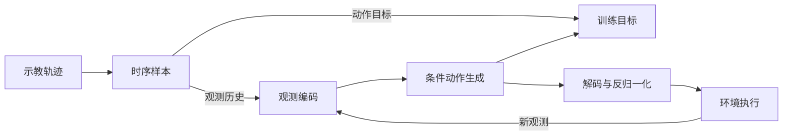

# 项目架构

项目以示教学习为核心，将数据组织、观测编码、动作生成和闭环评测连接起来。项目概览与阅读导航见 [README](../README.md)。

## 数据流

训练利用观测历史学习示教动作；推理生成动作窗口，由执行端按控制周期执行并更新观测。观测预训练和手部先验按方法需要参与策略初始化。

`dexmani_sim` 负责仿真示教与执行，`dexmani_real` 负责真机采集、显式字段导出与执行，本仓库负责策略学习、动作预测和评测组织。`deployment/` 提供外部执行端使用的推理接口。

## 核心模块

以下目录均位于 `dexmani_policy/` 下。

| 模块 | 代码目录 | 职责 |
| --- | --- | --- |
| 配置 | `configs/` | 定义公共运行设置与各方法配方 |
| 数据集 | `datasets/` | 读取示教回合，构造观测历史、动作窗口及辅助监督 |
| 策略 | `agents/policies/` | 组合编码器、动作表示和生成模型，定义学习目标 |
| 观测编码 | `agents/obs_encoder/` | 将视觉、状态与触觉编码为全局特征或空间特征序列 |
| 动作生成 | `agents/action_decoders/` | 通过 Diffusion、Flow 或 ODE 学习并生成动作表示 |
| 手部先验 | `agents/hand_prior/` | 提供手姿码本与连续潜表示的变换 |
| 训练 | `training/` | 组织策略训练、独立预训练及训练状态保存 |
| 公共工具 | `common/` | 提供归一化、checkpoint 恢复与共享推理处理 |
| 仿真评测 | `evaluation/`、`env_runner/` | 执行闭环交互，统计结果并进行选模与测试 |
| 部署推理 | `deployment/` | 恢复策略，提供动作预测和输入输出描述 |

## 训练与推理流程

训练入口 `train.py` 负责 CLI 与配置加载；`training.trainer.build_trainer` 构建数据集与策略，准备训练状态，再交给 `PolicyTrainer` 执行优化器更新、EMA、日志记录与 checkpoint 保存。配置、数据准备、优化器、日志和续训工具位于 `training/`；独立预训练位于 `training/pretrain/`。续训使用 `python -m dexmani_policy.training.resume --run RUN`。

主策略通过 `training.use_compile` 控制 backbone 编译；`training.compile_mode` 默认 `reduce-overhead`，可用 Hydra 覆盖并随 checkpoint 保存，续训可通过 `--compile-mode` 覆盖。

`set_seed` 只播种 Python、NumPy、Torch RNG；主训练、观测预训练、VQ 和 `evaluate_policy` 分别设置各自的实验后端策略。

策略初始化集中在 `training/initialization.py`：共享模型构造与归一化流程，以明确分支处理 RGB、Uni3D、观测预训练和手部先验。程序调用训练使用 `training.trainer.build_trainer`、`run_training`；构建策略使用 `training.initialization.build_policy`。

| 路径 | 模型与归一化 | optimizer、scheduler、EMA 与 step |
| --- | --- | --- |
| fresh | 加载外部权重，继承或拟合归一化 | 新建 |
| `initialization.policy` | 从同方法、同动作语义的 checkpoint 加载 | 新建 |
| resume | 从 checkpoint 恢复，不重新初始化或拟合 | 恢复 |

fresh 在构造前解析所需 RGB 架构；DQ-RISE 还先读取码本确定 `num_codes`，构造后再加载模型权重。

策略、观测预训练和 VQ 使用各自的训练循环，共享梯度有限性与输出目录检查。策略和观测预训练还共享优化器恢复与停止信号，收到停止信号后完成当前更新并保存。创建 worker、环境和日志的代码负责释放资源，异常使用 Python 原生传播。

策略和观测预训练的累积目标为 `sum(n_i * L_i) / sum(n_i)`，`n_i` 来自实际 batch。多批组逐批 backward，在梯度范数记录和裁剪前归一化；均值日志使用相同权重，每组只更新一次 optimizer、scheduler 和 step。各损失仍使用原有分母和批统计，VICReg 等目标不等价于拼接大 batch。

三个训练入口在配置覆盖和 cwd 确定后，将 `workspace.output_dir` 展开 `~` 并解析为绝对路径，供目录检查、日志、配置和 checkpoint 共用。fresh 拒绝已有实验产物，resume 继续写恢复的 run 目录。`config.yaml` 保留首次配方，续训参数与步数预算写入新 checkpoint 的 `effective_config`。

训练的相对路径以启动目录为准，运行配置保存解析后的实际 Zarr 路径。续训使用原运行的代码版本，在恢复状态前核对该路径、原始来源和训练组。观测预训练还核对验证组，策略沿用保存的控制周期与动作语义。Zarr 发布后保持固定，换数据时启动新实验并指定 `initialization.policy` 等权重来源。

观测归一化按字段配置，可选 `identity`、`limits` 或 `mean_std`。统计只使用训练集的原始帧。`mean_std` 使用总体标准差，小于 `1e-4` 的通道只减均值。RGB、触觉和策略要求保留物理坐标的字段使用 `identity`。运行 `python -m dexmani_policy.train --config-name dp3 normalization.joint_state=mean_std` 可切换关节状态的尺度。

动作使用 `limits`。使用预训练编码器或手部先验时，对应字段继承其训练尺度。

策略和观测预训练共用 `Checkpoint`，保存模型、归一化、有效配置、优化器和 scheduler 状态，EMA 状态可为空。VQ 使用独立格式，供选模和导出码本使用。`common/checkpoint.py` 负责状态读写，`common.inference.restore_policy` 根据有效配置构建推理策略并加载权重。

`effective_config.data_processing` 保存实际读取字段的处理参数。`training_data` 记录本次训练的原始 Zarr 和采集组，`prior_data` 记录本次直接加载的权重及预算核验结果。直接码本或观测先验通过同源训练组和选模组检查后记为 `budget_verified=True`。独立或未知来源的先验和整策略 warm start 均记为 `False`。整策略 warm start 读取当前完整 checkpoint 的 `training_data`，记录解析后的实际文件路径。直属来源的同源分组超出预算时仍会拒绝加载。完整续训沿用已保存的预算记录。 [观测预训练](观测预训练.md)

Real canonical 数据的 `episode_ends` 和 `source_episodes` 按连续段对应。`split_episodes` 按原始采集分组后生成段 mask，仿真数据按 episode 分组。策略、观测预训练和 VQ 共用这一划分，时序窗口不跨段。

`SequenceSampler` 按字段所需 horizon 读取连续区间，仅在窗口越过段边界时重复首尾帧；源行号接口单独供 ODE、未来触觉和 AFRO 构造特殊时间监督。

外部执行端通过 `deployment.load_policy` 恢复 `PolicyRuntime`，输入观测历史并取得物理单位下的动作窗口。`PolicyInfo` 描述所需模态、窗口长度、控制周期与策略能力；动作调度和发送由执行端负责。

`restore_policy` / `load_policy` 以 FP32 恢复模型并设为 eval，继承宿主的 matmul 精度和 cuDNN 设置。宿主需要 `highest` 时，在应用启动处调用 `torch.set_float32_matmul_precision("highest")`。不同 matmul 策略下不保证逐位一致。

RTC 前缀使用物理动作坐标，策略归一化后传给采样器。DQ-RISE、DexLatent 和 ODE 不支持 RTC，传入前缀、非零 `delay_steps` 或非零 `rtc_guidance_cap` 会报错。支持 RTC 的策略在无前缀时执行普通采样。

## 策略组成

观测编码主要有三种组织方式：

- **全局表征**：DP 汇聚 RGB 特征，DP3 汇聚点云特征，再结合机器人状态。ODE 将点云历史编码为条件，最新实测关节状态另作为向量场输入。
- **空间表征**：R3D 使用 Uni3D，ManiFlow 保留逐点特征；SAT、DQ-RISE 和 DexLatent 通过相机标定融合点云局部几何与图像语义。
- **交互表征**：CordViP 建模手物接触与协调，AdapTac 融合场景与触觉，详见[观测预训练](观测预训练.md)和[触觉与交互建模](触觉与交互建模.md)。

动作生成以观测表征为条件，采用以下机制：

- **Diffusion**：学习去噪过程，从噪声逐步恢复动作表示。
- **Rectified Flow**：学习从噪声到目标表示的向量场，通过积分生成动作；ManiFlow 另引入 EMA 教师的一致性目标。
- **ODE**：从上一条实际下发目标积分生成关节轨迹。

生成空间可以是关节轨迹、手姿索引或连续潜表示，最终转换为控制目标，详见[手部动作表示](手部动作表示.md)。策略的任务表现通过[仿真闭环评测](仿真评测机制.md)衡量。

`Policy` 用 `_encode_actions()`、`_decode_actions()` 转换物理动作与生成表示，`decoder_action_dim` 和 `control_action_dim` 分别描述生成与控制维度。DQ-RISE、DexLatent 通过动作转换复用公共训练和采样；AdapTac 增加力预测监督；ODE 使用独立的轨迹监督和积分推理。

各配方显式选择 Dataset，自定义 target 须接受配方参数。`agent.action_dim=null` 表示从 Dataset 推导维度，显式维度不匹配会报错；固定动作表示由对应 Policy 校验。

R3D 默认使用 `R3DDataset`。`use_aux_ee=false` 沿用基础数据行为；开启时要求 joint action，拼接并归一化 `action_ee` 的前 9 维。R3D 的分组损失为 `mean(joint19 MSE) + aux_loss_weight * mean(ee9 MSE)`，监督为 28 维，控制输出为 19 维。

R3D 的 [Uni3DEncoder](../dexmani_policy/agents/obs_encoder/pointcloud/uni3d.py) 接受 XYZ 或 XYZRGB 点云，XYZ 输入补零 RGB。FPS 与 KNN 确定邻居后，一次 Gather 六个通道，再在新生成的分组张量上将 XYZ 减去中心坐标，得到相对 XYZ 与 RGB；原始输入保持不变。

## 单尺度点云编码

[Point Transformer](../dexmani_policy/agents/obs_encoder/pointcloud/point_transformer.py) 由两个可独立调用的模块组成：`LocalPatchEncoder` 通过 FPS + KNN 分组，编码局部几何并加入绝对位置；`SpatialContextEncoder` 使用带 Metric 3D RoPE 的 Transformer 建模 Patch 之间的空间关系。

局部几何模块 `LocalGeometryEmbedding` 采用 R3D-style Point-Context Fusion：逐点 MLP → Patch 最大池化 → 将 Context 拼接到每个点 → 第二个逐点 MLP → 最大池化 → 线性投影。默认局部隐藏维度为 32，几何尺度为 0.10；RoPE 尺度为 0.05、base 为 100，空间编码使用 2 层、8 个 Attention Head 和 2.0 的 MLP ratio。

| 阶段 | 默认张量维度 |
| --- | --- |
| 输入点云 | `[B,1024,3或6]` |
| FPS + KNN 分组 | `[B,128,32,3或6]` |
| 局部几何和位置编码 | `[B,128,192]` |
| 完整编码器输出 | `tokens: [B,128,192]`、`xyz: [B,128,3]` |

AdapTac 使用完整的 `PointTransformerEncoder`。SAT、DQ-RISE 和 DexLatent 使用共享的 [RGBPointObservationEncoder](../dexmani_policy/agents/obs_encoder/rgb_point.py)：局部编码 → RGB Fusion → 空间编码。RGB Backbone 支持 `dino`、`dinov3` 和 `siglip`。默认 RGB Fusion 将几何与图像语义拼接为 384 维，每帧再加入一个关节状态 token，最终输出 `[B,T×129,384]`。

`agent.rgb_semantic_sampling` 默认为 `center`，在 FPS 中心采样 RGB。`group_mean` 复用已有 KNN 邻居，先对有效邻居的 RGB patch 特征求平均，再执行 LayerNorm 和 Linear。两种模式的参数与输出维度相同，模式随 `effective_config` 保存。用 `python -m dexmani_policy.train --config-name sat agent.rgb_semantic_sampling=group_mean` 启用该消融。

仿真点云处于 world 坐标系，`camera_extrinsic` 为 world→OpenCV camera；RGB 与点云来自同一次相机采集。观测先由 Policy 展平为 BT，图像仅在 ImageProcessor 中 Resize；投影与采样保持 FP32、半像素中心和 `align_corners=False`。有效性只表示投影有效，不判断遮挡；无有效样本的组在线性投影后清零，避免 bias 引入语义。

`pc_encoder_config.channels` 表示局部几何维度，RGBPoint 的空间编码维度由融合结构推导为其两倍。`local_hidden_dim` 随其他结构参数写入 `effective_config`；输入维度和 FPS 设置分别由策略的 `pc_dim`、`fps_random_config` 记录。完整点云编码器的权重按 `patch_encoder.*` 和 `spatial_encoder.*` 分组保存。策略恢复根据有效配置重新构建模型，并通过项目统一的 `restore_policy` 严格加载权重。

独立的 [MultimodalInteractionEncoder](../dexmani_policy/agents/obs_encoder/multimodal_interaction.py) 将 RGB 融合后的场景特征投影至 192 维，再供六个手部 token 通过相对注意力读取，并融合原始触觉。它分别返回场景与手部 token，当前未接入策略；输入输出和 Base-aligned 几何坐标约定见[多模态交互编码器](触觉与交互建模.md#多模态交互编码器)。

两个 RGB–point 编码器通过 [project_rgb_patches](../dexmani_policy/agents/obs_encoder/pointcloud/rgb_patch_fusion.py) 共享图像处理、RGB 特征网格构造和点云投影，再分别执行各自的空间编码与状态或触觉融合。原始观测的字段与形状检查位于数据读取和部署输入边界。

### 局部输入与配置

局部编码器接受非空 `[B,N,C]`，要求 `N >= max(num_patches, group_size)`、`C >= input_channels`。几何尺度 `geometry_scale` 必须有限且大于零。额外通道会被截取；有效通道统一转为 FP32，由 `LocalGeometryEmbedding` 执行一次 Gather，再直接将新生成张量的 XYZ 转为相对坐标并除以 `geometry_scale`。RGB 保持原值，原始点云不被修改。

四份策略配方显式设置 `local_hidden_dim: 32`，可通过 `agent.pc_encoder_config.local_hidden_dim=64` 切换。局部隐藏维度影响参数形状，恢复时按保存的 `effective_config` 构建模型并严格加载权重。
