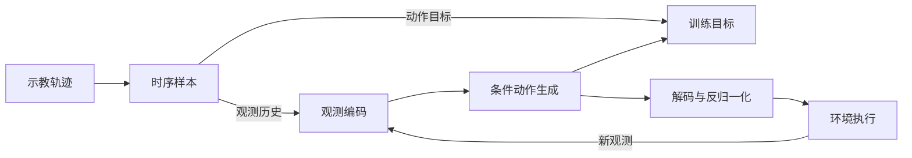

# 项目架构

项目以示教学习为核心，将数据组织、观测编码、动作生成和闭环评测连接起来。项目概览与阅读导航见 [README](../README.md)。

## 数据流

训练利用观测历史学习示教动作；推理生成动作窗口，由执行端按控制周期执行并更新观测。观测预训练和手部先验按方法需要参与策略初始化。

`dexmani_sim` 负责示教生成与仿真执行，本仓库负责策略学习、动作预测和评测组织。`deployment/` 提供外部执行端使用的推理接口，当前流程不包含 Real 数据训练或 Sim-to-Real。

## 核心模块

以下目录均位于 `dexmani_policy/` 下。

| 模块 | 代码目录 | 职责 |
| --- | --- | --- |
| 配置 | `configs/` | 定义公共运行设置与各方法配方 |
| 数据集 | `datasets/` | 读取示教回合，构造观测历史、动作窗口及辅助监督 |
| 策略 | `agents/policies/` | 组合编码器、动作表示和生成模型，定义学习目标 |
| 观测编码 | `agents/obs_encoder/` | 将视觉、状态与触觉编码为全局特征或空间特征序列 |
| 动作生成 | `agents/action_decoders/` | 通过 Diffusion、Flow 或 ODE 学习并生成动作表示 |
| 手部先验 | `agents/hand_prior/` | 提供关节轨迹组织、手姿码本与潜表示的变换 |
| 训练 | `training/` | 组织策略训练、独立预训练及训练状态保存 |
| 公共工具 | `common/` | 提供归一化、checkpoint 恢复与共享推理处理 |
| 仿真评测 | `evaluation/`、`env_runner/` | 执行闭环交互，统计结果并进行选模与测试 |
| 部署推理 | `deployment/` | 恢复策略，提供动作预测和输入输出描述 |

## 训练与推理流程

训练入口 `train.py` 根据配置构建数据集与策略，准备初始化权重、手部先验和归一化，再交给 `PolicyTrainer` 执行优化器更新、EMA、日志记录与 checkpoint 保存。观测编码器和手部先验的独立训练位于 `training/pretrain/`。

归一化连接原始物理量与模型内部表示，动作经解码和反归一化后输出。完整 checkpoint 保存模型权重、归一化参数、有效配置和训练状态，供续训、评测与推理恢复使用。

外部执行端通过 `deployment.load_policy` 恢复 `PolicyRuntime`，输入观测历史并取得物理单位下的动作窗口。`PolicyInfo` 描述所需模态、窗口长度、控制周期与策略能力；动作调度和发送由执行端负责。

## 策略组成

观测编码主要有三种组织方式：

- **全局表征**：DP 汇聚 RGB 特征，DP3 汇聚点云特征，再结合机器人状态。ODE 将点云历史编码为条件，最新实测关节状态另作为向量场输入。
- **空间表征**：R3D 使用 Uni3D，ManiFlow 保留逐点特征；SAT、DQ-RISE 和 DexLatent 通过相机标定融合点云局部几何与图像语义。
- **交互表征**：CordViP 建模手物接触与协调，AdapTac 融合场景与触觉，详见[观测预训练](观测预训练.md)和[触觉与交互建模](触觉与交互建模.md)。

动作生成以观测表征为条件，采用以下机制：

- **Diffusion**：学习去噪过程，从噪声逐步恢复动作表示。
- **Rectified Flow**：学习从噪声到目标表示的向量场，通过积分生成动作；ManiFlow 另引入 EMA 教师的一致性目标。
- **ODE**：从上一条实际下发目标积分生成关节轨迹。

生成空间可以是关节轨迹、手姿索引或连续潜表示，最终转换为控制目标，详见[手部动作表示](手部动作表示.md)。策略的任务表现通过[仿真闭环评测](仿真评测机制.md)衡量。

## 单尺度点云编码

[Point Transformer](../dexmani_policy/agents/obs_encoder/pointcloud/point_transformer.py) 由两个可独立调用的模块组成：`LocalPatchEncoder` 通过 FPS + KNN 分组，编码局部几何并加入绝对位置；`SpatialContextEncoder` 使用带 Metric 3D RoPE 的 Transformer 建模 Patch 之间的空间关系。

局部几何模块 `LocalGeometryEmbedding` 采用 R3D-style Point-Context Fusion：逐点 MLP → Patch 最大池化 → 将 Context 拼接到每个点 → 第二个逐点 MLP → 最大池化 → 线性投影。默认局部隐藏维度为 64，几何尺度为 0.10；RoPE 尺度为 0.05、base 为 100，空间编码使用 2 层、8 个 Attention Head 和 2.0 的 MLP ratio。

| 阶段 | 默认张量维度 |
| --- | --- |
| 输入点云 | `[B,1024,3或6]` |
| FPS + KNN 分组 | `[B,128,32,3或6]` |
| 局部几何和位置编码 | `[B,128,192]` |
| 完整编码器输出 | `tokens: [B,128,192]`、`xyz: [B,128,3]` |

AdapTac 使用完整的 `PointTransformerEncoder`。SAT、DQ-RISE 和 DexLatent 使用共享的 [RGBPointObservationEncoder](../dexmani_policy/agents/obs_encoder/rgb_point.py)：局部编码 → RGB Fusion → 空间编码。RGB Fusion 将几何与图像语义拼接为 384 维，每帧再加入一个关节状态 token，最终输出 `[B,T×129,384]`。

`pc_encoder_config.channels` 表示局部几何维度，RGBPoint 的空间编码维度由融合结构推导为其两倍。`local_hidden_dim` 随其他结构参数写入 `effective_config`；输入维度和 FPS 设置分别由策略的 `pc_dim`、`fps_random_config` 记录。完整点云编码器的权重按 `patch_encoder.*` 和 `spatial_encoder.*` 分组保存。策略恢复根据有效配置重新构建模型，并通过项目统一的 `restore_policy` 严格加载权重。
