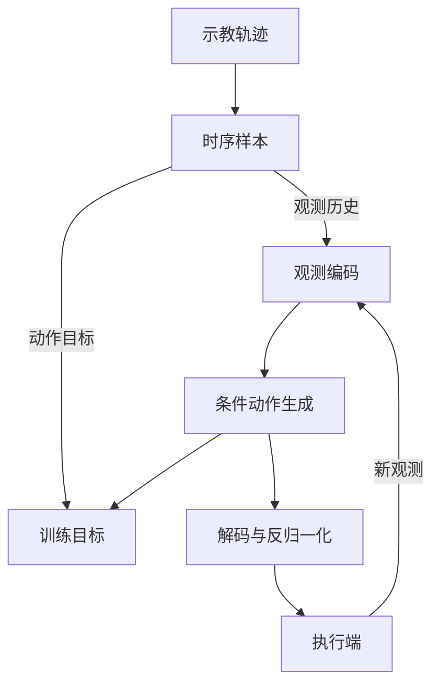

# DexMani Policy · 项目架构

本文介绍系统分工、共享数据流和各策略的核心机制。项目概览见 [README](../README.md)；具体数据、动作表示、预训练和评测协议分别由专题文档说明。

## 系统分工

项目围绕示教学习和闭环执行组织：训练时用示教动作监督条件生成模型，执行时根据新观测反复生成动作窗口。

图中的训练目标分支用于学习；执行反馈分支用于仿真或真实机器人闭环。动作生成的训练目标随方法采用扩散、Flow 或一致性约束。

| 部分 | 核心职责 |
| --- | --- |
| 数据集 | 从 episode 中构造观测历史、动作窗口及方法需要的辅助标签 |
| 策略 | 组合观测编码、动作表示与条件生成模型，输出物理动作窗口 |
| 训练 | 学习策略，维护训练状态与可选 EMA 权重，保存可恢复的产物 |
| 评测 | 在仿真中执行策略，完成候选选模和独立测试 |
| 推理接口 | 根据保存的策略恢复输入、动作和归一化约定，供执行端调用 |

`dexmani_sim` 负责仿真环境，`dexmani_real` 负责真实观测、设备适配和控制调度；硬件控制不在策略学习模块内。

## 共享数据流

### 时序与动作窗口

示教数据按 episode 切分，采样窗口不跨 episode；边界处可重复首尾帧补齐。每条样本包含前 N 帧观测和长为 H 的动作目标，最后一帧观测对应当前查询时刻。

策略先将内部表示完整解码并反归一化，再返回从当前时刻开始的物理动作窗口。未来可用长度为 P = H − N + 1；执行端选择其中前 C 步，满足 1 ≤ C ≤ P，然后根据新观测重新预测。生成模型的采样步数、预测窗口长度和实际执行步数是三个独立概念。

| 动作空间 | 含义 |
| --- | --- |
| 关节动作 | 7 维机械臂与 12 维手部绝对关节目标，共 19 维 |
| 末端动作 | 位置、rotation-6D 与 12 维手部目标，共 21 维 |
| R3D 辅助末端预测 | 在关节动作外增加末端监督，实际控制仍只下发 19 维关节目标 |

各策略支持的动作空间有所不同。存储字段、观测与动作的对齐，以及实测位姿与动作目标的区别见[仿真数据集格式](仿真数据集格式.md)。

### 数据划分与归一化

数据划分以 episode 为单位，区分训练、留出验证和未使用数据。数据划分随机性与训练随机性独立；主策略默认使用全部 episodes，显式留出的验证数据也不会自动触发离线验证或选模。

新拟合的归一化统计只来自对应训练 episodes 的真实源帧，不包含验证集、窗口补齐或随机增强。策略统一应用输入变换，生成模型在相应的归一化表示空间学习，输出时再恢复物理动作。

几何投影和手部交互需要保持坐标、单位与标定一致；这些物理量不能任意标准化。预训练编码器及手部先验拥有的输入变换随组件一起迁移，新字段才拟合本阶段统计。最终统计随完整策略保存，恢复训练与推理时直接复用。

## 策略组成与差异

各策略由观测编码和动作生成两部分连接。共享组件提供一致的数据与输出语义，各方法保留自己的表征结构和学习目标。

| 策略 | 观测表征 | 动作生成 |
| --- | --- | --- |
| DP | RGB 特征与关节状态组成全局条件 | 条件 UNet 扩散 |
| DP3 | PointNet 系列点云特征与关节状态组成全局条件 | 条件 UNet 扩散 |
| R3D | Uni3D 空间特征、位置与关节状态 | 单向注意力 Transformer 扩散，可增加末端辅助监督 |
| ManiFlow | 逐点特征与状态组成空间条件 token | Flow Matching 与 EMA 一致性训练 |
| AFRO | 迁移时序动力学预训练的点云编码器，结合关节状态 | 条件 UNet 扩散 |
| CordViP | 迁移接触与协调预训练的手部、物体点云和状态编码器 | 条件 UNet 扩散 |
| SAT | 几何与 RGB 语义融合的空间 token，加状态 token | Rectified Flow，按关节组织轨迹 token |
| DQ-RISE | 与 SAT 共用空间观测编码 | Rectified Flow，生成机械臂动作与连续手部码本索引 |
| DexLatent | 与 SAT 共用空间观测编码 | Rectified Flow，生成机械臂动作与冻结先验的手部 latent |
| AdapTac | 场景点云、触觉与关节状态，通过未来力引导融合 | 未来力扩散与动作扩散 |
| InterAct-Dex | 身体交互历史与场景 token，结合实测位姿、指尖和触觉 | Rectified Flow，未来力增量作为训练辅助监督 |

AFRO、CordViP 的目标与迁移规则见[观测预训练](观测预训练.md)；SAT、DQ-RISE、DexLatent 的动作空间见[手部动作表示](手部动作表示.md)。

## 空间与视觉表征

### 全局条件与空间 token

DP、DP3 和 AFRO 将每帧观测汇聚为特征，再组合历史形成动作条件。ManiFlow 保留逐点 token；R3D 使用 Uni3D 空间特征，由动作 query 读取观测，观测 context 不随动作解码层更新。

SAT、DQ-RISE、DexLatent、AdapTac 和 InterAct-Dex 复用 Sparse3D 组件：选取空间中心、聚合邻域几何，再通过全局注意力交换信息。局部形状与绝对位置共同决定空间表征。

### 几何与图像语义对齐

SAT、DQ-RISE 和 DexLatent 共享空间观测编码器。点云提供局部几何，RGB 主干提供图像语义；通过相机标定和图像变换，将邻域点投影到特征图，再聚合对应语义并融合到空间 token。

语义融合可发生在全局空间注意力之前或之后；邻域成员可采用均匀或距离加权。对齐模块在无直接图像支持处保留输入特征，后续全局注意力仍可传播其他位置的语义。投影有效性只表示几何支持，不包含遮挡判断，也不代表语义正确率。

每帧保留空间 token 和一个状态 token，再按历史顺序交给动作模型。不同帧独立采样的同序号空间 token 不代表同一个物理点。默认图像语义来自冻结的 DINOv2-small，也可使用其他视觉主干或微调方式；这些选择属于具体实验配方。

## 触觉与手部交互

### AdapTac：未来力引导动作生成

AdapTac 先让点云与五指触觉特征双向交互，再组合历史预测未来绝对力。观测力历史和预测未来力共同引导视觉、触觉融合，融合结果与关节状态一起作为动作扩散的条件。推理时也执行未来力预测，因此它是动作生成链路的一部分。

触觉有三种表征：`force` 编码五指合力；`taxel` 编码每指的密集传感器通道；`patch` 按预设区域组织密集触觉描述。每次只使用一种触觉字段，观测、未来目标与引导信号保持一致。Patch 描述以原始零力为参考；当前区域映射属于尚未获 SDK 验证的实验假设。

训练同时优化动作目标与有效未来力的预测误差，动作损失也会通过预测力反向传播。将显式力损失权重设为零，仍会使用未来标签构造力分支训练输入，因此不能把它解释为“无未来触觉监督”的基线。

### InterAct-Dex：身体交互与场景表征

InterAct-Dex 用腕部和五指六个身体槽组织状态。实测末端位姿定义身体参考框架，实测指尖位置描述局部几何；身体 query 结合附近原始点云和 Sparse3D 特征读取场景，并按手指注入触觉调制。历史编码在身体槽之间交换空间信息，并沿时间保持因果关系。

另一组场景 query 从同一份 Sparse3D 特征读取更广的环境信息。身体历史与场景 token 并行保留、按帧组合，供动作 Flow 使用；场景分支不经过身体历史编码器。

未来力增量提供两种可选的训练辅助目标：

| 方式 | 核心机制 |
| --- | --- |
| `encoder` | 用最新手指特征和对应跨度的有序动作条件，预测各跨度的力变化 |
| `action_prefix` | 从有效跨度中抽取一个，仅让动作模型读取该跨度允许的带噪动作前缀，再预测力变化 |

两者预测的都是未来力减当前力；归一化 offset 相消，只保留尺度变换。`encoder` 按有监督跨度平均误差；`action_prefix` 对抽中的跨度计算误差，可选择提高接近干净动作时刻的监督权重。前缀在进入注意力前截断，以避免读取更远动作。

这些辅助头不参与在线动作生成。辅助权重为零时关闭对应头与未来标签读取；这一行为与 AdapTac 的零显式力损失权重不同。

### 触觉数据边界

合法零力仍是有效观测，越过 episode 边界的未来标签不计入力监督。仿真触觉是世界系力；真实 aggregate 与 dense 来自不同 SDK 通道，单位和坐标轴尚未统一标定，不能互相重建或直接视为同一物理量。

当前仿真只提供 aggregate 触觉，dense 触觉只具备真实数据生产端。策略推理接口不会自动完成不同来源的单位、坐标或时间对齐；这些事实影响方法解释和部署适用范围。

## 动作生成机制

扩散策略在观测条件下学习恢复带噪动作，推理从噪声逐步生成动作序列。UNet 与 Transformer 是条件去噪主干的不同选择，具体预测目标随方法而定。

Rectified Flow 在噪声与目标动作表示之间构造直线路径：x(t) = (1 − t)ε + ta，噪声端为 t = 0，数据端为 t = 1；模型学习速度 a − ε，推理通过积分得到动作表示。训练时间采样与推理积分网格各自定义。

ManiFlow 同时使用 Flow Matching 和 EMA 教师的一致性约束，学习不同时间跨度上的生成行为；训练时间网格与推理采样预算分别决定训练和执行过程。

动作模型的内部输出可以是普通动作序列、逐关节轨迹、码本索引或先验 latent。内部表示必须先完成各自的解码与反归一化，才能作为物理动作执行。不同表示的损失尺度不相同，不能直接用 Flow MSE 排名方法。

## 预训练、恢复与闭环执行

观测预训练学习可迁移的编码器；手部预训练或外部先验定义手姿表示。新策略初始化时导入相关权重及其输入变换，再学习动作生成。AFRO 默认冻结迁移的视觉部分、继续训练状态部分；CordViP 默认微调迁移编码器。

完整 checkpoint 保存构造配置、模型、归一化统计，以及恢复训练所需的优化与随机状态；推理只使用其中的策略相关内容。恢复训练沿用原数据、划分和配方。已有训练状态与数据顺序相互关联，改变数据或学习配方应作为新实验。

仿真评测按“预测动作窗口—执行前缀—更新观测”运行，并将候选选模与独立测试分开。胜者由 checkpoint、raw/EMA 权重选择、采样步数和执行长度共同定义，详见[仿真评测机制](仿真评测机制.md)。

真实执行端还需保证观测历史对齐、控制周期与训练语义一致。动作步数不能代替时间长度；推理接口只返回动作窗口，执行队列和延迟由执行端管理。

连续物理动作路径支持推理阶段的 RTC 引导：使用已对齐的旧计划剩余动作，约束新窗口与已承诺动作的衔接。引导是软约束，执行端仍须继续执行已经承诺的旧动作。DQ-RISE 的码本索引和 DexLatent 的 latent 不直接接受物理动作前缀，因此这两条路径不支持 RTC；ManiFlow 的 RTC 属于本地扩展，不能据此推断实际闭环收益。

SSH 连接、远程训练与实验取回步骤见[SSH 服务器训练部署](SSH服务器训练部署.md)。
